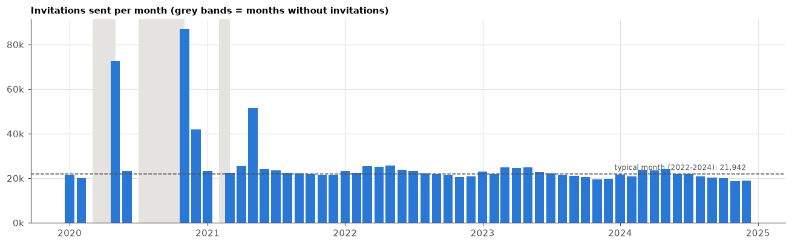
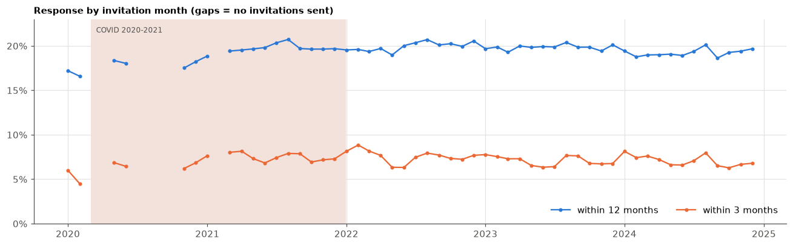

# COVID-19: how the pandemic shows in the data

The dataset covers invitations from January 2020 to December 2024, so the first two COVID years are in it.
This notebook checks five things:

1. **Invitation volume:** were invitations paused or batched?
2. **Response:** did fewer women come, or did they come later?
3. **Composition vs. behaviour:** was 2020 different because other women were invited, or because the same kinds of
   women came less?
4. **Look-back features:** prevention or healthcare contacts measured over the pandemic may look lower than usual.
5. **The model:** does it rank or calibrate COVID-period invitations worse?

Data: the prepared dataset (`data/Rakhaton2026_prepared.csv`) and the official split. Labels: screened within 3 / 6 /
12 months of the invitation. All ROC AUC values are for the 12-month label.


```python
import sys
from pathlib import Path

import matplotlib.pyplot as plt
import pandas as pd
from IPython.display import display
from sklearn.metrics import roc_auc_score


ROOT = Path("..").resolve()
sys.path[:0] = [str(ROOT / "segmentation"), str(ROOT / "training" / "classifiers")]
from segments import assign


LABELS = ["SCREENING_3M_FLAG", "SCREENING_6M_FLAG", "SCREENING_12M_FLAG"]
cols = ["INVITATION_DATE", "FIRST_INVITATION", "MONTHS_SINCE_LAST_SCREEN", "GYN_PREVENTION_24M_CNT",
        "OTHER_SCREENING_36M_CNT", "HEALTHCARE_CONTACT_12M_CNT", "GP_PREVENTION_24M_CNT",
        "DENTAL_PREVENTION_24M_CNT", "AGE_BAND_MEAN", "INVITATION_SEQUENCE", *LABELS]
df = pd.read_csv(ROOT / "data" / "Rakhaton2026_prepared.csv", usecols=cols)
date = pd.to_datetime(df.INVITATION_DATE)
df["year"], df["month"] = date.dt.year, date.dt.to_period("M")

INK2, GRID, BLUE, ORANGE, SHADE = "#52514e", "#e4e3df", "#2a78d6", "#eb6834", "#f3e1dc"
plt.rcParams.update({
    "figure.dpi": 110, "axes.spines.top": False, "axes.spines.right": False,
    "axes.edgecolor": INK2, "axes.labelcolor": INK2, "xtick.color": INK2, "ytick.color": INK2,
    "axes.grid": True, "grid.color": GRID, "grid.linewidth": 0.8, "axes.axisbelow": True,
    "axes.titleweight": "bold", "axes.titlesize": 10, "axes.titlelocation": "left", "legend.frameon": False,
})
pct = plt.FuncFormatter(lambda v, _: f"{v:.0%}")
print(f"{len(df):,} invitations, {date.min().date()} to {date.max().date()}")
```

    1,344,556 invitations, 2020-01-14 to 2024-12-06
    

## 1. Invitations were paused and sent in catch-up batches


```python
months = pd.period_range("2020-01", "2024-12", freq="M")
monthly = df.groupby("month").agg(
    n=("SCREENING_12M_FLAG", "size"), r3=("SCREENING_3M_FLAG", "mean"), r12=("SCREENING_12M_FLAG", "mean")
).reindex(months)
normal = monthly.loc[monthly.index.year >= 2022, "n"].median()
x = months.to_timestamp()

fig, ax = plt.subplots(figsize=(12, 3.8))
for gap in monthly.index[monthly.n.isna()]:  # shade the months without invitations
    ax.axvspan(gap.to_timestamp(), (gap + 1).to_timestamp(), color=GRID, lw=0)
ax.bar(x, monthly.n.fillna(0), width=25, color=BLUE)
ax.axhline(normal, color=INK2, lw=1, ls="--")
ax.text(x[-1], normal * 1.08, f"typical month (2022-2024): {normal:,.0f}", ha="right", fontsize=8, color=INK2)
ax.yaxis.set_major_formatter(plt.FuncFormatter(lambda v, _: f"{v / 1000:.0f}k"))
ax.set_title("Invitations sent per month (grey bands = months without invitations)")
plt.tight_layout(); plt.show()

gaps = monthly[monthly.n.isna()].index.astype(str).tolist()
big = monthly[monthly.n > 2 * normal]
print("Months without invitations:", ", ".join(gaps))
print("Catch-up batches (> 2x a typical month):",
      ", ".join(f"{m} {int(n):,} ({n / normal:.1f}x)" for m, n in big.n.items()))
```


    

    


    Months without invitations: 2020-03, 2020-04, 2020-07, 2020-08, 2020-09, 2020-10, 2021-02
    Catch-up batches (> 2x a typical month): 2020-05 72,750 (3.3x), 2020-11 87,036 (4.0x), 2021-05 51,483 (2.3x)
    

## 2. Fewer women came, and they came later


```python
fig, ax = plt.subplots(figsize=(12, 3.8))
ax.axvspan(pd.Timestamp("2020-03-01"), pd.Timestamp("2021-12-31"), color=SHADE, lw=0)
ax.text(pd.Timestamp("2020-03-15"), 0.215, "COVID 2020-2021", fontsize=8, color=INK2)
ax.plot(x, monthly.r12, color=BLUE, marker="o", ms=3, label="within 12 months")
ax.plot(x, monthly.r3, color=ORANGE, marker="o", ms=3, label="within 3 months")
ax.yaxis.set_major_formatter(pct)
ax.set_ylim(0, 0.23)
ax.legend(loc="lower right", ncol=2)
ax.set_title("Response by invitation month (gaps = no invitations sent)")
plt.tight_layout(); plt.show()
worst = monthly.r12.idxmin()
print(f"Lowest month: {worst}, {monthly.r3[worst]:.1%} within 3 months and {monthly.r12[worst]:.1%} within 12 months")
```


    

    


    Lowest month: 2020-02, 4.5% within 3 months and 16.6% within 12 months
    


```python
yearly = df.groupby("year").agg(
    invitations=("SCREENING_12M_FLAG", "size"),
    within_3m=("SCREENING_3M_FLAG", "mean"),
    within_12m=("SCREENING_12M_FLAG", "mean"),
)
yearly["came within 3m (share of responders)"] = yearly.within_3m / yearly.within_12m
yearly.style.format({"invitations": "{:,}", "within_3m": "{:.1%}", "within_12m": "{:.1%}",
                     "came within 3m (share of responders)": "{:.0%}"})
```


<style type="text/css">
</style>
<table id="T_bc3e0">
  <thead>
    <tr>
      <th class="blank level0" >&nbsp;</th>
      <th id="T_bc3e0_level0_col0" class="col_heading level0 col0" >invitations</th>
      <th id="T_bc3e0_level0_col1" class="col_heading level0 col1" >within_3m</th>
      <th id="T_bc3e0_level0_col2" class="col_heading level0 col2" >within_12m</th>
      <th id="T_bc3e0_level0_col3" class="col_heading level0 col3" >came within 3m (share of responders)</th>
    </tr>
    <tr>
      <th class="index_name level0" >year</th>
      <th class="blank col0" >&nbsp;</th>
      <th class="blank col1" >&nbsp;</th>
      <th class="blank col2" >&nbsp;</th>
      <th class="blank col3" >&nbsp;</th>
    </tr>
  </thead>
  <tbody>
    <tr>
      <th id="T_bc3e0_level0_row0" class="row_heading level0 row0" >2020</th>
      <td id="T_bc3e0_row0_col0" class="data row0 col0" >266,502</td>
      <td id="T_bc3e0_row0_col1" class="data row0 col1" >6.4%</td>
      <td id="T_bc3e0_row0_col2" class="data row0 col2" >17.8%</td>
      <td id="T_bc3e0_row0_col3" class="data row0 col3" >36%</td>
    </tr>
    <tr>
      <th id="T_bc3e0_level0_row1" class="row_heading level0 row1" >2021</th>
      <td id="T_bc3e0_row1_col0" class="data row1 col0" >279,010</td>
      <td id="T_bc3e0_row1_col1" class="data row1 col1" >7.5%</td>
      <td id="T_bc3e0_row1_col2" class="data row1 col2" >19.7%</td>
      <td id="T_bc3e0_row1_col3" class="data row1 col3" >38%</td>
    </tr>
    <tr>
      <th id="T_bc3e0_level0_row2" class="row_heading level0 row2" >2022</th>
      <td id="T_bc3e0_row2_col0" class="data row2 col0" >275,993</td>
      <td id="T_bc3e0_row2_col1" class="data row2 col1" >7.6%</td>
      <td id="T_bc3e0_row2_col2" class="data row2 col2" >19.9%</td>
      <td id="T_bc3e0_row2_col3" class="data row2 col3" >38%</td>
    </tr>
    <tr>
      <th id="T_bc3e0_level0_row3" class="row_heading level0 row3" >2023</th>
      <td id="T_bc3e0_row3_col0" class="data row3 col0" >266,585</td>
      <td id="T_bc3e0_row3_col1" class="data row3 col1" >7.1%</td>
      <td id="T_bc3e0_row3_col2" class="data row3 col2" >19.8%</td>
      <td id="T_bc3e0_row3_col3" class="data row3 col3" >36%</td>
    </tr>
    <tr>
      <th id="T_bc3e0_level0_row4" class="row_heading level0 row4" >2024</th>
      <td id="T_bc3e0_row4_col0" class="data row4 col0" >256,466</td>
      <td id="T_bc3e0_row4_col1" class="data row4 col1" >7.1%</td>
      <td id="T_bc3e0_row4_col2" class="data row4 col2" >19.2%</td>
      <td id="T_bc3e0_row4_col3" class="data row4 col3" >37%</td>
    </tr>
  </tbody>
</table>


## 3. Behaviour, not a different mix of women

Each invitation's segment (`segmentation/segments.py`) describes who she is at the invitation date. If 2020 had
the 2021–2024 response rates of its segments, its overall rate would be the *expected* value below.


```python
seg = assign(df)
by_seg = df.pivot_table(index=seg, columns="year", values="SCREENING_12M_FLAG", aggfunc="mean", observed=False)
display(by_seg.style.format("{:.1%}").set_caption("12-month response by segment and year"))

later = df.year >= 2021
rate_later = df.loc[later, "SCREENING_12M_FLAG"].groupby(seg[later]).mean()
y20 = df.year == 2020
expected = seg[y20].map(rate_later).astype(float).mean()
actual = df.loc[y20, "SCREENING_12M_FLAG"].mean()
print(f"2020: actual {actual:.1%}, expected from its segment mix at 2021-2024 rates {expected:.1%} "
      f"-> {(expected - actual) * 100:.1f} percentage points fewer women came")
```


<style type="text/css">
</style>
<table id="T_a79e9">
  <caption>12-month response by segment and year</caption>
  <thead>
    <tr>
      <th class="index_name level0" >year</th>
      <th id="T_a79e9_level0_col0" class="col_heading level0 col0" >2020</th>
      <th id="T_a79e9_level0_col1" class="col_heading level0 col1" >2021</th>
      <th id="T_a79e9_level0_col2" class="col_heading level0 col2" >2022</th>
      <th id="T_a79e9_level0_col3" class="col_heading level0 col3" >2023</th>
      <th id="T_a79e9_level0_col4" class="col_heading level0 col4" >2024</th>
    </tr>
    <tr>
      <th class="index_name level0" >SEGMENT</th>
      <th class="blank col0" >&nbsp;</th>
      <th class="blank col1" >&nbsp;</th>
      <th class="blank col2" >&nbsp;</th>
      <th class="blank col3" >&nbsp;</th>
      <th class="blank col4" >&nbsp;</th>
    </tr>
  </thead>
  <tbody>
    <tr>
      <th id="T_a79e9_level0_row0" class="row_heading level0 row0" >A not due yet</th>
      <td id="T_a79e9_row0_col0" class="data row0 col0" >2.2%</td>
      <td id="T_a79e9_row0_col1" class="data row0 col1" >2.3%</td>
      <td id="T_a79e9_row0_col2" class="data row0 col2" >2.2%</td>
      <td id="T_a79e9_row0_col3" class="data row0 col3" >2.6%</td>
      <td id="T_a79e9_row0_col4" class="data row0 col4" >2.4%</td>
    </tr>
    <tr>
      <th id="T_a79e9_level0_row1" class="row_heading level0 row1" >B first invitation</th>
      <td id="T_a79e9_row1_col0" class="data row1 col0" >48.1%</td>
      <td id="T_a79e9_row1_col1" class="data row1 col1" >53.5%</td>
      <td id="T_a79e9_row1_col2" class="data row1 col2" >54.4%</td>
      <td id="T_a79e9_row1_col3" class="data row1 col3" >54.8%</td>
      <td id="T_a79e9_row1_col4" class="data row1 col4" >55.1%</td>
    </tr>
    <tr>
      <th id="T_a79e9_level0_row2" class="row_heading level0 row2" >C lapsed screener, gynaecologist</th>
      <td id="T_a79e9_row2_col0" class="data row2 col0" >36.2%</td>
      <td id="T_a79e9_row2_col1" class="data row2 col1" >41.0%</td>
      <td id="T_a79e9_row2_col2" class="data row2 col2" >42.8%</td>
      <td id="T_a79e9_row2_col3" class="data row2 col3" >42.5%</td>
      <td id="T_a79e9_row2_col4" class="data row2 col4" >43.3%</td>
    </tr>
    <tr>
      <th id="T_a79e9_level0_row3" class="row_heading level0 row3" >D lapsed screener, no gynaecologist</th>
      <td id="T_a79e9_row3_col0" class="data row3 col0" >19.6%</td>
      <td id="T_a79e9_row3_col1" class="data row3 col1" >23.6%</td>
      <td id="T_a79e9_row3_col2" class="data row3 col2" >24.5%</td>
      <td id="T_a79e9_row3_col3" class="data row3 col3" >24.4%</td>
      <td id="T_a79e9_row3_col4" class="data row3 col4" >24.8%</td>
    </tr>
    <tr>
      <th id="T_a79e9_level0_row4" class="row_heading level0 row4" >E never screened, gynaecologist</th>
      <td id="T_a79e9_row4_col0" class="data row4 col0" >20.2%</td>
      <td id="T_a79e9_row4_col1" class="data row4 col1" >21.9%</td>
      <td id="T_a79e9_row4_col2" class="data row4 col2" >21.5%</td>
      <td id="T_a79e9_row4_col3" class="data row4 col3" >21.3%</td>
      <td id="T_a79e9_row4_col4" class="data row4 col4" >20.5%</td>
    </tr>
    <tr>
      <th id="T_a79e9_level0_row5" class="row_heading level0 row5" >F never screened, other screening</th>
      <td id="T_a79e9_row5_col0" class="data row5 col0" >7.5%</td>
      <td id="T_a79e9_row5_col1" class="data row5 col1" >8.9%</td>
      <td id="T_a79e9_row5_col2" class="data row5 col2" >9.2%</td>
      <td id="T_a79e9_row5_col3" class="data row5 col3" >9.3%</td>
      <td id="T_a79e9_row5_col4" class="data row5 col4" >9.3%</td>
    </tr>
    <tr>
      <th id="T_a79e9_level0_row6" class="row_heading level0 row6" >G never screened, healthcare user</th>
      <td id="T_a79e9_row6_col0" class="data row6 col0" >5.1%</td>
      <td id="T_a79e9_row6_col1" class="data row6 col1" >5.6%</td>
      <td id="T_a79e9_row6_col2" class="data row6 col2" >5.8%</td>
      <td id="T_a79e9_row6_col3" class="data row6 col3" >6.5%</td>
      <td id="T_a79e9_row6_col4" class="data row6 col4" >6.1%</td>
    </tr>
    <tr>
      <th id="T_a79e9_level0_row7" class="row_heading level0 row7" >H disconnected</th>
      <td id="T_a79e9_row7_col0" class="data row7 col0" >2.0%</td>
      <td id="T_a79e9_row7_col1" class="data row7 col1" >1.8%</td>
      <td id="T_a79e9_row7_col2" class="data row7 col2" >1.3%</td>
      <td id="T_a79e9_row7_col3" class="data row7 col3" >2.7%</td>
      <td id="T_a79e9_row7_col4" class="data row7 col4" >2.6%</td>
    </tr>
  </tbody>
</table>


    2020: actual 17.8%, expected from its segment mix at 2021-2024 rates 20.2% -> 2.4 percentage points fewer women came
    

## 4. The look-back features show a smaller dip


```python
feats = df.groupby("year").agg(
    healthcare_contacts_12m_median=("HEALTHCARE_CONTACT_12M_CNT", "median"),
    gp_prevention_24m=("GP_PREVENTION_24M_CNT", lambda s: (s > 0).mean()),
    gynaecologist_prevention_24m=("GYN_PREVENTION_24M_CNT", lambda s: (s > 0).mean()),
    other_screening_36m=("OTHER_SCREENING_36M_CNT", lambda s: (s > 0).mean()),
    dental_prevention_24m=("DENTAL_PREVENTION_24M_CNT", lambda s: (s > 0).mean()),
    screened_before_5y=("MONTHS_SINCE_LAST_SCREEN", lambda s: s.notna().mean()),
    first_invitation=("FIRST_INVITATION", "mean"),
    mean_age=("AGE_BAND_MEAN", "mean"),
)
feats.style.format(dict.fromkeys(feats.columns, "{:.1%}") | {"healthcare_contacts_12m_median": "{:.0f}", "mean_age": "{:.1f}"})\
    .set_caption("Features by invitation year (shares of invitations with at least one visit)")
```


<style type="text/css">
</style>
<table id="T_0caf5">
  <caption>Features by invitation year (shares of invitations with at least one visit)</caption>
  <thead>
    <tr>
      <th class="blank level0" >&nbsp;</th>
      <th id="T_0caf5_level0_col0" class="col_heading level0 col0" >healthcare_contacts_12m_median</th>
      <th id="T_0caf5_level0_col1" class="col_heading level0 col1" >gp_prevention_24m</th>
      <th id="T_0caf5_level0_col2" class="col_heading level0 col2" >gynaecologist_prevention_24m</th>
      <th id="T_0caf5_level0_col3" class="col_heading level0 col3" >other_screening_36m</th>
      <th id="T_0caf5_level0_col4" class="col_heading level0 col4" >dental_prevention_24m</th>
      <th id="T_0caf5_level0_col5" class="col_heading level0 col5" >screened_before_5y</th>
      <th id="T_0caf5_level0_col6" class="col_heading level0 col6" >first_invitation</th>
      <th id="T_0caf5_level0_col7" class="col_heading level0 col7" >mean_age</th>
    </tr>
    <tr>
      <th class="index_name level0" >year</th>
      <th class="blank col0" >&nbsp;</th>
      <th class="blank col1" >&nbsp;</th>
      <th class="blank col2" >&nbsp;</th>
      <th class="blank col3" >&nbsp;</th>
      <th class="blank col4" >&nbsp;</th>
      <th class="blank col5" >&nbsp;</th>
      <th class="blank col6" >&nbsp;</th>
      <th class="blank col7" >&nbsp;</th>
    </tr>
  </thead>
  <tbody>
    <tr>
      <th id="T_0caf5_level0_row0" class="row_heading level0 row0" >2020</th>
      <td id="T_0caf5_row0_col0" class="data row0 col0" >10</td>
      <td id="T_0caf5_row0_col1" class="data row0 col1" >41.0%</td>
      <td id="T_0caf5_row0_col2" class="data row0 col2" >35.3%</td>
      <td id="T_0caf5_row0_col3" class="data row0 col3" >51.7%</td>
      <td id="T_0caf5_row0_col4" class="data row0 col4" >56.6%</td>
      <td id="T_0caf5_row0_col5" class="data row0 col5" >19.0%</td>
      <td id="T_0caf5_row0_col6" class="data row0 col6" >18.8%</td>
      <td id="T_0caf5_row0_col7" class="data row0 col7" >56.0</td>
    </tr>
    <tr>
      <th id="T_0caf5_level0_row1" class="row_heading level0 row1" >2021</th>
      <td id="T_0caf5_row1_col0" class="data row1 col0" >12</td>
      <td id="T_0caf5_row1_col1" class="data row1 col1" >39.3%</td>
      <td id="T_0caf5_row1_col2" class="data row1 col2" >36.1%</td>
      <td id="T_0caf5_row1_col3" class="data row1 col3" >52.0%</td>
      <td id="T_0caf5_row1_col4" class="data row1 col4" >55.4%</td>
      <td id="T_0caf5_row1_col5" class="data row1 col5" >19.8%</td>
      <td id="T_0caf5_row1_col6" class="data row1 col6" >18.0%</td>
      <td id="T_0caf5_row1_col7" class="data row1 col7" >55.9</td>
    </tr>
    <tr>
      <th id="T_0caf5_level0_row2" class="row_heading level0 row2" >2022</th>
      <td id="T_0caf5_row2_col0" class="data row2 col0" >13</td>
      <td id="T_0caf5_row2_col1" class="data row2 col1" >40.9%</td>
      <td id="T_0caf5_row2_col2" class="data row2 col2" >36.4%</td>
      <td id="T_0caf5_row2_col3" class="data row2 col3" >51.5%</td>
      <td id="T_0caf5_row2_col4" class="data row2 col4" >55.3%</td>
      <td id="T_0caf5_row2_col5" class="data row2 col5" >18.9%</td>
      <td id="T_0caf5_row2_col6" class="data row2 col6" >17.0%</td>
      <td id="T_0caf5_row2_col7" class="data row2 col7" >55.8</td>
    </tr>
    <tr>
      <th id="T_0caf5_level0_row3" class="row_heading level0 row3" >2023</th>
      <td id="T_0caf5_row3_col0" class="data row3 col0" >11</td>
      <td id="T_0caf5_row3_col1" class="data row3 col1" >44.1%</td>
      <td id="T_0caf5_row3_col2" class="data row3 col2" >37.6%</td>
      <td id="T_0caf5_row3_col3" class="data row3 col3" >52.2%</td>
      <td id="T_0caf5_row3_col4" class="data row3 col4" >55.2%</td>
      <td id="T_0caf5_row3_col5" class="data row3 col5" >17.0%</td>
      <td id="T_0caf5_row3_col6" class="data row3 col6" >16.1%</td>
      <td id="T_0caf5_row3_col7" class="data row3 col7" >55.6</td>
    </tr>
    <tr>
      <th id="T_0caf5_level0_row4" class="row_heading level0 row4" >2024</th>
      <td id="T_0caf5_row4_col0" class="data row4 col0" >11</td>
      <td id="T_0caf5_row4_col1" class="data row4 col1" >46.2%</td>
      <td id="T_0caf5_row4_col2" class="data row4 col2" >38.7%</td>
      <td id="T_0caf5_row4_col3" class="data row4 col3" >53.9%</td>
      <td id="T_0caf5_row4_col4" class="data row4 col4" >54.9%</td>
      <td id="T_0caf5_row4_col5" class="data row4 col5" >15.9%</td>
      <td id="T_0caf5_row4_col6" class="data row4 col6" >15.3%</td>
      <td id="T_0caf5_row4_col7" class="data row4 col7" >55.8</td>
    </tr>
  </tbody>
</table>


## 5. The model ranks COVID-period invitations as well as any other year

Gradient boosting (the best model, `training/classifiers`) trained on the train split, which mixes all years. Per
year of the test invitations: ROC AUC, the actual rate and the average predicted probability.


```python
from data import prepare
from gradient_boosting.model import make_model


LABEL = "SCREENING_12M_FLAG"
data, x_split = prepare()
model = make_model(x_split["train"]).fit(x_split["train"], data["train"][LABEL])
test = data["test"].assign(p=model.predict_proba(x_split["test"])[:, 1],
                           year=pd.to_datetime(data["test"].INVITATION_DATE).dt.year)
by_year = pd.DataFrame([
    {"year": y, "test invitations": len(g), "actual": g[LABEL].mean(), "predicted": g.p.mean(),
     "predicted - actual": g.p.mean() - g[LABEL].mean(), "ROC AUC": roc_auc_score(g[LABEL], g.p)}
    for y, g in test.groupby("year")
]).set_index("year")
display(by_year.style.format({"test invitations": "{:,}", "actual": "{:.1%}", "predicted": "{:.1%}",
                              "predicted - actual": lambda v: f"{v * 100:+.1f} pp".replace("-0.0", "0.0").replace("+0.0", "0.0"), "ROC AUC": "{:.3f}"}))

with_year = {k: v.assign(YEAR=pd.to_datetime(data[k].INVITATION_DATE).dt.year) for k, v in x_split.items()}
model_y = make_model(with_year["train"]).fit(with_year["train"], data["train"][LABEL])
auc = roc_auc_score(test[LABEL], test.p)
auc_y = roc_auc_score(data["test"][LABEL], model_y.predict_proba(with_year["test"])[:, 1])
print(f"Test ROC AUC without the year: {auc:.4f}, with the year as a feature: {auc_y:.4f} ({auc_y - auc:+.4f})")
```


<style type="text/css">
</style>
<table id="T_2bc53">
  <thead>
    <tr>
      <th class="blank level0" >&nbsp;</th>
      <th id="T_2bc53_level0_col0" class="col_heading level0 col0" >test invitations</th>
      <th id="T_2bc53_level0_col1" class="col_heading level0 col1" >actual</th>
      <th id="T_2bc53_level0_col2" class="col_heading level0 col2" >predicted</th>
      <th id="T_2bc53_level0_col3" class="col_heading level0 col3" >predicted - actual</th>
      <th id="T_2bc53_level0_col4" class="col_heading level0 col4" >ROC AUC</th>
    </tr>
    <tr>
      <th class="index_name level0" >year</th>
      <th class="blank col0" >&nbsp;</th>
      <th class="blank col1" >&nbsp;</th>
      <th class="blank col2" >&nbsp;</th>
      <th class="blank col3" >&nbsp;</th>
      <th class="blank col4" >&nbsp;</th>
    </tr>
  </thead>
  <tbody>
    <tr>
      <th id="T_2bc53_level0_row0" class="row_heading level0 row0" >2020</th>
      <td id="T_2bc53_row0_col0" class="data row0 col0" >40,091</td>
      <td id="T_2bc53_row0_col1" class="data row0 col1" >17.9%</td>
      <td id="T_2bc53_row0_col2" class="data row0 col2" >18.7%</td>
      <td id="T_2bc53_row0_col3" class="data row0 col3" >+0.8 pp</td>
      <td id="T_2bc53_row0_col4" class="data row0 col4" >0.842</td>
    </tr>
    <tr>
      <th id="T_2bc53_level0_row1" class="row_heading level0 row1" >2021</th>
      <td id="T_2bc53_row1_col0" class="data row1 col0" >41,821</td>
      <td id="T_2bc53_row1_col1" class="data row1 col1" >19.7%</td>
      <td id="T_2bc53_row1_col2" class="data row1 col2" >19.7%</td>
      <td id="T_2bc53_row1_col3" class="data row1 col3" >0.0 pp</td>
      <td id="T_2bc53_row1_col4" class="data row1 col4" >0.848</td>
    </tr>
    <tr>
      <th id="T_2bc53_level0_row2" class="row_heading level0 row2" >2022</th>
      <td id="T_2bc53_row2_col0" class="data row2 col0" >41,392</td>
      <td id="T_2bc53_row2_col1" class="data row2 col1" >19.7%</td>
      <td id="T_2bc53_row2_col2" class="data row2 col2" >19.7%</td>
      <td id="T_2bc53_row2_col3" class="data row2 col3" >0.0 pp</td>
      <td id="T_2bc53_row2_col4" class="data row2 col4" >0.844</td>
    </tr>
    <tr>
      <th id="T_2bc53_level0_row3" class="row_heading level0 row3" >2023</th>
      <td id="T_2bc53_row3_col0" class="data row3 col0" >40,015</td>
      <td id="T_2bc53_row3_col1" class="data row3 col1" >20.1%</td>
      <td id="T_2bc53_row3_col2" class="data row3 col2" >19.4%</td>
      <td id="T_2bc53_row3_col3" class="data row3 col3" >-0.7 pp</td>
      <td id="T_2bc53_row3_col4" class="data row3 col4" >0.834</td>
    </tr>
    <tr>
      <th id="T_2bc53_level0_row4" class="row_heading level0 row4" >2024</th>
      <td id="T_2bc53_row4_col0" class="data row4 col0" >38,532</td>
      <td id="T_2bc53_row4_col1" class="data row4 col1" >19.0%</td>
      <td id="T_2bc53_row4_col2" class="data row4 col2" >18.8%</td>
      <td id="T_2bc53_row4_col3" class="data row4 col3" >-0.2 pp</td>
      <td id="T_2bc53_row4_col4" class="data row4 col4" >0.837</td>
    </tr>
  </tbody>
</table>


    Test ROC AUC without the year: 0.8412, with the year as a feature: 0.8419 (+0.0007)
    

## 6. Takeaways

- **Invitations were paused and sent in catch-up batches.** No letters in March–April 2020, July–October 2020 and
  February 2021, then catch-up batches in May 2020 (3.3× a typical month), November 2020 (4.0×) and May 2021 (2.3×).
- **Fewer women came, and later.** In 2020, 17.8 % were screened within 12 months vs. 19.2–19.9 % in 2021–2024, and
  only 6.4 % within 3 months (7.1–7.6 % later). The worst month is February 2020, invited just before the first
  lockdown: 4.5 % within 3 months, 16.6 % within 12.
- **Behaviour, not a different mix of women.** With 2021–2024 rates, 2020's mix of women would have given 20.2 %;
  the actual 17.8 % means about 2.4 percentage points fewer women came. The drop hit the women who usually come most:
  first invitations (48 % vs. 54–55 %) and lapsed regular screeners (36 % vs. 41–43 %; 20 % vs. 24–25 %). Women
  who never screen were barely affected. The likely reason: limited screening capacity and postponed visits.
- **Look-back features show a smaller dip.** For invitations whose look-back window covers the pandemic, fewer
  women had a GP prevention visit (39–41 % in 2021–2022 vs. 44–46 % in 2023–2024), and 2020 invitations have the
  lowest median of healthcare contacts (10 vs. 11–13).
- **The model is barely affected.** It ranks 2020 invitations as well as other years (ROC AUC 0.842), but its
  probabilities are 0.8 percentage points too high there, since it does not know about the pandemic. Adding the year
  as a feature improves the overall ROC AUC by only +0.0007.

**Implications.** No change to the model is needed: COVID shifted the level of response, not who responds.
Where exact probabilities or expected rates matter (capacity planning, the experiment's baseline rates), use
2021–2024, which is closer to what a future pilot will face.
