# Rakathon 2026: exploratory data analysis

**Dataset:** `data/Rakhaton2026.csv`. Each row is one addressed invitation to **mammography screening**, sent by VZP (2020–2024).
**Task:** predict whether the invited woman attends screening within 3, 6 or 12 months of the invitation date (T0).

Column semantics come from `data/Rakathon_Datove_rozhrani.docx`. Boolean columns use Czech flags: `A` = *ano* (yes), `N` = *ne* (no).

| Group | Columns |
|---|---|
| Keys | `INVITATION_ID`, `PERSON_ID`, `INVITATION_DATE` (T0) |
| Invitation history | `PRIOR_INVITATION_COUNT`, `INVITATION_SEQUENCE`, `MONTHS_LAST_INVITATION`, `FIRST_INVITATION` |
| Demography / region | `AGE_BAND`, `VZP_TERRITORIAL_AREA` (VZP branch, **not** an administrative district) |
| Insurance & registration | `INSURANCE_DURATION_YEARS`, `GP_REGISTERED`, `GP_REG_DURATION_BAND`, `GYN_REGISTERED_FLAG`, `GYN_REG_DURATION_BAND` |
| Screening history (B3) | `PRIOR_SCREEN_COUNT_5Y`, `MONTHS_SINCE_LAST_SCREEN`, `NEVER_SCREENED_BEFORE_FLAG` |
| Preventive behaviour (B4) | `HEALTHCARE_CONTACT_12M_CNT`, `GP_PREVENTION_24M_CNT`, `GYN_PREVENTION_24M_CNT`, `OTHER_SCREENING_36M_CNT`, `DENTAL_PREVENTION_24M_CNT` |
| Labels | `SCREENING_3M_FLAG`, `SCREENING_6M_FLAG`, `SCREENING_12M_FLAG` |


```python
from pathlib import Path

import matplotlib.pyplot as plt
import matplotlib.ticker as mtick
import numpy as np
import pandas as pd

pd.set_option("display.max_columns", 50)
pd.set_option("display.width", 200)

DATA = Path("../data/Rakhaton2026.csv")

# Validated categorical palette (fixed order) + neutral ink colours
C1, C2, C3 = "#2a78d6", "#eb6834", "#1baf7a"
INK, INK2, GRID = "#0b0b0b", "#52514e", "#e4e3df"
plt.rcParams.update({
    "figure.figsize": (10, 4), "figure.dpi": 110,
    "axes.spines.top": False, "axes.spines.right": False,
    "axes.edgecolor": INK2, "axes.labelcolor": INK2, "xtick.color": INK2, "ytick.color": INK2,
    "axes.grid": True, "axes.grid.axis": "y", "grid.color": GRID, "grid.linewidth": 0.8,
    "axes.axisbelow": True, "axes.prop_cycle": plt.cycler(color=[C1, C2, C3]),
    "axes.titleweight": "bold", "axes.titlesize": 11, "axes.titlelocation": "left",
    "lines.linewidth": 2, "legend.frameon": False,
})
pct = mtick.PercentFormatter(1.0, decimals=None)
```

## 1. Load and schema


```python
FLAG_COLS = ["FIRST_INVITATION", "GP_REGISTERED", "GYN_REGISTERED_FLAG", "NEVER_SCREENED_BEFORE_FLAG",
             "SCREENING_3M_FLAG", "SCREENING_6M_FLAG", "SCREENING_12M_FLAG"]
LABELS = ["SCREENING_3M_FLAG", "SCREENING_6M_FLAG", "SCREENING_12M_FLAG"]

raw = pd.read_csv(DATA, dtype={"PERSON_ID": str, "INVITATION_ID": str},
                  keep_default_na=False, na_values=[""])
df = raw.copy()
df["INVITATION_DATE"] = pd.to_datetime(df["INVITATION_DATE"], format="%d.%m.%Y")
for c in FLAG_COLS:
    assert set(df[c].unique()) <= {"A", "N"}, c
    df[c] = df[c].eq("A")
for c in ["AGE_BAND", "GP_REG_DURATION_BAND", "GYN_REG_DURATION_BAND"]:
    df[c] = df[c].astype("category")
df["VZP_TERRITORIAL_AREA"] = df["VZP_TERRITORIAL_AREA"].astype("category")

print(f"{len(df):,} invitations | {df.PERSON_ID.nunique():,} women | {df.shape[1]} columns")
print(f"Memory: {df.memory_usage(deep=True).sum() / 1e6:.0f} MB")
df.head()
```

    1,344,556 invitations | 508,527 women | 25 columns
    Memory: 320 MB
    


<div>
<style scoped>
    .dataframe tbody tr th:only-of-type {
        vertical-align: middle;
    }

    .dataframe tbody tr th {
        vertical-align: top;
    }

    .dataframe thead th {
        text-align: right;
    }
</style>
<table border="1" class="dataframe">
  <thead>
    <tr style="text-align: right;">
      <th></th>
      <th>INVITATION_ID</th>
      <th>PERSON_ID</th>
      <th>INVITATION_DATE</th>
      <th>AGE_BAND</th>
      <th>VZP_TERRITORIAL_AREA</th>
      <th>PRIOR_INVITATION_COUNT</th>
      <th>MONTHS_LAST_INVITATION</th>
      <th>INVITATION_SEQUENCE</th>
      <th>HEALTHCARE_CONTACT_12M_CNT</th>
      <th>FIRST_INVITATION</th>
      <th>INSURANCE_DURATION_YEARS</th>
      <th>GP_REGISTERED</th>
      <th>GP_REG_DURATION_BAND</th>
      <th>GYN_REGISTERED_FLAG</th>
      <th>GYN_REG_DURATION_BAND</th>
      <th>PRIOR_SCREEN_COUNT_5Y</th>
      <th>MONTHS_SINCE_LAST_SCREEN</th>
      <th>NEVER_SCREENED_BEFORE_FLAG</th>
      <th>GP_PREVENTION_24M_CNT</th>
      <th>GYN_PREVENTION_24M_CNT</th>
      <th>OTHER_SCREENING_36M_CNT</th>
      <th>DENTAL_PREVENTION_24M_CNT</th>
      <th>SCREENING_3M_FLAG</th>
      <th>SCREENING_6M_FLAG</th>
      <th>SCREENING_12M_FLAG</th>
    </tr>
  </thead>
  <tbody>
    <tr>
      <th>0</th>
      <td>INV000000000000270</td>
      <td>923546909213458</td>
      <td>2020-01-14</td>
      <td>70-74</td>
      <td>JIČÍN</td>
      <td>7</td>
      <td>12.0</td>
      <td>7</td>
      <td>7</td>
      <td>False</td>
      <td>28</td>
      <td>True</td>
      <td>&gt;5</td>
      <td>False</td>
      <td>NaN</td>
      <td>0</td>
      <td>NaN</td>
      <td>True</td>
      <td>0</td>
      <td>0</td>
      <td>0</td>
      <td>0</td>
      <td>False</td>
      <td>False</td>
      <td>False</td>
    </tr>
    <tr>
      <th>1</th>
      <td>INV000000000000273</td>
      <td>439672095098918</td>
      <td>2020-01-14</td>
      <td>70-74</td>
      <td>PÍSEK</td>
      <td>4</td>
      <td>12.0</td>
      <td>4</td>
      <td>10</td>
      <td>False</td>
      <td>28</td>
      <td>True</td>
      <td>&gt;5</td>
      <td>True</td>
      <td>&gt;5</td>
      <td>0</td>
      <td>NaN</td>
      <td>True</td>
      <td>0</td>
      <td>0</td>
      <td>0</td>
      <td>2</td>
      <td>False</td>
      <td>False</td>
      <td>False</td>
    </tr>
    <tr>
      <th>2</th>
      <td>INV000000000000276</td>
      <td>150998219588515</td>
      <td>2020-01-14</td>
      <td>70-74</td>
      <td>STRAKONICE</td>
      <td>7</td>
      <td>12.0</td>
      <td>7</td>
      <td>7</td>
      <td>False</td>
      <td>28</td>
      <td>True</td>
      <td>&gt;5</td>
      <td>True</td>
      <td>&gt;5</td>
      <td>0</td>
      <td>NaN</td>
      <td>True</td>
      <td>1</td>
      <td>0</td>
      <td>1</td>
      <td>1</td>
      <td>True</td>
      <td>True</td>
      <td>True</td>
    </tr>
    <tr>
      <th>3</th>
      <td>INV000000000000283</td>
      <td>402004958199037</td>
      <td>2020-01-14</td>
      <td>70-74</td>
      <td>LIBEREC</td>
      <td>6</td>
      <td>12.0</td>
      <td>6</td>
      <td>20</td>
      <td>False</td>
      <td>9</td>
      <td>True</td>
      <td>&gt;5</td>
      <td>True</td>
      <td>2-5</td>
      <td>0</td>
      <td>NaN</td>
      <td>True</td>
      <td>0</td>
      <td>1</td>
      <td>0</td>
      <td>2</td>
      <td>False</td>
      <td>False</td>
      <td>False</td>
    </tr>
    <tr>
      <th>4</th>
      <td>INV000000000000288</td>
      <td>371784222157673</td>
      <td>2020-01-14</td>
      <td>70-74</td>
      <td>PRAHA-HL.MĚSTO</td>
      <td>7</td>
      <td>12.0</td>
      <td>7</td>
      <td>0</td>
      <td>False</td>
      <td>28</td>
      <td>True</td>
      <td>&gt;5</td>
      <td>False</td>
      <td>NaN</td>
      <td>0</td>
      <td>NaN</td>
      <td>True</td>
      <td>0</td>
      <td>0</td>
      <td>0</td>
      <td>0</td>
      <td>False</td>
      <td>False</td>
      <td>False</td>
    </tr>
  </tbody>
</table>
</div>


```python
df.dtypes.to_frame('dtype').T
```


<div>
<style scoped>
    .dataframe tbody tr th:only-of-type {
        vertical-align: middle;
    }

    .dataframe tbody tr th {
        vertical-align: top;
    }

    .dataframe thead th {
        text-align: right;
    }
</style>
<table border="1" class="dataframe">
  <thead>
    <tr style="text-align: right;">
      <th></th>
      <th>INVITATION_ID</th>
      <th>PERSON_ID</th>
      <th>INVITATION_DATE</th>
      <th>AGE_BAND</th>
      <th>VZP_TERRITORIAL_AREA</th>
      <th>PRIOR_INVITATION_COUNT</th>
      <th>MONTHS_LAST_INVITATION</th>
      <th>INVITATION_SEQUENCE</th>
      <th>HEALTHCARE_CONTACT_12M_CNT</th>
      <th>FIRST_INVITATION</th>
      <th>INSURANCE_DURATION_YEARS</th>
      <th>GP_REGISTERED</th>
      <th>GP_REG_DURATION_BAND</th>
      <th>GYN_REGISTERED_FLAG</th>
      <th>GYN_REG_DURATION_BAND</th>
      <th>PRIOR_SCREEN_COUNT_5Y</th>
      <th>MONTHS_SINCE_LAST_SCREEN</th>
      <th>NEVER_SCREENED_BEFORE_FLAG</th>
      <th>GP_PREVENTION_24M_CNT</th>
      <th>GYN_PREVENTION_24M_CNT</th>
      <th>OTHER_SCREENING_36M_CNT</th>
      <th>DENTAL_PREVENTION_24M_CNT</th>
      <th>SCREENING_3M_FLAG</th>
      <th>SCREENING_6M_FLAG</th>
      <th>SCREENING_12M_FLAG</th>
    </tr>
  </thead>
  <tbody>
    <tr>
      <th>dtype</th>
      <td>object</td>
      <td>object</td>
      <td>datetime64[ns]</td>
      <td>category</td>
      <td>category</td>
      <td>int64</td>
      <td>float64</td>
      <td>int64</td>
      <td>int64</td>
      <td>bool</td>
      <td>int64</td>
      <td>bool</td>
      <td>category</td>
      <td>bool</td>
      <td>category</td>
      <td>int64</td>
      <td>float64</td>
      <td>bool</td>
      <td>int64</td>
      <td>int64</td>
      <td>int64</td>
      <td>int64</td>
      <td>bool</td>
      <td>bool</td>
      <td>bool</td>
    </tr>
  </tbody>
</table>
</div>


```python
df.describe().T
```


<div>
<style scoped>
    .dataframe tbody tr th:only-of-type {
        vertical-align: middle;
    }

    .dataframe tbody tr th {
        vertical-align: top;
    }

    .dataframe thead th {
        text-align: right;
    }
</style>
<table border="1" class="dataframe">
  <thead>
    <tr style="text-align: right;">
      <th></th>
      <th>count</th>
      <th>mean</th>
      <th>min</th>
      <th>25%</th>
      <th>50%</th>
      <th>75%</th>
      <th>max</th>
      <th>std</th>
    </tr>
  </thead>
  <tbody>
    <tr>
      <th>INVITATION_DATE</th>
      <td>1344556</td>
      <td>2022-06-28 03:07:25.669202688</td>
      <td>2020-01-14 00:00:00</td>
      <td>2021-04-09 00:00:00</td>
      <td>2022-06-15 00:00:00</td>
      <td>2023-09-13 00:00:00</td>
      <td>2024-12-06 00:00:00</td>
      <td>NaN</td>
    </tr>
    <tr>
      <th>PRIOR_INVITATION_COUNT</th>
      <td>1344556.0</td>
      <td>5.093778</td>
      <td>1.0</td>
      <td>2.0</td>
      <td>5.0</td>
      <td>8.0</td>
      <td>11.0</td>
      <td>3.102906</td>
    </tr>
    <tr>
      <th>MONTHS_LAST_INVITATION</th>
      <td>1115329.0</td>
      <td>15.242588</td>
      <td>8.0</td>
      <td>11.0</td>
      <td>12.0</td>
      <td>12.0</td>
      <td>120.0</td>
      <td>13.513922</td>
    </tr>
    <tr>
      <th>INVITATION_SEQUENCE</th>
      <td>1344556.0</td>
      <td>4.827278</td>
      <td>1.0</td>
      <td>2.0</td>
      <td>4.0</td>
      <td>8.0</td>
      <td>11.0</td>
      <td>3.204227</td>
    </tr>
    <tr>
      <th>HEALTHCARE_CONTACT_12M_CNT</th>
      <td>1344556.0</td>
      <td>15.947105</td>
      <td>0.0</td>
      <td>5.0</td>
      <td>12.0</td>
      <td>22.0</td>
      <td>450.0</td>
      <td>16.211469</td>
    </tr>
    <tr>
      <th>INSURANCE_DURATION_YEARS</th>
      <td>1344556.0</td>
      <td>27.055716</td>
      <td>5.0</td>
      <td>26.0</td>
      <td>29.0</td>
      <td>31.0</td>
      <td>32.0</td>
      <td>5.665121</td>
    </tr>
    <tr>
      <th>PRIOR_SCREEN_COUNT_5Y</th>
      <td>1344556.0</td>
      <td>0.393915</td>
      <td>0.0</td>
      <td>0.0</td>
      <td>0.0</td>
      <td>0.0</td>
      <td>18.0</td>
      <td>0.888477</td>
    </tr>
    <tr>
      <th>MONTHS_SINCE_LAST_SCREEN</th>
      <td>244270.0</td>
      <td>39.276055</td>
      <td>0.0</td>
      <td>37.0</td>
      <td>43.0</td>
      <td>50.0</td>
      <td>76.0</td>
      <td>17.55009</td>
    </tr>
    <tr>
      <th>GP_PREVENTION_24M_CNT</th>
      <td>1344556.0</td>
      <td>0.445579</td>
      <td>0.0</td>
      <td>0.0</td>
      <td>0.0</td>
      <td>1.0</td>
      <td>9.0</td>
      <td>0.564932</td>
    </tr>
    <tr>
      <th>GYN_PREVENTION_24M_CNT</th>
      <td>1344556.0</td>
      <td>0.551119</td>
      <td>0.0</td>
      <td>0.0</td>
      <td>0.0</td>
      <td>1.0</td>
      <td>9.0</td>
      <td>0.812454</td>
    </tr>
    <tr>
      <th>OTHER_SCREENING_36M_CNT</th>
      <td>1344556.0</td>
      <td>1.309066</td>
      <td>0.0</td>
      <td>0.0</td>
      <td>1.0</td>
      <td>2.0</td>
      <td>26.0</td>
      <td>1.639471</td>
    </tr>
    <tr>
      <th>DENTAL_PREVENTION_24M_CNT</th>
      <td>1344556.0</td>
      <td>0.9122</td>
      <td>0.0</td>
      <td>0.0</td>
      <td>1.0</td>
      <td>2.0</td>
      <td>9.0</td>
      <td>0.943308</td>
    </tr>
  </tbody>
</table>
</div>


## 2. Data quality

### 2.1 Missingness is structural, not random
Every column with NaNs maps to a flag that explains why the value is missing.


```python
na = df.isna().sum()
na = na[na > 0].to_frame("n_missing").assign(share=lambda t: t.n_missing / len(df))
na
```


<div>
<style scoped>
    .dataframe tbody tr th:only-of-type {
        vertical-align: middle;
    }

    .dataframe tbody tr th {
        vertical-align: top;
    }

    .dataframe thead th {
        text-align: right;
    }
</style>
<table border="1" class="dataframe">
  <thead>
    <tr style="text-align: right;">
      <th></th>
      <th>n_missing</th>
      <th>share</th>
    </tr>
  </thead>
  <tbody>
    <tr>
      <th>MONTHS_LAST_INVITATION</th>
      <td>229227</td>
      <td>0.170485</td>
    </tr>
    <tr>
      <th>GP_REG_DURATION_BAND</th>
      <td>19370</td>
      <td>0.014406</td>
    </tr>
    <tr>
      <th>GYN_REG_DURATION_BAND</th>
      <td>288783</td>
      <td>0.214779</td>
    </tr>
    <tr>
      <th>MONTHS_SINCE_LAST_SCREEN</th>
      <td>1100286</td>
      <td>0.818327</td>
    </tr>
  </tbody>
</table>
</div>


```python
checks = {
    "MONTHS_LAST_INVITATION NaN  <=> FIRST_INVITATION": (df.MONTHS_LAST_INVITATION.isna() == df.FIRST_INVITATION).all(),
    "MONTHS_SINCE_LAST_SCREEN NaN <=> NEVER_SCREENED_BEFORE": (df.MONTHS_SINCE_LAST_SCREEN.isna() == df.NEVER_SCREENED_BEFORE_FLAG).all(),
    "NEVER_SCREENED <=> PRIOR_SCREEN_COUNT_5Y == 0": (df.NEVER_SCREENED_BEFORE_FLAG == df.PRIOR_SCREEN_COUNT_5Y.eq(0)).all(),
    "GP_REG_DURATION_BAND NaN <=> not GP_REGISTERED": (df.GP_REG_DURATION_BAND.isna() == ~df.GP_REGISTERED).all(),
    "GYN_REG_DURATION_BAND NaN <=> not GYN_REGISTERED": (df.GYN_REG_DURATION_BAND.isna() == ~df.GYN_REGISTERED_FLAG).all(),
    "labels nested: 3M => 6M => 12M": ((~df.SCREENING_3M_FLAG | df.SCREENING_6M_FLAG) & (~df.SCREENING_6M_FLAG | df.SCREENING_12M_FLAG)).all(),
    "INVITATION_ID unique": df.INVITATION_ID.is_unique,
    "no fully duplicated rows": not raw.drop(columns="INVITATION_ID").duplicated().any(),
}
pd.Series(checks, name="holds").to_frame()
```


<div>
<style scoped>
    .dataframe tbody tr th:only-of-type {
        vertical-align: middle;
    }

    .dataframe tbody tr th {
        vertical-align: top;
    }

    .dataframe thead th {
        text-align: right;
    }
</style>
<table border="1" class="dataframe">
  <thead>
    <tr style="text-align: right;">
      <th></th>
      <th>holds</th>
    </tr>
  </thead>
  <tbody>
    <tr>
      <th>MONTHS_LAST_INVITATION NaN  &lt;=&gt; FIRST_INVITATION</th>
      <td>True</td>
    </tr>
    <tr>
      <th>MONTHS_SINCE_LAST_SCREEN NaN &lt;=&gt; NEVER_SCREENED_BEFORE</th>
      <td>True</td>
    </tr>
    <tr>
      <th>NEVER_SCREENED &lt;=&gt; PRIOR_SCREEN_COUNT_5Y == 0</th>
      <td>False</td>
    </tr>
    <tr>
      <th>GP_REG_DURATION_BAND NaN &lt;=&gt; not GP_REGISTERED</th>
      <td>True</td>
    </tr>
    <tr>
      <th>GYN_REG_DURATION_BAND NaN &lt;=&gt; not GYN_REGISTERED</th>
      <td>True</td>
    </tr>
    <tr>
      <th>labels nested: 3M =&gt; 6M =&gt; 12M</th>
      <td>True</td>
    </tr>
    <tr>
      <th>INVITATION_ID unique</th>
      <td>True</td>
    </tr>
    <tr>
      <th>no fully duplicated rows</th>
      <td>True</td>
    </tr>
  </tbody>
</table>
</div>


**Note.** "Never screened before" really means *no screening in the 60-month look-back window*. It does not mean never screened in her lifetime.
The check below looks at the oddities in the screening-history columns.


```python
mls = df.MONTHS_SINCE_LAST_SCREEN
print("MONTHS_SINCE_LAST_SCREEN > 60 (outside documented 5y window):", (mls > 60).sum())
print("MONTHS_SINCE_LAST_SCREEN == 0 (screened in the month of T0):", (mls == 0).sum())
edge = df[~df.NEVER_SCREENED_BEFORE_FLAG & df.PRIOR_SCREEN_COUNT_5Y.eq(0)]
print(f"NEVER_SCREENED = N but PRIOR_SCREEN_COUNT_5Y = 0: {len(edge):,} rows, MONTHS_SINCE_LAST_SCREEN in "
      f"[{edge.MONTHS_SINCE_LAST_SCREEN.min():.0f}, {edge.MONTHS_SINCE_LAST_SCREEN.max():.0f}]  -> 60-month window edge effect")
print("PRIOR_INVITATION_COUNT == INVITATION_SEQUENCE:", f"{(df.PRIOR_INVITATION_COUNT == df.INVITATION_SEQUENCE).mean():.1%}")
print("PRIOR_INVITATION_COUNT <  INVITATION_SEQUENCE:", (df.PRIOR_INVITATION_COUNT < df.INVITATION_SEQUENCE).sum())
display(pd.crosstab(df.FIRST_INVITATION, df.INVITATION_SEQUENCE, margins=True))
print("PRIOR_SCREEN_COUNT_5Y distribution (note: 2 dominates, so it likely counts claim codes, not visits):")
df.PRIOR_SCREEN_COUNT_5Y.value_counts().sort_index().head(10).to_frame("rows").T
```

    MONTHS_SINCE_LAST_SCREEN > 60 (outside documented 5y window): 193
    MONTHS_SINCE_LAST_SCREEN == 0 (screened in the month of T0): 23677
    NEVER_SCREENED = N but PRIOR_SCREEN_COUNT_5Y = 0: 3,354 rows, MONTHS_SINCE_LAST_SCREEN in [60, 76]  -> 60-month window edge effect
    PRIOR_INVITATION_COUNT == INVITATION_SEQUENCE: 88.0%
    PRIOR_INVITATION_COUNT <  INVITATION_SEQUENCE: 0
    


<div>
<style scoped>
    .dataframe tbody tr th:only-of-type {
        vertical-align: middle;
    }

    .dataframe tbody tr th {
        vertical-align: top;
    }

    .dataframe thead th {
        text-align: right;
    }
</style>
<table border="1" class="dataframe">
  <thead>
    <tr style="text-align: right;">
      <th>INVITATION_SEQUENCE</th>
      <th>1</th>
      <th>2</th>
      <th>3</th>
      <th>4</th>
      <th>5</th>
      <th>6</th>
      <th>7</th>
      <th>8</th>
      <th>9</th>
      <th>10</th>
      <th>11</th>
      <th>All</th>
    </tr>
    <tr>
      <th>FIRST_INVITATION</th>
      <th></th>
      <th></th>
      <th></th>
      <th></th>
      <th></th>
      <th></th>
      <th></th>
      <th></th>
      <th></th>
      <th></th>
      <th></th>
      <th></th>
    </tr>
  </thead>
  <tbody>
    <tr>
      <th>False</th>
      <td>59977</td>
      <td>170395</td>
      <td>126631</td>
      <td>104845</td>
      <td>93913</td>
      <td>75868</td>
      <td>142987</td>
      <td>117981</td>
      <td>93420</td>
      <td>71515</td>
      <td>57797</td>
      <td>1115329</td>
    </tr>
    <tr>
      <th>True</th>
      <td>229175</td>
      <td>52</td>
      <td>0</td>
      <td>0</td>
      <td>0</td>
      <td>0</td>
      <td>0</td>
      <td>0</td>
      <td>0</td>
      <td>0</td>
      <td>0</td>
      <td>229227</td>
    </tr>
    <tr>
      <th>All</th>
      <td>289152</td>
      <td>170447</td>
      <td>126631</td>
      <td>104845</td>
      <td>93913</td>
      <td>75868</td>
      <td>142987</td>
      <td>117981</td>
      <td>93420</td>
      <td>71515</td>
      <td>57797</td>
      <td>1344556</td>
    </tr>
  </tbody>
</table>
</div>


    PRIOR_SCREEN_COUNT_5Y distribution (note: 2 dominates, so it likely counts claim codes, not visits):
    


<div>
<style scoped>
    .dataframe tbody tr th:only-of-type {
        vertical-align: middle;
    }

    .dataframe tbody tr th {
        vertical-align: top;
    }

    .dataframe thead th {
        text-align: right;
    }
</style>
<table border="1" class="dataframe">
  <thead>
    <tr style="text-align: right;">
      <th>PRIOR_SCREEN_COUNT_5Y</th>
      <th>0</th>
      <th>1</th>
      <th>2</th>
      <th>3</th>
      <th>4</th>
      <th>5</th>
      <th>6</th>
      <th>7</th>
      <th>8</th>
      <th>9</th>
    </tr>
  </thead>
  <tbody>
    <tr>
      <th>rows</th>
      <td>1103640</td>
      <td>8103</td>
      <td>196238</td>
      <td>20950</td>
      <td>13189</td>
      <td>1650</td>
      <td>591</td>
      <td>82</td>
      <td>40</td>
      <td>21</td>
    </tr>
  </tbody>
</table>
</div>


## 3. Targets


```python
rates = df[LABELS].mean()
incr = rates.diff().fillna(rates)
display(pd.DataFrame({"cumulative rate": rates, "incremental share": incr, "positives": df[LABELS].sum()}))

fig, ax = plt.subplots(figsize=(6, 3.2))
bars = ax.bar(["≤ 3 months", "≤ 6 months", "≤ 12 months"], rates.values, width=0.55, color=C1)
ax.bar_label(bars, labels=[f"{r:.1%}" for r in rates], padding=3, color=INK)
ax.yaxis.set_major_formatter(pct); ax.set_ylim(0, rates.max() * 1.2)
ax.set_title("Share of invitations followed by screening")
plt.show()
```


<div>
<style scoped>
    .dataframe tbody tr th:only-of-type {
        vertical-align: middle;
    }

    .dataframe tbody tr th {
        vertical-align: top;
    }

    .dataframe thead th {
        text-align: right;
    }
</style>
<table border="1" class="dataframe">
  <thead>
    <tr style="text-align: right;">
      <th></th>
      <th>cumulative rate</th>
      <th>incremental share</th>
      <th>positives</th>
    </tr>
  </thead>
  <tbody>
    <tr>
      <th>SCREENING_3M_FLAG</th>
      <td>0.071227</td>
      <td>0.071227</td>
      <td>95769</td>
    </tr>
    <tr>
      <th>SCREENING_6M_FLAG</th>
      <td>0.125410</td>
      <td>0.054183</td>
      <td>168621</td>
    </tr>
    <tr>
      <th>SCREENING_12M_FLAG</th>
      <td>0.193027</td>
      <td>0.067617</td>
      <td>259536</td>
    </tr>
  </tbody>
</table>
</div>


    
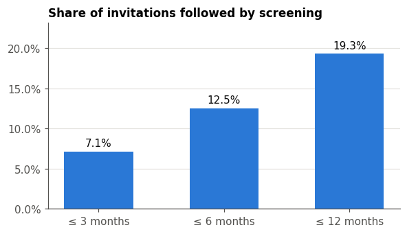
    


Labels are nested and imbalanced. Only **~19%** of invitations lead to screening within a year, and **~37%** of those who respond do so only after 6 months.

## 4. Time dimension


```python
m = df.set_index("INVITATION_DATE").resample("MS")
monthly = pd.DataFrame({"invitations": m.size(), **{l: m[l].mean() for l in LABELS}})

fig, (a1, a2) = plt.subplots(2, 1, figsize=(11, 6), sharex=True)
a1.bar(monthly.index, monthly.invitations, width=25, color=C1)
a1.set_title("Invitations sent per month")
for l, c in zip(LABELS, [C1, C2, C3]):
    a2.plot(monthly.index, monthly[l], color=c, label=l.split("_")[1])
a2.yaxis.set_major_formatter(pct); a2.set_title("Response rate by invitation month")
a2.legend(ncol=3, loc="upper left")
plt.tight_layout(); plt.show()
```


    
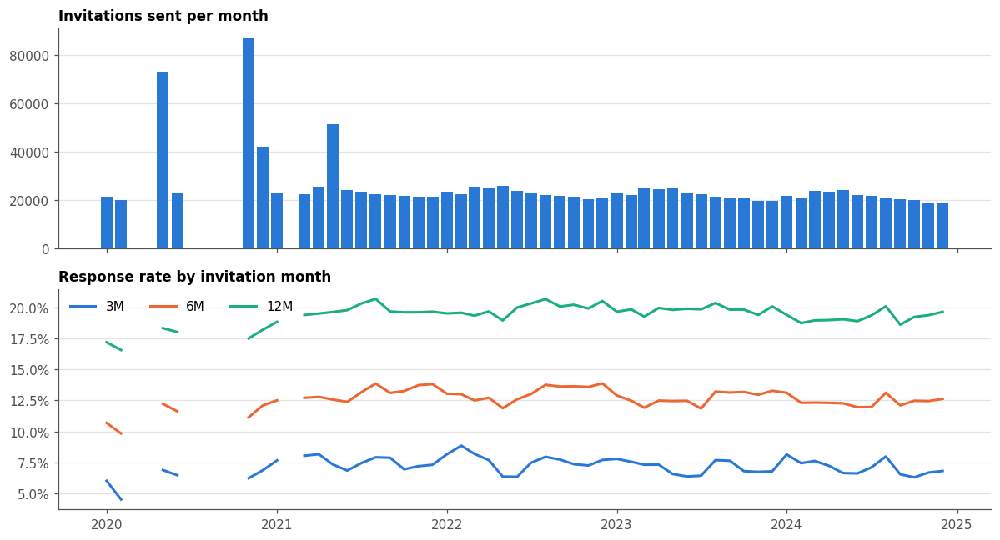
    


```python
by_year = df.groupby(df.INVITATION_DATE.dt.year)[LABELS].mean()
by_year.insert(0, "n", df.groupby(df.INVITATION_DATE.dt.year).size())
by_year.style.format({l: "{:.1%}" for l in LABELS} | {"n": "{:,}"})
```


<style type="text/css">
</style>
<table id="T_a1a3a">
  <thead>
    <tr>
      <th class="blank level0" >&nbsp;</th>
      <th id="T_a1a3a_level0_col0" class="col_heading level0 col0" >n</th>
      <th id="T_a1a3a_level0_col1" class="col_heading level0 col1" >SCREENING_3M_FLAG</th>
      <th id="T_a1a3a_level0_col2" class="col_heading level0 col2" >SCREENING_6M_FLAG</th>
      <th id="T_a1a3a_level0_col3" class="col_heading level0 col3" >SCREENING_12M_FLAG</th>
    </tr>
    <tr>
      <th class="index_name level0" >INVITATION_DATE</th>
      <th class="blank col0" >&nbsp;</th>
      <th class="blank col1" >&nbsp;</th>
      <th class="blank col2" >&nbsp;</th>
      <th class="blank col3" >&nbsp;</th>
    </tr>
  </thead>
  <tbody>
    <tr>
      <th id="T_a1a3a_level0_row0" class="row_heading level0 row0" >2020</th>
      <td id="T_a1a3a_row0_col0" class="data row0 col0" >266,502</td>
      <td id="T_a1a3a_row0_col1" class="data row0 col1" >6.4%</td>
      <td id="T_a1a3a_row0_col2" class="data row0 col2" >11.5%</td>
      <td id="T_a1a3a_row0_col3" class="data row0 col3" >17.8%</td>
    </tr>
    <tr>
      <th id="T_a1a3a_level0_row1" class="row_heading level0 row1" >2021</th>
      <td id="T_a1a3a_row1_col0" class="data row1 col0" >279,010</td>
      <td id="T_a1a3a_row1_col1" class="data row1 col1" >7.5%</td>
      <td id="T_a1a3a_row1_col2" class="data row1 col2" >13.0%</td>
      <td id="T_a1a3a_row1_col3" class="data row1 col3" >19.7%</td>
    </tr>
    <tr>
      <th id="T_a1a3a_level0_row2" class="row_heading level0 row2" >2022</th>
      <td id="T_a1a3a_row2_col0" class="data row2 col0" >275,993</td>
      <td id="T_a1a3a_row2_col1" class="data row2 col1" >7.6%</td>
      <td id="T_a1a3a_row2_col2" class="data row2 col2" >13.1%</td>
      <td id="T_a1a3a_row2_col3" class="data row2 col3" >19.9%</td>
    </tr>
    <tr>
      <th id="T_a1a3a_level0_row3" class="row_heading level0 row3" >2023</th>
      <td id="T_a1a3a_row3_col0" class="data row3 col0" >266,585</td>
      <td id="T_a1a3a_row3_col1" class="data row3 col1" >7.1%</td>
      <td id="T_a1a3a_row3_col2" class="data row3 col2" >12.7%</td>
      <td id="T_a1a3a_row3_col3" class="data row3 col3" >19.8%</td>
    </tr>
    <tr>
      <th id="T_a1a3a_level0_row4" class="row_heading level0 row4" >2024</th>
      <td id="T_a1a3a_row4_col0" class="data row4 col0" >256,466</td>
      <td id="T_a1a3a_row4_col1" class="data row4 col1" >7.1%</td>
      <td id="T_a1a3a_row4_col2" class="data row4 col2" >12.4%</td>
      <td id="T_a1a3a_row4_col3" class="data row4 col3" >19.2%</td>
    </tr>
  </tbody>
</table>


```python
dow = df.INVITATION_DATE.dt.day_name().value_counts()
print("Invitation weekday distribution:"); print(dow)
print("Distinct invitation dates:", df.INVITATION_DATE.nunique())
print()
print("First-invitation share by age band:")
df.groupby("AGE_BAND", observed=True).FIRST_INVITATION.mean().map("{:.1%}".format).to_frame().T
```

    Invitation weekday distribution:
    INVITATION_DATE
    Thursday     314609
    Tuesday      314561
    Wednesday    267100
    Friday       242837
    Monday       159467
    Saturday      23583
    Sunday        22399
    Name: count, dtype: int64
    Distinct invitation dates: 60
    
    First-invitation share by age band:
    


<div>
<style scoped>
    .dataframe tbody tr th:only-of-type {
        vertical-align: middle;
    }

    .dataframe tbody tr th {
        vertical-align: top;
    }

    .dataframe thead th {
        text-align: right;
    }
</style>
<table border="1" class="dataframe">
  <thead>
    <tr style="text-align: right;">
      <th>AGE_BAND</th>
      <th>40-44</th>
      <th>45-49</th>
      <th>50-54</th>
      <th>55-59</th>
      <th>60-64</th>
      <th>65-69</th>
      <th>70-74</th>
    </tr>
  </thead>
  <tbody>
    <tr>
      <th>FIRST_INVITATION</th>
      <td>100.0%</td>
      <td>33.5%</td>
      <td>3.1%</td>
      <td>6.4%</td>
      <td>6.3%</td>
      <td>6.2%</td>
      <td>6.5%</td>
    </tr>
  </tbody>
</table>
</div>


Invitations go out in batches on a limited set of dates. The response rate shows clear dips: 2020 is visibly lower (COVID).
The 12-month labels for invitations sent in late 2024 depend on claims up to late 2025. The data doc says insurance was tracked until 31.12.2025, so the windows should be complete, but this is worth confirming with the organisers.

## 5. Women with repeated invitations


```python
per_person = df.groupby("PERSON_ID", observed=True)
n_rows = per_person.size()
display(n_rows.value_counts().sort_index().to_frame("women").assign(share=lambda t: t.women / t.women.sum()))
print(f"Rows belonging to women with >1 invitation: {(n_rows[n_rows > 1].sum() / len(df)):.1%}")
```


<div>
<style scoped>
    .dataframe tbody tr th:only-of-type {
        vertical-align: middle;
    }

    .dataframe tbody tr th {
        vertical-align: top;
    }

    .dataframe thead th {
        text-align: right;
    }
</style>
<table border="1" class="dataframe">
  <thead>
    <tr style="text-align: right;">
      <th></th>
      <th>women</th>
      <th>share</th>
    </tr>
  </thead>
  <tbody>
    <tr>
      <th>1</th>
      <td>190970</td>
      <td>0.375536</td>
    </tr>
    <tr>
      <th>2</th>
      <td>95778</td>
      <td>0.188344</td>
    </tr>
    <tr>
      <th>3</th>
      <td>54097</td>
      <td>0.106380</td>
    </tr>
    <tr>
      <th>4</th>
      <td>38671</td>
      <td>0.076045</td>
    </tr>
    <tr>
      <th>5</th>
      <td>129011</td>
      <td>0.253695</td>
    </tr>
  </tbody>
</table>
</div>


    Rows belonging to women with >1 invitation: 85.8%
    


```python
# Order each woman's invitations and look at consecutive pairs
s = df.sort_values(["PERSON_ID", "INVITATION_DATE"])
g = s.groupby("PERSON_ID", observed=True)
s["prev_date"] = g.INVITATION_DATE.shift()
s["prev_12m"] = g.SCREENING_12M_FLAG.shift()
s["prev_seq"] = g.INVITATION_SEQUENCE.shift()
s["prev_prior_screen"] = g.PRIOR_SCREEN_COUNT_5Y.shift()
pairs = s.dropna(subset=["prev_date"]).copy()
pairs["gap_months"] = (pairs.INVITATION_DATE - pairs.prev_date).dt.days / 30.44

print("Gap between consecutive invitations in dataset (months):")
display(pairs.gap_months.describe(percentiles=[.05, .25, .5, .75, .95]).to_frame().T)
print(f"Consecutive invitations < 12 months apart (overlapping 12M label windows): {(pairs.gap_months < 12).mean():.1%}")
print(f"PRIOR_INVITATION_COUNT constant within woman: {(per_person.PRIOR_INVITATION_COUNT.nunique() == 1).mean():.1%}")
print(f"INVITATION_SEQUENCE increases by exactly 1: {(pairs.INVITATION_SEQUENCE - pairs.prev_seq).eq(1).mean():.1%}")
```

    Gap between consecutive invitations in dataset (months):
    


<div>
<style scoped>
    .dataframe tbody tr th:only-of-type {
        vertical-align: middle;
    }

    .dataframe tbody tr th {
        vertical-align: top;
    }

    .dataframe thead th {
        text-align: right;
    }
</style>
<table border="1" class="dataframe">
  <thead>
    <tr style="text-align: right;">
      <th></th>
      <th>count</th>
      <th>mean</th>
      <th>std</th>
      <th>min</th>
      <th>5%</th>
      <th>25%</th>
      <th>50%</th>
      <th>75%</th>
      <th>95%</th>
      <th>max</th>
    </tr>
  </thead>
  <tbody>
    <tr>
      <th>gap_months</th>
      <td>836029.0</td>
      <td>12.21438</td>
      <td>3.986698</td>
      <td>8.409987</td>
      <td>9.78975</td>
      <td>11.695138</td>
      <td>11.925099</td>
      <td>12.122208</td>
      <td>12.516426</td>
      <td>48.554534</td>
    </tr>
  </tbody>
</table>
</div>


    Consecutive invitations < 12 months apart (overlapping 12M label windows): 66.6%
    PRIOR_INVITATION_COUNT constant within woman: 37.6%
    INVITATION_SEQUENCE increases by exactly 1: 99.2%
    


```python
fig, ax = plt.subplots(figsize=(9, 3.2))
ax.hist(pairs.gap_months.clip(upper=60), bins=60, color=C1, edgecolor="white", linewidth=0.5)
ax.set_xlabel("months between consecutive invitations (clipped at 60)"); ax.set_title("Re-invitation gap")
plt.show()
```


    
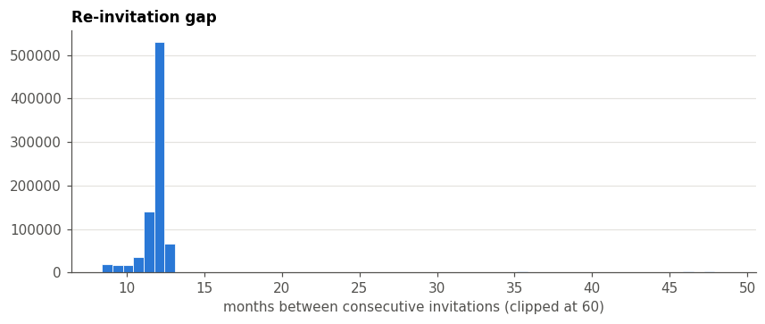
    


**Consistency check.** If a woman responded to invitation *k*, her screening history at invitation *k+1* should reflect it. A large mismatch would point to a feature-construction problem.


```python
inc = pairs.PRIOR_SCREEN_COUNT_5Y - pairs.prev_prior_screen
pd.crosstab(pairs.prev_12m.astype(bool).map({True: "prev screened ≤12M", False: "prev not screened"}),
            np.sign(inc).map({-1: "count fell", 0: "count same", 1: "count rose"}), normalize="index").style.format("{:.1%}")
```


<style type="text/css">
</style>
<table id="T_f0415">
  <thead>
    <tr>
      <th class="index_name level0" >col_0</th>
      <th id="T_f0415_level0_col0" class="col_heading level0 col0" >count fell</th>
      <th id="T_f0415_level0_col1" class="col_heading level0 col1" >count rose</th>
      <th id="T_f0415_level0_col2" class="col_heading level0 col2" >count same</th>
    </tr>
    <tr>
      <th class="index_name level0" >prev_12m</th>
      <th class="blank col0" >&nbsp;</th>
      <th class="blank col1" >&nbsp;</th>
      <th class="blank col2" >&nbsp;</th>
    </tr>
  </thead>
  <tbody>
    <tr>
      <th id="T_f0415_level0_row0" class="row_heading level0 row0" >prev not screened</th>
      <td id="T_f0415_row0_col0" class="data row0 col0" >5.7%</td>
      <td id="T_f0415_row0_col1" class="data row0 col1" >0.1%</td>
      <td id="T_f0415_row0_col2" class="data row0 col2" >94.2%</td>
    </tr>
    <tr>
      <th id="T_f0415_level0_row1" class="row_heading level0 row1" >prev screened ≤12M</th>
      <td id="T_f0415_row1_col0" class="data row1 col0" >2.4%</td>
      <td id="T_f0415_row1_col1" class="data row1 col1" >74.3%</td>
      <td id="T_f0415_row1_col2" class="data row1 col2" >23.2%</td>
    </tr>
  </tbody>
</table>


```python
habit = pairs.groupby(pairs.prev_12m.astype(bool))[LABELS].mean()
habit.index = habit.index.map({True: "screened after previous invitation", False: "did not screen after previous"})
habit.style.format("{:.1%}")
```


<style type="text/css">
</style>
<table id="T_4b3f7">
  <thead>
    <tr>
      <th class="blank level0" >&nbsp;</th>
      <th id="T_4b3f7_level0_col0" class="col_heading level0 col0" >SCREENING_3M_FLAG</th>
      <th id="T_4b3f7_level0_col1" class="col_heading level0 col1" >SCREENING_6M_FLAG</th>
      <th id="T_4b3f7_level0_col2" class="col_heading level0 col2" >SCREENING_12M_FLAG</th>
    </tr>
    <tr>
      <th class="index_name level0" >prev_12m</th>
      <th class="blank col0" >&nbsp;</th>
      <th class="blank col1" >&nbsp;</th>
      <th class="blank col2" >&nbsp;</th>
    </tr>
  </thead>
  <tbody>
    <tr>
      <th id="T_4b3f7_level0_row0" class="row_heading level0 row0" >did not screen after previous</th>
      <td id="T_4b3f7_row0_col0" class="data row0 col0" >3.4%</td>
      <td id="T_4b3f7_row0_col1" class="data row0 col1" >6.6%</td>
      <td id="T_4b3f7_row0_col2" class="data row0 col2" >11.3%</td>
    </tr>
    <tr>
      <th id="T_4b3f7_level0_row1" class="row_heading level0 row1" >screened after previous invitation</th>
      <td id="T_4b3f7_row1_col0" class="data row1 col0" >16.2%</td>
      <td id="T_4b3f7_row1_col1" class="data row1 col1" >19.8%</td>
      <td id="T_4b3f7_row1_col2" class="data row1 col2" >23.4%</td>
    </tr>
  </tbody>
</table>


Previous behaviour carries most of the signal. Because the same woman appears up to 5 times, **train/validation splits must be grouped by `PERSON_ID`**, or done out-of-time, to avoid leakage.

## 6. Response rate by feature


```python
BASE = df.SCREENING_12M_FLAG.mean()

def rate_plot(col, data=df, ax=None, order=None, min_n=500, title=None, rot=0):
    t = data.groupby(col, observed=True, dropna=False).SCREENING_12M_FLAG.agg(["mean", "size"])
    t = t[t["size"] >= min_n]
    if order is not None:
        t = t.reindex([o for o in order if o in t.index])
    ax = ax or plt.subplots(figsize=(8, 3))[1]
    x = [str(i) for i in t.index]
    ax.bar(x, t["mean"], width=0.65, color=C1)
    ax.axhline(BASE, color=INK2, lw=1, ls="--")
    ax.yaxis.set_major_formatter(pct)
    ax.set_title(title or col)
    ax.tick_params(axis="x", rotation=rot)
    ax2 = ax.twiny(); ax2.set_xlim(ax.get_xlim()); ax2.set_xticks(range(len(x)))
    ax2.set_xticklabels([f"{n/1000:.0f}k" if n >= 1000 else str(n) for n in t["size"]], fontsize=7, color=INK2)
    ax2.tick_params(length=0); ax2.grid(False); [s.set_visible(False) for s in ax2.spines.values()]
    return t

print(f"Dashed line = overall 12M response rate ({BASE:.1%}); top axis = number of invitations in the bin")
```

    Dashed line = overall 12M response rate (19.3%); top axis = number of invitations in the bin
    

### 6.1 Demography


```python
t = rate_plot("AGE_BAND", title="12M screening rate by age band")
plt.show(); t.style.format({"mean": "{:.1%}", "size": "{:,}"})
```


    
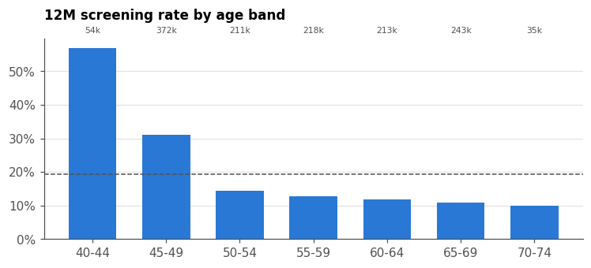
    


<style type="text/css">
</style>
<table id="T_29b21">
  <thead>
    <tr>
      <th class="blank level0" >&nbsp;</th>
      <th id="T_29b21_level0_col0" class="col_heading level0 col0" >mean</th>
      <th id="T_29b21_level0_col1" class="col_heading level0 col1" >size</th>
    </tr>
    <tr>
      <th class="index_name level0" >AGE_BAND</th>
      <th class="blank col0" >&nbsp;</th>
      <th class="blank col1" >&nbsp;</th>
    </tr>
  </thead>
  <tbody>
    <tr>
      <th id="T_29b21_level0_row0" class="row_heading level0 row0" >40-44</th>
      <td id="T_29b21_row0_col0" class="data row0 col0" >56.8%</td>
      <td id="T_29b21_row0_col1" class="data row0 col1" >53,616</td>
    </tr>
    <tr>
      <th id="T_29b21_level0_row1" class="row_heading level0 row1" >45-49</th>
      <td id="T_29b21_row1_col0" class="data row1 col0" >31.1%</td>
      <td id="T_29b21_row1_col1" class="data row1 col1" >371,835</td>
    </tr>
    <tr>
      <th id="T_29b21_level0_row2" class="row_heading level0 row2" >50-54</th>
      <td id="T_29b21_row2_col0" class="data row2 col0" >14.4%</td>
      <td id="T_29b21_row2_col1" class="data row2 col1" >211,093</td>
    </tr>
    <tr>
      <th id="T_29b21_level0_row3" class="row_heading level0 row3" >55-59</th>
      <td id="T_29b21_row3_col0" class="data row3 col0" >12.8%</td>
      <td id="T_29b21_row3_col1" class="data row3 col1" >217,696</td>
    </tr>
    <tr>
      <th id="T_29b21_level0_row4" class="row_heading level0 row4" >60-64</th>
      <td id="T_29b21_row4_col0" class="data row4 col0" >11.9%</td>
      <td id="T_29b21_row4_col1" class="data row4 col1" >212,906</td>
    </tr>
    <tr>
      <th id="T_29b21_level0_row5" class="row_heading level0 row5" >65-69</th>
      <td id="T_29b21_row5_col0" class="data row5 col0" >11.0%</td>
      <td id="T_29b21_row5_col1" class="data row5 col1" >242,690</td>
    </tr>
    <tr>
      <th id="T_29b21_level0_row6" class="row_heading level0 row6" >70-74</th>
      <td id="T_29b21_row6_col0" class="data row6 col0" >10.0%</td>
      <td id="T_29b21_row6_col1" class="data row6 col1" >34,720</td>
    </tr>
  </tbody>
</table>


**The 40–44 band responds at ~57%.** The Czech programme starts at 45 and invitations go out in the birthday month, so this band is probably women aged 44 being invited just before eligibility.
It could also be self-referred or diagnostic cases. Either way, it is a very different population and may be worth modelling separately. The 45–49 band (the first regular invitations) is also high.


```python
area = df.groupby("VZP_TERRITORIAL_AREA", observed=True).SCREENING_12M_FLAG.agg(["mean", "size"]).sort_values("mean")
fig, ax = plt.subplots(figsize=(8, 14))
ax.barh(area.index.astype(str), area["mean"], height=0.7, color=C1)
ax.axvline(BASE, color=INK2, lw=1, ls="--")
ax.xaxis.set_major_formatter(pct); ax.grid(axis="x"); ax.grid(axis="y", visible=False)
ax.tick_params(axis="y", labelsize=7); ax.set_title(f"12M rate by VZP territorial area ({len(area)} areas)")
plt.tight_layout(); plt.show()
print(f"Range: {area['mean'].min():.1%} – {area['mean'].max():.1%};  size range {area['size'].min():,} – {area['size'].max():,}")
```


    
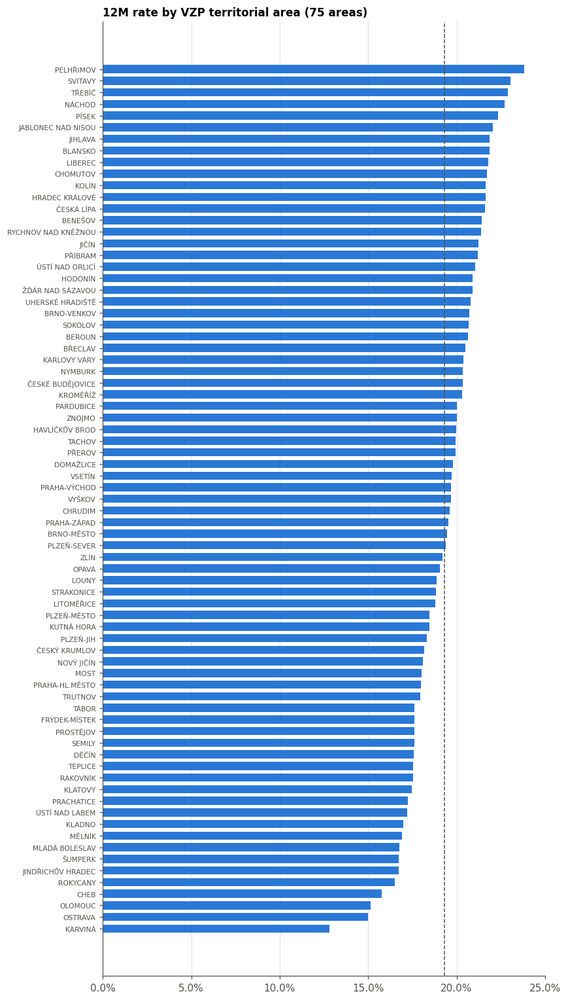
    


    Range: 12.8% – 23.8%;  size range 5,089 – 193,569
    

### 6.2 Invitation history


```python
fig, axes = plt.subplots(1, 3, figsize=(15, 3.4))
rate_plot("FIRST_INVITATION", ax=axes[0])
rate_plot("INVITATION_SEQUENCE", ax=axes[1])
d = df.assign(MLI=df.MONTHS_LAST_INVITATION.clip(upper=36).astype("Int64").astype(str).replace("<NA>", "first"))
order = [str(i) for i in range(8, 37)] + ["first"]
rate_plot("MLI", data=d, ax=axes[2], order=order, title="MONTHS_LAST_INVITATION (36 = 36+)")
plt.tight_layout(); plt.show()
```


    
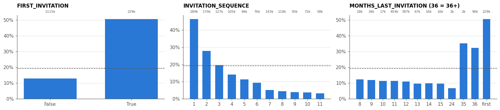
    


### 6.3 Screening history: the strongest group


```python
fig, axes = plt.subplots(1, 2, figsize=(14, 3.6))
d = df.assign(PSC=df.PRIOR_SCREEN_COUNT_5Y.clip(upper=5))
rate_plot("PSC", data=d, ax=axes[0], title="PRIOR_SCREEN_COUNT_5Y (5 = 5+)")
d = df.assign(MSLS=pd.cut(df.MONTHS_SINCE_LAST_SCREEN, bins=[-1, 6, 12, 18, 21, 24, 27, 30, 36, 48, 60, 80]).astype(str)
              .where(df.MONTHS_SINCE_LAST_SCREEN.notna(), "never"))
order = [str(i) for i in pd.cut(pd.Series([0]), bins=[-1, 6, 12, 18, 21, 24, 27, 30, 36, 48, 60, 80]).cat.categories] + ["never"]
rate_plot("MSLS", data=d, ax=axes[1], order=order, title="MONTHS_SINCE_LAST_SCREEN (binned)", rot=30)
plt.tight_layout(); plt.show()
```


    
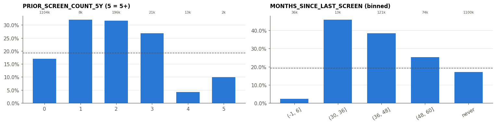
    


```python
fig, ax = plt.subplots(figsize=(11, 3.4))
t = df[df.MONTHS_SINCE_LAST_SCREEN.notna()].groupby("MONTHS_SINCE_LAST_SCREEN").agg(
    r12=("SCREENING_12M_FLAG", "mean"), r3=("SCREENING_3M_FLAG", "mean"), n=("SCREENING_12M_FLAG", "size"))
t = t[t.n >= 200].reindex(range(0, 61))  # NaN months break the line instead of interpolating across the gap
ax.plot(t.index, t.r12, color=C1, marker="o", ms=3, label="≤12M"); ax.plot(t.index, t.r3, color=C2, marker="o", ms=3, label="≤3M")
ax.axvspan(3.5, 29.5, color=GRID, alpha=0.5, lw=0)
ax.text(16.5, 0.3, "almost no invitations (201 rows):\nscreened women are\nnot re-invited until lapsed", ha="center", color=INK2, fontsize=8)
ax.yaxis.set_major_formatter(pct); ax.set_xlabel("months since last screening")
ax.set_title("Response vs. time since last screen (previously screened women)"); ax.legend()
plt.show()
pd.cut(df.MONTHS_SINCE_LAST_SCREEN, [-1, 3, 29, 36, 48, 60, 80]).value_counts(sort=False).to_frame("rows").T
```


    
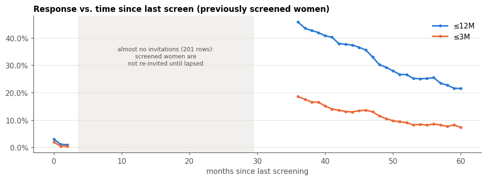
    


<div>
<style scoped>
    .dataframe tbody tr th:only-of-type {
        vertical-align: middle;
    }

    .dataframe tbody tr th {
        vertical-align: top;
    }

    .dataframe thead th {
        text-align: right;
    }
</style>
<table border="1" class="dataframe">
  <thead>
    <tr style="text-align: right;">
      <th>MONTHS_SINCE_LAST_SCREEN</th>
      <th>(-1, 3]</th>
      <th>(3, 29]</th>
      <th>(29, 36]</th>
      <th>(36, 48]</th>
      <th>(48, 60]</th>
      <th>(60, 80]</th>
    </tr>
  </thead>
  <tbody>
    <tr>
      <th>rows</th>
      <td>36289</td>
      <td>201</td>
      <td>12865</td>
      <td>120784</td>
      <td>73938</td>
      <td>193</td>
    </tr>
  </tbody>
</table>
</div>


### 6.4 Preventive behaviour and healthcare contact


```python
fig, axes = plt.subplots(2, 2, figsize=(14, 6.5))
for ax, c in zip(axes.flat, ["GP_PREVENTION_24M_CNT", "GYN_PREVENTION_24M_CNT", "OTHER_SCREENING_36M_CNT", "DENTAL_PREVENTION_24M_CNT"]):
    d = df.assign(**{c: df[c].clip(upper=5)})
    rate_plot(c, data=d, ax=ax, title=f"{c} (5 = 5+)")
plt.tight_layout(); plt.show()
```


    
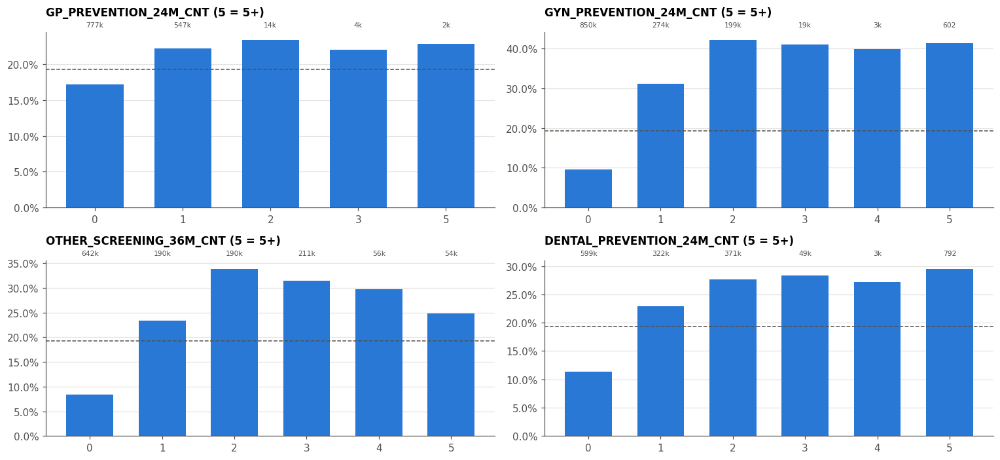
    


```python
fig, axes = plt.subplots(1, 2, figsize=(14, 3.4))
hc_bins = [-1, 0, 2, 5, 10, 15, 20, 30, 50, 1000]
d = df.assign(HC=pd.cut(df.HEALTHCARE_CONTACT_12M_CNT, hc_bins))
rate_plot("HC", data=d, ax=axes[0], title="HEALTHCARE_CONTACT_12M_CNT (binned)", rot=30)
d = df.assign(INS=pd.cut(df.INSURANCE_DURATION_YEARS, [0, 10, 15, 20, 25, 28, 30, 33]))
rate_plot("INS", data=d, ax=axes[1], title="INSURANCE_DURATION_YEARS (binned)", rot=30)
plt.tight_layout(); plt.show()
```


    
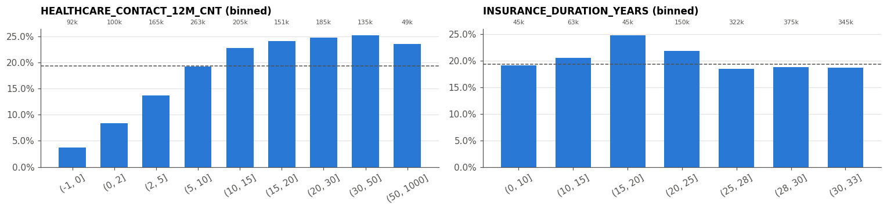
    


### 6.5 Doctor registration


```python
fig, axes = plt.subplots(1, 2, figsize=(12, 3.4))
d = df.assign(GP=df.GP_REG_DURATION_BAND.astype(str).replace("nan", "not registered"))
rate_plot("GP", data=d, ax=axes[0], order=["not registered", "<2", "2-5", ">5"], title="GP registration duration")
d = df.assign(GYN=df.GYN_REG_DURATION_BAND.astype(str).replace("nan", "not registered"))
rate_plot("GYN", data=d, ax=axes[1], order=["not registered", "<2", "2-5", ">5"], title="Gynaecologist registration duration")
plt.tight_layout(); plt.show()
```


    
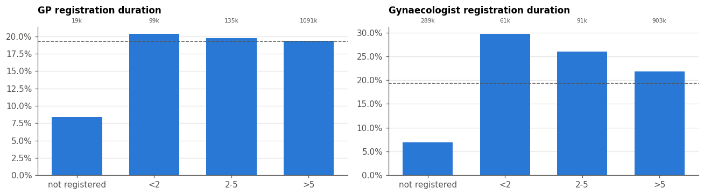
    


## 7. Feature correlations


```python
NUM = ["PRIOR_INVITATION_COUNT", "INVITATION_SEQUENCE", "MONTHS_LAST_INVITATION", "HEALTHCARE_CONTACT_12M_CNT",
       "INSURANCE_DURATION_YEARS", "PRIOR_SCREEN_COUNT_5Y", "MONTHS_SINCE_LAST_SCREEN", "GP_PREVENTION_24M_CNT",
       "GYN_PREVENTION_24M_CNT", "OTHER_SCREENING_36M_CNT", "DENTAL_PREVENTION_24M_CNT"]
age_mid = df.AGE_BAND.astype(str).str[:2].astype(int) + 2
corr = df[NUM].assign(AGE=age_mid, GYN_REG=df.GYN_REGISTERED_FLAG.astype(int),
                      SCREEN_12M=df.SCREENING_12M_FLAG.astype(int)).corr(method="spearman")

fig, ax = plt.subplots(figsize=(9, 7.5))
im = ax.imshow(corr, cmap="RdBu_r", vmin=-1, vmax=1)
ax.set_xticks(range(len(corr)), corr.columns, rotation=90, fontsize=7); ax.set_yticks(range(len(corr)), corr.columns, fontsize=7)
ax.grid(False)
for i in range(len(corr)):
    for j in range(len(corr)):
        v = corr.iat[i, j]
        if abs(v) >= 0.2 and i != j:
            ax.text(j, i, f"{v:.2f}", ha="center", va="center", fontsize=6, color="white" if abs(v) > 0.6 else INK)
fig.colorbar(im, shrink=0.7); ax.set_title("Spearman correlation (|ρ| ≥ 0.2 annotated)")
plt.tight_layout(); plt.show()
corr["SCREEN_12M"].drop("SCREEN_12M").sort_values(key=abs, ascending=False).to_frame("ρ with 12M label")
```


    
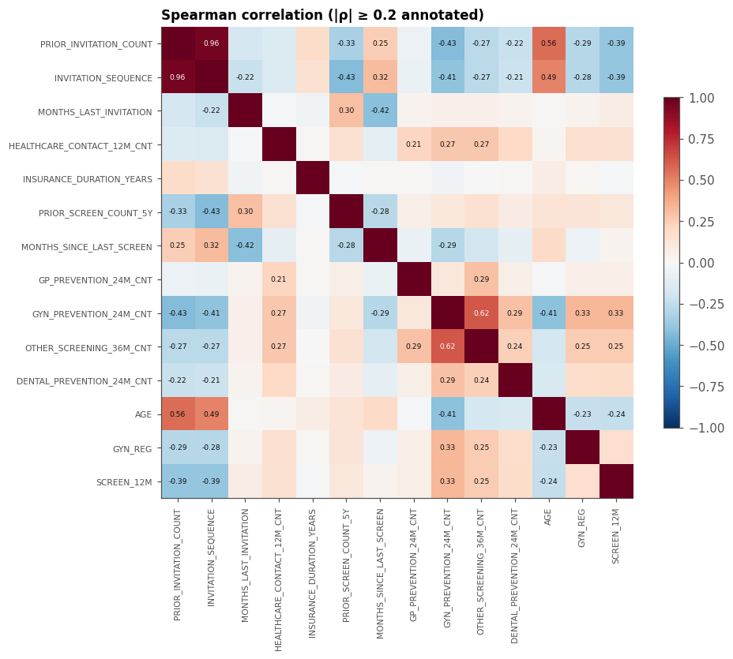
    


<div>
<style scoped>
    .dataframe tbody tr th:only-of-type {
        vertical-align: middle;
    }

    .dataframe tbody tr th {
        vertical-align: top;
    }

    .dataframe thead th {
        text-align: right;
    }
</style>
<table border="1" class="dataframe">
  <thead>
    <tr style="text-align: right;">
      <th></th>
      <th>ρ with 12M label</th>
    </tr>
  </thead>
  <tbody>
    <tr>
      <th>PRIOR_INVITATION_COUNT</th>
      <td>-0.390237</td>
    </tr>
    <tr>
      <th>INVITATION_SEQUENCE</th>
      <td>-0.386297</td>
    </tr>
    <tr>
      <th>GYN_PREVENTION_24M_CNT</th>
      <td>0.332179</td>
    </tr>
    <tr>
      <th>OTHER_SCREENING_36M_CNT</th>
      <td>0.253989</td>
    </tr>
    <tr>
      <th>AGE</th>
      <td>-0.240734</td>
    </tr>
    <tr>
      <th>DENTAL_PREVENTION_24M_CNT</th>
      <td>0.182591</td>
    </tr>
    <tr>
      <th>GYN_REG</th>
      <td>0.164285</td>
    </tr>
    <tr>
      <th>HEALTHCARE_CONTACT_12M_CNT</th>
      <td>0.149514</td>
    </tr>
    <tr>
      <th>PRIOR_SCREEN_COUNT_5Y</th>
      <td>0.116954</td>
    </tr>
    <tr>
      <th>MONTHS_LAST_INVITATION</th>
      <td>0.077328</td>
    </tr>
    <tr>
      <th>GP_PREVENTION_24M_CNT</th>
      <td>0.063481</td>
    </tr>
    <tr>
      <th>MONTHS_SINCE_LAST_SCREEN</th>
      <td>0.034331</td>
    </tr>
    <tr>
      <th>INSURANCE_DURATION_YEARS</th>
      <td>-0.023128</td>
    </tr>
  </tbody>
</table>
</div>


## 8. Quick baseline: how much signal is there?

This is a gradient-boosted tree on the raw features, nothing tuned. The split is **out-of-time with a gap**: train on invitations from 2020–2021, whose 12-month label windows close by the end of 2022, and test on 2023–2024.
No label window overlaps the test period. This mirrors deployment: score new invitations with a model trained only on outcomes that are already known.


```python
import os
os.environ["LOKY_MAX_CPU_COUNT"] = str(os.cpu_count())
import warnings
warnings.filterwarnings("ignore", message="Could not find the number of physical cores")
from sklearn.ensemble import HistGradientBoostingClassifier
from sklearn.inspection import permutation_importance
from sklearn.metrics import average_precision_score, roc_auc_score

FEATS = NUM + ["AGE_BAND", "VZP_TERRITORIAL_AREA", "GP_REGISTERED", "GP_REG_DURATION_BAND",
               "GYN_REGISTERED_FLAG", "GYN_REG_DURATION_BAND", "FIRST_INVITATION", "NEVER_SCREENED_BEFORE_FLAG"]
X = df[FEATS].copy()
for c in ["GP_REGISTERED", "GYN_REGISTERED_FLAG", "FIRST_INVITATION", "NEVER_SCREENED_BEFORE_FLAG"]:
    X[c] = X[c].astype(int)

year = df.INVITATION_DATE.dt.year
test = year >= 2023
train = year <= 2021
print(f"train {train.sum():,} rows | test {test.sum():,} rows")

results = {}
models = {}
for l in LABELS:
    y = df[l].astype(int)
    clf = HistGradientBoostingClassifier(max_iter=300, learning_rate=0.1, categorical_features="from_dtype",
                                         early_stopping=True, random_state=0)
    clf.fit(X[train], y[train])
    p = clf.predict_proba(X[test])[:, 1]
    results[l] = {"ROC AUC": roc_auc_score(y[test], p), "PR AUC": average_precision_score(y[test], p),
                  "test base rate": y[test].mean()}
    models[l] = clf
pd.DataFrame(results).T.style.format("{:.3f}")
```

    train 545,512 rows | test 523,051 rows
    

      File "C:\Users\adamd\AppData\Local\Programs\Python\Python312\Lib\site-packages\joblib\externals\loky\backend\context.py", line 257, in _count_physical_cores
        cpu_info = subprocess.run(
                   ^^^^^^^^^^^^^^^
      File "C:\Users\adamd\AppData\Local\Programs\Python\Python312\Lib\subprocess.py", line 548, in run
        with Popen(*popenargs, **kwargs) as process:
             ^^^^^^^^^^^^^^^^^^^^^^^^^^^
      File "C:\Users\adamd\AppData\Local\Programs\Python\Python312\Lib\subprocess.py", line 1026, in __init__
        self._execute_child(args, executable, preexec_fn, close_fds,
      File "C:\Users\adamd\AppData\Local\Programs\Python\Python312\Lib\subprocess.py", line 1538, in _execute_child
        hp, ht, pid, tid = _winapi.CreateProcess(executable, args,
                           ^^^^^^^^^^^^^^^^^^^^^^^^^^^^^^^^^^^^^^^
    


<style type="text/css">
</style>
<table id="T_4421e">
  <thead>
    <tr>
      <th class="blank level0" >&nbsp;</th>
      <th id="T_4421e_level0_col0" class="col_heading level0 col0" >ROC AUC</th>
      <th id="T_4421e_level0_col1" class="col_heading level0 col1" >PR AUC</th>
      <th id="T_4421e_level0_col2" class="col_heading level0 col2" >test base rate</th>
    </tr>
  </thead>
  <tbody>
    <tr>
      <th id="T_4421e_level0_row0" class="row_heading level0 row0" >SCREENING_3M_FLAG</th>
      <td id="T_4421e_row0_col0" class="data row0 col0" >0.830</td>
      <td id="T_4421e_row0_col1" class="data row0 col1" >0.275</td>
      <td id="T_4421e_row0_col2" class="data row0 col2" >0.071</td>
    </tr>
    <tr>
      <th id="T_4421e_level0_row1" class="row_heading level0 row1" >SCREENING_6M_FLAG</th>
      <td id="T_4421e_row1_col0" class="data row1 col0" >0.831</td>
      <td id="T_4421e_row1_col1" class="data row1 col1" >0.427</td>
      <td id="T_4421e_row1_col2" class="data row1 col2" >0.125</td>
    </tr>
    <tr>
      <th id="T_4421e_level0_row2" class="row_heading level0 row2" >SCREENING_12M_FLAG</th>
      <td id="T_4421e_row2_col0" class="data row2 col0" >0.833</td>
      <td id="T_4421e_row2_col1" class="data row2 col1" >0.575</td>
      <td id="T_4421e_row2_col2" class="data row2 col2" >0.195</td>
    </tr>
  </tbody>
</table>


```python
rng = np.random.default_rng(0)
idx = rng.choice(np.flatnonzero(test), 60_000, replace=False)
pi = permutation_importance(models["SCREENING_12M_FLAG"], X.iloc[idx], df.SCREENING_12M_FLAG.iloc[idx].astype(int),
                            scoring="roc_auc", n_repeats=3, random_state=0, n_jobs=-1)
imp = pd.Series(pi.importances_mean, index=FEATS).sort_values()
fig, ax = plt.subplots(figsize=(8, 6))
ax.barh(imp.index, imp.values, height=0.65, color=C1)
ax.grid(axis="x"); ax.grid(axis="y", visible=False); ax.tick_params(axis="y", labelsize=8)
ax.set_xlabel("drop in ROC AUC when permuted"); ax.set_title("Permutation importance: 12M model (test sample)")
plt.tight_layout(); plt.show()
```


    
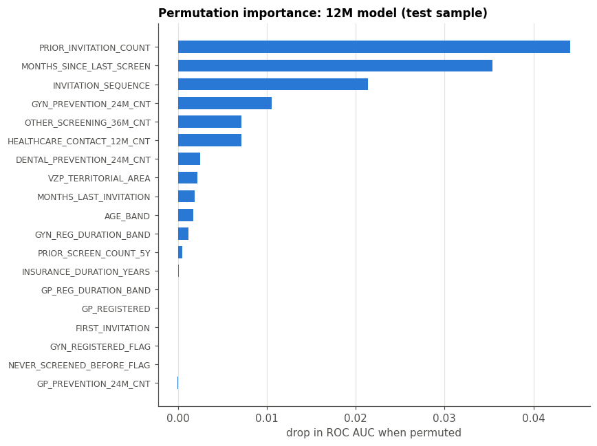
    


## 9. Key findings

**Data quality**
- 1,344,556 invitations for 508,527 women. There are no duplicates, and every NaN is *structural*: each one is fully explained by a flag (`FIRST_INVITATION`, `NEVER_SCREENED_BEFORE_FLAG`, `GP_REGISTERED`, `GYN_REGISTERED_FLAG`). Impute with a sentinel or a "missing" category, not with a mean.
- Small inconsistencies:
  - 3,354 rows have `NEVER_SCREENED = N` but `PRIOR_SCREEN_COUNT_5Y = 0`. This is a 60-month window-edge effect.
  - 193 rows have `MONTHS_SINCE_LAST_SCREEN > 60`, although the documented window is 60 months.
  - 52 rows have `FIRST_INVITATION = A` but `INVITATION_SEQUENCE = 2`.
- `PRIOR_SCREEN_COUNT_5Y` is mostly **2** (196k rows) rather than 1 (8k). It probably counts claim codes, not visits (2 codes per mammography visit?). Worth asking the organisers.

**Targets**
- 3M / 6M / 12M positive rates are 7.1% / 12.5% / 19.3%. The labels are strictly nested, and about 35% of 12-month responders come after month 6.
- Rates are stable at about 19–20% for 2021–2024. 2020 is lower (17.8%) and has COVID gaps in invitation sending (spring and autumn 2020).

**Population structure (important for modelling)**
- **Invitations target non-attenders.** Previously screened women are only invited once they have lapsed (≥30 months since the last screen). A separate cluster of about 36k rows was screened 0–3 months before T0, and these rarely respond (~2%).
- Repeat invitations come about every 12 months. **Response falls sharply with `INVITATION_SEQUENCE`**, from 46% on the 1st invitation to about 3% on the 11th: chronic non-attenders get re-invited again and again.
- **The 40–44 band (100% first invitations) responds at 57%**, and 45–49 at 31%. These are first-time invitees, a very different group from the 50+ re-invited population. Consider a separate model or interaction terms.
- 86% of rows belong to women with more than one invitation, and consecutive invitations are about 12 months apart, so **12M label windows overlap with the next invitation**. Use out-of-time splits with a gap (or at least splits grouped by `PERSON_ID`).

**Predictors**
- The strongest signals are invitation history (`PRIOR_INVITATION_COUNT`, `INVITATION_SEQUENCE`), `MONTHS_SINCE_LAST_SCREEN`, and preventive behaviour: `GYN_PREVENTION_24M_CNT` (10% response at 0 visits vs. 42% at 2+), `OTHER_SCREENING_36M_CNT`, `HEALTHCARE_CONTACT_12M_CNT` (4% response with zero contacts).
- Not being registered with a gynaecologist (7%) or a GP (9%) strongly predicts non-response.
- Regional spread across the 75 VZP areas is 12.8%–23.8%: modest but real.
- Insurance duration and GP prevention counts are weak.

**Baseline**
- An untuned HistGradientBoosting model, trained on 2020–2021 and tested on 2023–2024, reaches **ROC AUC ≈ 0.83** for all three horizons. PR AUC is 0.28 / 0.43 / 0.58 against base rates of 0.07 / 0.13 / 0.20.

**Next steps**
- Sequence features built from earlier rows of the same woman: previous response, number of past non-responses.
- Handle the 40–44 cohort and first invitations explicitly.
- Calibrate predictions and evaluate them per invitation batch.
- Clarify the claim-code semantics of `PRIOR_SCREEN_COUNT_5Y` with the organisers.
