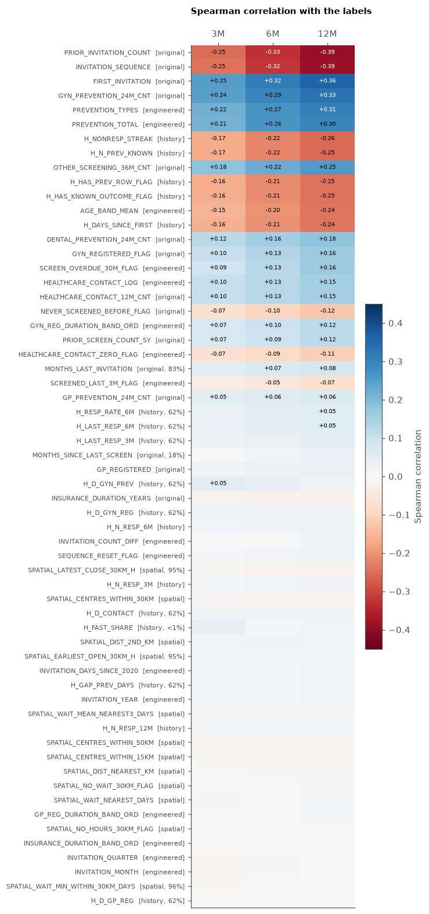

# Correlation of attributes with the labels

How strongly is each attribute associated with the three labels
(`SCREENING_3M_FLAG`, `SCREENING_6M_FLAG`, `SCREENING_12M_FLAG`)?

**Data:** the cleaned, prepared dataset `data/Rakhaton2026_prepared.csv` (all 1,344,556 invitations), built by
`preprocessing/pipeline.py`. It holds the original attributes plus the engineered ones (history `H_*`,
spatial `SPATIAL_*`, dates, flags). The `LIN_*` columns are only linear-model re-encodings of other columns
(dummies, median-filled copies), so they are left out.

**Measures**
- **Numeric and flag attributes:** Spearman rank correlation with each label, and Pearson in the table.
  Labels are 0/1, so Pearson is the point-biserial correlation. Spearman is robust to the long-tailed counts.
- **Categorical attributes:** Cramér's V (0 = no association, 1 = perfect). It has no sign.
- Attributes with missing values (e.g. `MONTHS_SINCE_LAST_SCREEN` exists only for previously screened women;
  history features only after an earlier invitation) are correlated on the rows where they are present.
  The `coverage` column shows that share. Read low-coverage correlations as "within that subgroup".

Correlation is not importance. Correlated attributes share the same signal (e.g. `INVITATION_SEQUENCE` vs
`PRIOR_INVITATION_COUNT`), and non-monotonic effects can show near-zero correlation.


```python
from pathlib import Path

import matplotlib.pyplot as plt
import numpy as np
import pandas as pd
from scipy.stats import chi2_contingency


pd.set_option("display.max_rows", 200)
INK2, GRID = "#52514e", "#e4e3df"
plt.rcParams.update({
    "figure.dpi": 110, "axes.spines.top": False, "axes.spines.right": False,
    "axes.edgecolor": INK2, "axes.labelcolor": INK2, "xtick.color": INK2, "ytick.color": INK2,
    "axes.titleweight": "bold", "axes.titlesize": 10, "axes.titlelocation": "left",
})

LABELS = ["SCREENING_3M_FLAG", "SCREENING_6M_FLAG", "SCREENING_12M_FLAG"]
SHORT = {l: l.split("_")[1] for l in LABELS}  # 3M / 6M / 12M
CATEGORICAL = ["AGE_BAND", "VZP_TERRITORIAL_AREA", "GP_REG_DURATION_BAND", "GYN_REG_DURATION_BAND"]
NOT_ATTRIBUTES = {"INVITATION_ID", "PERSON_ID", "INVITATION_DATE", *LABELS}

df = pd.read_csv(Path("../data/Rakhaton2026_prepared.csv"), dtype={"INVITATION_ID": str, "PERSON_ID": str},
                 keep_default_na=False, na_values=[""])
numeric = [c for c in df.columns
           if c not in NOT_ATTRIBUTES | set(CATEGORICAL) and not c.startswith("LIN_")]
print(f"{len(df):,} invitations | {len(numeric)} numeric/flag attributes | {len(CATEGORICAL)} categorical")
print("Label rates:", {SHORT[l]: f"{df[l].mean():.1%}" for l in LABELS})
```

    1,344,556 invitations | 60 numeric/flag attributes | 4 categorical
    Label rates: {'3M': '7.1%', '6M': '12.5%', '12M': '19.3%'}
    

## 1. Numeric and flag attributes


```python
ORIGINAL = set(pd.read_csv("../data/Rakhaton2026.csv", nrows=0).columns)


def origin(col):
    if col.startswith("H_"):
        return "history"
    if col.startswith("SPATIAL_"):
        return "spatial"
    return "original" if col in ORIGINAL else "engineered"


rows = []
for col in numeric:
    present = df[col].notna()
    x = df.loc[present, col]
    row = {"attribute": col, "origin": origin(col), "coverage": present.mean()}
    for l in LABELS:
        y = df.loc[present, l]
        row[f"spearman {SHORT[l]}"] = x.corr(y, method="spearman")
        row[f"pearson {SHORT[l]}"] = x.corr(y)
    rows.append(row)

corr = (pd.DataFrame(rows).set_index("attribute")
        .sort_values("spearman 12M", key=abs, ascending=False))
fmt = {c: "{:+.3f}" for c in corr.columns if c.startswith(("spearman", "pearson"))} | {"coverage": "{:.1%}"}
corr.style.format(fmt).background_gradient(
    subset=[c for c in corr.columns if c.startswith("spearman")], cmap="RdBu", vmin=-0.4, vmax=0.4)
```


<style type="text/css">
#T_c1826_row0_col2 {
  background-color: #d05548;
  color: #f1f1f1;
}
#T_c1826_row0_col4 {
  background-color: #ab162a;
  color: #f1f1f1;
}
#T_c1826_row0_col6 {
  background-color: #700320;
  color: #f1f1f1;
}
#T_c1826_row1_col2, #T_c1826_row9_col6, #T_c1826_row10_col6 {
  background-color: #d35a4a;
  color: #f1f1f1;
}
#T_c1826_row1_col4 {
  background-color: #ae172a;
  color: #f1f1f1;
}
#T_c1826_row1_col6 {
  background-color: #730421;
  color: #f1f1f1;
}
#T_c1826_row2_col2 {
  background-color: #3f8ec0;
  color: #f1f1f1;
}
#T_c1826_row2_col4 {
  background-color: #2267ac;
  color: #f1f1f1;
}
#T_c1826_row2_col6 {
  background-color: #124984;
  color: #f1f1f1;
}
#T_c1826_row3_col2 {
  background-color: #4291c2;
  color: #f1f1f1;
}
#T_c1826_row3_col4 {
  background-color: #2c75b4;
  color: #f1f1f1;
}
#T_c1826_row3_col6 {
  background-color: #1c5c9f;
  color: #f1f1f1;
}
#T_c1826_row4_col2, #T_c1826_row5_col2 {
  background-color: #5ca3cb;
  color: #f1f1f1;
}
#T_c1826_row4_col4 {
  background-color: #3783bb;
  color: #f1f1f1;
}
#T_c1826_row4_col6 {
  background-color: #266caf;
  color: #f1f1f1;
}
#T_c1826_row5_col4 {
  background-color: #3a87bd;
  color: #f1f1f1;
}
#T_c1826_row5_col6 {
  background-color: #2a71b2;
  color: #f1f1f1;
}
#T_c1826_row6_col2, #T_c1826_row7_col2 {
  background-color: #f19e7d;
  color: #000000;
}
#T_c1826_row6_col4, #T_c1826_row7_col4 {
  background-color: #dd7059;
  color: #f1f1f1;
}
#T_c1826_row6_col6, #T_c1826_row7_col6 {
  background-color: #cf5246;
  color: #f1f1f1;
}
#T_c1826_row8_col2, #T_c1826_row13_col6 {
  background-color: #7bb6d6;
  color: #000000;
}
#T_c1826_row8_col4 {
  background-color: #529dc8;
  color: #f1f1f1;
}
#T_c1826_row8_col6 {
  background-color: #3c8abe;
  color: #f1f1f1;
}
#T_c1826_row9_col2, #T_c1826_row10_col2 {
  background-color: #f2a17f;
  color: #000000;
}
#T_c1826_row9_col4, #T_c1826_row10_col4 {
  background-color: #df765e;
  color: #f1f1f1;
}
#T_c1826_row11_col2 {
  background-color: #f5a886;
  color: #000000;
}
#T_c1826_row11_col4 {
  background-color: #e48066;
  color: #f1f1f1;
}
#T_c1826_row11_col6 {
  background-color: #d55d4c;
  color: #f1f1f1;
}
#T_c1826_row12_col2 {
  background-color: #f4a683;
  color: #000000;
}
#T_c1826_row12_col4 {
  background-color: #e27b62;
  color: #f1f1f1;
}
#T_c1826_row12_col6 {
  background-color: #d6604d;
  color: #f1f1f1;
}
#T_c1826_row13_col2 {
  background-color: #b1d5e7;
  color: #000000;
}
#T_c1826_row13_col4 {
  background-color: #96c7df;
  color: #000000;
}
#T_c1826_row14_col2 {
  background-color: #c0dceb;
  color: #000000;
}
#T_c1826_row14_col4 {
  background-color: #a7d0e4;
  color: #000000;
}
#T_c1826_row14_col6 {
  background-color: #8dc2dc;
  color: #000000;
}
#T_c1826_row15_col2, #T_c1826_row20_col4 {
  background-color: #c7e0ed;
  color: #000000;
}
#T_c1826_row15_col4 {
  background-color: #acd2e5;
  color: #000000;
}
#T_c1826_row15_col6 {
  background-color: #90c4dd;
  color: #000000;
}
#T_c1826_row16_col2, #T_c1826_row17_col2 {
  background-color: #bddbea;
  color: #000000;
}
#T_c1826_row16_col4, #T_c1826_row17_col4 {
  background-color: #a9d1e5;
  color: #000000;
}
#T_c1826_row16_col6, #T_c1826_row17_col6 {
  background-color: #9bc9e0;
  color: #000000;
}
#T_c1826_row18_col2, #T_c1826_row23_col6 {
  background-color: #fcdecd;
  color: #000000;
}
#T_c1826_row18_col4 {
  background-color: #fbd0b9;
  color: #000000;
}
#T_c1826_row18_col6 {
  background-color: #f8bfa4;
  color: #000000;
}
#T_c1826_row19_col2 {
  background-color: #d5e7f1;
  color: #000000;
}
#T_c1826_row19_col4 {
  background-color: #c5dfec;
  color: #000000;
}
#T_c1826_row19_col6, #T_c1826_row20_col6 {
  background-color: #b3d6e8;
  color: #000000;
}
#T_c1826_row20_col2 {
  background-color: #d7e8f1;
  color: #000000;
}
#T_c1826_row21_col2 {
  background-color: #fcdfcf;
  color: #000000;
}
#T_c1826_row21_col4 {
  background-color: #fcd5bf;
  color: #000000;
}
#T_c1826_row21_col6 {
  background-color: #fac8af;
  color: #000000;
}
#T_c1826_row22_col2 {
  background-color: #e0ecf3;
  color: #000000;
}
#T_c1826_row22_col4, #T_c1826_row24_col6 {
  background-color: #d8e9f1;
  color: #000000;
}
#T_c1826_row22_col6 {
  background-color: #d2e6f0;
  color: #000000;
}
#T_c1826_row23_col2 {
  background-color: #faeae1;
  color: #000000;
}
#T_c1826_row23_col4 {
  background-color: #fbe5d8;
  color: #000000;
}
#T_c1826_row24_col2, #T_c1826_row30_col2 {
  background-color: #deebf2;
  color: #000000;
}
#T_c1826_row24_col4 {
  background-color: #dbeaf2;
  color: #000000;
}
#T_c1826_row25_col2, #T_c1826_row26_col2, #T_c1826_row27_col4, #T_c1826_row28_col6, #T_c1826_row29_col6 {
  background-color: #e7f0f4;
  color: #000000;
}
#T_c1826_row25_col4, #T_c1826_row26_col4 {
  background-color: #e1edf3;
  color: #000000;
}
#T_c1826_row25_col6, #T_c1826_row26_col6 {
  background-color: #ddebf2;
  color: #000000;
}
#T_c1826_row27_col2, #T_c1826_row29_col4 {
  background-color: #eaf1f5;
  color: #000000;
}
#T_c1826_row27_col6 {
  background-color: #e4eef4;
  color: #000000;
}
#T_c1826_row28_col2, #T_c1826_row50_col2, #T_c1826_row53_col2, #T_c1826_row53_col4, #T_c1826_row55_col2, #T_c1826_row56_col6, #T_c1826_row57_col6, #T_c1826_row59_col2, #T_c1826_row59_col4 {
  background-color: #f6f7f7;
  color: #000000;
}
#T_c1826_row28_col4, #T_c1826_row33_col2, #T_c1826_row35_col4, #T_c1826_row37_col2, #T_c1826_row41_col2, #T_c1826_row42_col2, #T_c1826_row42_col4, #T_c1826_row42_col6, #T_c1826_row43_col6, #T_c1826_row44_col6, #T_c1826_row45_col6 {
  background-color: #f2f5f6;
  color: #000000;
}
#T_c1826_row29_col2, #T_c1826_row39_col2 {
  background-color: #edf2f5;
  color: #000000;
}
#T_c1826_row30_col4, #T_c1826_row40_col2 {
  background-color: #e6eff4;
  color: #000000;
}
#T_c1826_row30_col6, #T_c1826_row32_col2, #T_c1826_row32_col4, #T_c1826_row32_col6, #T_c1826_row33_col6 {
  background-color: #ecf2f5;
  color: #000000;
}
#T_c1826_row31_col2, #T_c1826_row38_col2, #T_c1826_row38_col6 {
  background-color: #f8f2ef;
  color: #000000;
}
#T_c1826_row31_col4 {
  background-color: #f9f0eb;
  color: #000000;
}
#T_c1826_row31_col6 {
  background-color: #f9efe9;
  color: #000000;
}
#T_c1826_row33_col4, #T_c1826_row34_col6, #T_c1826_row35_col6, #T_c1826_row37_col6, #T_c1826_row39_col4 {
  background-color: #eff3f5;
  color: #000000;
}
#T_c1826_row34_col2, #T_c1826_row51_col2, #T_c1826_row51_col4, #T_c1826_row52_col4, #T_c1826_row54_col2, #T_c1826_row54_col4, #T_c1826_row55_col4, #T_c1826_row55_col6, #T_c1826_row58_col4, #T_c1826_row58_col6, #T_c1826_row59_col6 {
  background-color: #f7f6f6;
  color: #000000;
}
#T_c1826_row34_col4, #T_c1826_row43_col2, #T_c1826_row44_col2, #T_c1826_row45_col2, #T_c1826_row47_col2, #T_c1826_row50_col4, #T_c1826_row50_col6, #T_c1826_row52_col6, #T_c1826_row53_col6, #T_c1826_row56_col4, #T_c1826_row57_col4 {
  background-color: #f5f6f7;
  color: #000000;
}
#T_c1826_row35_col2, #T_c1826_row40_col4, #T_c1826_row43_col4, #T_c1826_row44_col4, #T_c1826_row45_col4, #T_c1826_row47_col4, #T_c1826_row47_col6 {
  background-color: #f3f5f6;
  color: #000000;
}
#T_c1826_row36_col2, #T_c1826_row46_col2, #T_c1826_row46_col4, #T_c1826_row48_col4 {
  background-color: #f8f3f0;
  color: #000000;
}
#T_c1826_row36_col4, #T_c1826_row36_col6, #T_c1826_row38_col4 {
  background-color: #f8f1ed;
  color: #000000;
}
#T_c1826_row37_col4, #T_c1826_row39_col6, #T_c1826_row40_col6, #T_c1826_row41_col4, #T_c1826_row41_col6 {
  background-color: #f0f4f6;
  color: #000000;
}
#T_c1826_row46_col6, #T_c1826_row48_col6, #T_c1826_row49_col4, #T_c1826_row56_col2, #T_c1826_row57_col2 {
  background-color: #f8f4f2;
  color: #000000;
}
#T_c1826_row48_col2, #T_c1826_row49_col2, #T_c1826_row49_col6, #T_c1826_row51_col6, #T_c1826_row52_col2, #T_c1826_row54_col6, #T_c1826_row58_col2 {
  background-color: #f7f5f4;
  color: #000000;
}
</style>
<table id="T_c1826">
  <thead>
    <tr>
      <th class="blank level0" >&nbsp;</th>
      <th id="T_c1826_level0_col0" class="col_heading level0 col0" >origin</th>
      <th id="T_c1826_level0_col1" class="col_heading level0 col1" >coverage</th>
      <th id="T_c1826_level0_col2" class="col_heading level0 col2" >spearman 3M</th>
      <th id="T_c1826_level0_col3" class="col_heading level0 col3" >pearson 3M</th>
      <th id="T_c1826_level0_col4" class="col_heading level0 col4" >spearman 6M</th>
      <th id="T_c1826_level0_col5" class="col_heading level0 col5" >pearson 6M</th>
      <th id="T_c1826_level0_col6" class="col_heading level0 col6" >spearman 12M</th>
      <th id="T_c1826_level0_col7" class="col_heading level0 col7" >pearson 12M</th>
    </tr>
    <tr>
      <th class="index_name level0" >attribute</th>
      <th class="blank col0" >&nbsp;</th>
      <th class="blank col1" >&nbsp;</th>
      <th class="blank col2" >&nbsp;</th>
      <th class="blank col3" >&nbsp;</th>
      <th class="blank col4" >&nbsp;</th>
      <th class="blank col5" >&nbsp;</th>
      <th class="blank col6" >&nbsp;</th>
      <th class="blank col7" >&nbsp;</th>
    </tr>
  </thead>
  <tbody>
    <tr>
      <th id="T_c1826_level0_row0" class="row_heading level0 row0" >PRIOR_INVITATION_COUNT</th>
      <td id="T_c1826_row0_col0" class="data row0 col0" >original</td>
      <td id="T_c1826_row0_col1" class="data row0 col1" >100.0%</td>
      <td id="T_c1826_row0_col2" class="data row0 col2" >-0.250</td>
      <td id="T_c1826_row0_col3" class="data row0 col3" >-0.240</td>
      <td id="T_c1826_row0_col4" class="data row0 col4" >-0.327</td>
      <td id="T_c1826_row0_col5" class="data row0 col5" >-0.315</td>
      <td id="T_c1826_row0_col6" class="data row0 col6" >-0.390</td>
      <td id="T_c1826_row0_col7" class="data row0 col7" >-0.377</td>
    </tr>
    <tr>
      <th id="T_c1826_level0_row1" class="row_heading level0 row1" >INVITATION_SEQUENCE</th>
      <td id="T_c1826_row1_col0" class="data row1 col0" >original</td>
      <td id="T_c1826_row1_col1" class="data row1 col1" >100.0%</td>
      <td id="T_c1826_row1_col2" class="data row1 col2" >-0.245</td>
      <td id="T_c1826_row1_col3" class="data row1 col3" >-0.230</td>
      <td id="T_c1826_row1_col4" class="data row1 col4" >-0.322</td>
      <td id="T_c1826_row1_col5" class="data row1 col5" >-0.303</td>
      <td id="T_c1826_row1_col6" class="data row1 col6" >-0.386</td>
      <td id="T_c1826_row1_col7" class="data row1 col7" >-0.366</td>
    </tr>
    <tr>
      <th id="T_c1826_level0_row2" class="row_heading level0 row2" >FIRST_INVITATION</th>
      <td id="T_c1826_row2_col0" class="data row2 col0" >original</td>
      <td id="T_c1826_row2_col1" class="data row2 col1" >100.0%</td>
      <td id="T_c1826_row2_col2" class="data row2 col2" >+0.248</td>
      <td id="T_c1826_row2_col3" class="data row2 col3" >+0.248</td>
      <td id="T_c1826_row2_col4" class="data row2 col4" >+0.316</td>
      <td id="T_c1826_row2_col5" class="data row2 col5" >+0.316</td>
      <td id="T_c1826_row2_col6" class="data row2 col6" >+0.360</td>
      <td id="T_c1826_row2_col7" class="data row2 col7" >+0.360</td>
    </tr>
    <tr>
      <th id="T_c1826_level0_row3" class="row_heading level0 row3" >GYN_PREVENTION_24M_CNT</th>
      <td id="T_c1826_row3_col0" class="data row3 col0" >original</td>
      <td id="T_c1826_row3_col1" class="data row3 col1" >100.0%</td>
      <td id="T_c1826_row3_col2" class="data row3 col2" >+0.243</td>
      <td id="T_c1826_row3_col3" class="data row3 col3" >+0.238</td>
      <td id="T_c1826_row3_col4" class="data row3 col4" >+0.293</td>
      <td id="T_c1826_row3_col5" class="data row3 col5" >+0.284</td>
      <td id="T_c1826_row3_col6" class="data row3 col6" >+0.332</td>
      <td id="T_c1826_row3_col7" class="data row3 col7" >+0.320</td>
    </tr>
    <tr>
      <th id="T_c1826_level0_row4" class="row_heading level0 row4" >PREVENTION_TYPES</th>
      <td id="T_c1826_row4_col0" class="data row4 col0" >engineered</td>
      <td id="T_c1826_row4_col1" class="data row4 col1" >100.0%</td>
      <td id="T_c1826_row4_col2" class="data row4 col2" >+0.216</td>
      <td id="T_c1826_row4_col3" class="data row4 col3" >+0.216</td>
      <td id="T_c1826_row4_col4" class="data row4 col4" >+0.267</td>
      <td id="T_c1826_row4_col5" class="data row4 col5" >+0.268</td>
      <td id="T_c1826_row4_col6" class="data row4 col6" >+0.308</td>
      <td id="T_c1826_row4_col7" class="data row4 col7" >+0.309</td>
    </tr>
    <tr>
      <th id="T_c1826_level0_row5" class="row_heading level0 row5" >PREVENTION_TOTAL</th>
      <td id="T_c1826_row5_col0" class="data row5 col0" >engineered</td>
      <td id="T_c1826_row5_col1" class="data row5 col1" >100.0%</td>
      <td id="T_c1826_row5_col2" class="data row5 col2" >+0.213</td>
      <td id="T_c1826_row5_col3" class="data row5 col3" >+0.211</td>
      <td id="T_c1826_row5_col4" class="data row5 col4" >+0.261</td>
      <td id="T_c1826_row5_col5" class="data row5 col5" >+0.254</td>
      <td id="T_c1826_row5_col6" class="data row5 col6" >+0.299</td>
      <td id="T_c1826_row5_col7" class="data row5 col7" >+0.288</td>
    </tr>
    <tr>
      <th id="T_c1826_level0_row6" class="row_heading level0 row6" >H_NONRESP_STREAK</th>
      <td id="T_c1826_row6_col0" class="data row6 col0" >history</td>
      <td id="T_c1826_row6_col1" class="data row6 col1" >100.0%</td>
      <td id="T_c1826_row6_col2" class="data row6 col2" >-0.168</td>
      <td id="T_c1826_row6_col3" class="data row6 col3" >-0.157</td>
      <td id="T_c1826_row6_col4" class="data row6 col4" >-0.220</td>
      <td id="T_c1826_row6_col5" class="data row6 col5" >-0.206</td>
      <td id="T_c1826_row6_col6" class="data row6 col6" >-0.256</td>
      <td id="T_c1826_row6_col7" class="data row6 col7" >-0.241</td>
    </tr>
    <tr>
      <th id="T_c1826_level0_row7" class="row_heading level0 row7" >H_N_PREV_KNOWN</th>
      <td id="T_c1826_row7_col0" class="data row7 col0" >history</td>
      <td id="T_c1826_row7_col1" class="data row7 col1" >100.0%</td>
      <td id="T_c1826_row7_col2" class="data row7 col2" >-0.168</td>
      <td id="T_c1826_row7_col3" class="data row7 col3" >-0.157</td>
      <td id="T_c1826_row7_col4" class="data row7 col4" >-0.219</td>
      <td id="T_c1826_row7_col5" class="data row7 col5" >-0.206</td>
      <td id="T_c1826_row7_col6" class="data row7 col6" >-0.255</td>
      <td id="T_c1826_row7_col7" class="data row7 col7" >-0.241</td>
    </tr>
    <tr>
      <th id="T_c1826_level0_row8" class="row_heading level0 row8" >OTHER_SCREENING_36M_CNT</th>
      <td id="T_c1826_row8_col0" class="data row8 col0" >original</td>
      <td id="T_c1826_row8_col1" class="data row8 col1" >100.0%</td>
      <td id="T_c1826_row8_col2" class="data row8 col2" >+0.184</td>
      <td id="T_c1826_row8_col3" class="data row8 col3" >+0.154</td>
      <td id="T_c1826_row8_col4" class="data row8 col4" >+0.222</td>
      <td id="T_c1826_row8_col5" class="data row8 col5" >+0.183</td>
      <td id="T_c1826_row8_col6" class="data row8 col6" >+0.254</td>
      <td id="T_c1826_row8_col7" class="data row8 col7" >+0.207</td>
    </tr>
    <tr>
      <th id="T_c1826_level0_row9" class="row_heading level0 row9" >H_HAS_PREV_ROW_FLAG</th>
      <td id="T_c1826_row9_col0" class="data row9 col0" >history</td>
      <td id="T_c1826_row9_col1" class="data row9 col1" >100.0%</td>
      <td id="T_c1826_row9_col2" class="data row9 col2" >-0.165</td>
      <td id="T_c1826_row9_col3" class="data row9 col3" >-0.165</td>
      <td id="T_c1826_row9_col4" class="data row9 col4" >-0.213</td>
      <td id="T_c1826_row9_col5" class="data row9 col5" >-0.213</td>
      <td id="T_c1826_row9_col6" class="data row9 col6" >-0.245</td>
      <td id="T_c1826_row9_col7" class="data row9 col7" >-0.245</td>
    </tr>
    <tr>
      <th id="T_c1826_level0_row10" class="row_heading level0 row10" >H_HAS_KNOWN_OUTCOME_FLAG</th>
      <td id="T_c1826_row10_col0" class="data row10 col0" >history</td>
      <td id="T_c1826_row10_col1" class="data row10 col1" >100.0%</td>
      <td id="T_c1826_row10_col2" class="data row10 col2" >-0.165</td>
      <td id="T_c1826_row10_col3" class="data row10 col3" >-0.165</td>
      <td id="T_c1826_row10_col4" class="data row10 col4" >-0.213</td>
      <td id="T_c1826_row10_col5" class="data row10 col5" >-0.213</td>
      <td id="T_c1826_row10_col6" class="data row10 col6" >-0.245</td>
      <td id="T_c1826_row10_col7" class="data row10 col7" >-0.245</td>
    </tr>
    <tr>
      <th id="T_c1826_level0_row11" class="row_heading level0 row11" >AGE_BAND_MEAN</th>
      <td id="T_c1826_row11_col0" class="data row11 col0" >engineered</td>
      <td id="T_c1826_row11_col1" class="data row11 col1" >100.0%</td>
      <td id="T_c1826_row11_col2" class="data row11 col2" >-0.154</td>
      <td id="T_c1826_row11_col3" class="data row11 col3" >-0.149</td>
      <td id="T_c1826_row11_col4" class="data row11 col4" >-0.202</td>
      <td id="T_c1826_row11_col5" class="data row11 col5" >-0.196</td>
      <td id="T_c1826_row11_col6" class="data row11 col6" >-0.241</td>
      <td id="T_c1826_row11_col7" class="data row11 col7" >-0.234</td>
    </tr>
    <tr>
      <th id="T_c1826_level0_row12" class="row_heading level0 row12" >H_DAYS_SINCE_FIRST</th>
      <td id="T_c1826_row12_col0" class="data row12 col0" >history</td>
      <td id="T_c1826_row12_col1" class="data row12 col1" >100.0%</td>
      <td id="T_c1826_row12_col2" class="data row12 col2" >-0.159</td>
      <td id="T_c1826_row12_col3" class="data row12 col3" >-0.149</td>
      <td id="T_c1826_row12_col4" class="data row12 col4" >-0.207</td>
      <td id="T_c1826_row12_col5" class="data row12 col5" >-0.195</td>
      <td id="T_c1826_row12_col6" class="data row12 col6" >-0.240</td>
      <td id="T_c1826_row12_col7" class="data row12 col7" >-0.228</td>
    </tr>
    <tr>
      <th id="T_c1826_level0_row13" class="row_heading level0 row13" >DENTAL_PREVENTION_24M_CNT</th>
      <td id="T_c1826_row13_col0" class="data row13 col0" >original</td>
      <td id="T_c1826_row13_col1" class="data row13 col1" >100.0%</td>
      <td id="T_c1826_row13_col2" class="data row13 col2" >+0.121</td>
      <td id="T_c1826_row13_col3" class="data row13 col3" >+0.117</td>
      <td id="T_c1826_row13_col4" class="data row13 col4" >+0.156</td>
      <td id="T_c1826_row13_col5" class="data row13 col5" >+0.151</td>
      <td id="T_c1826_row13_col6" class="data row13 col6" >+0.183</td>
      <td id="T_c1826_row13_col7" class="data row13 col7" >+0.176</td>
    </tr>
    <tr>
      <th id="T_c1826_level0_row14" class="row_heading level0 row14" >GYN_REGISTERED_FLAG</th>
      <td id="T_c1826_row14_col0" class="data row14 col0" >original</td>
      <td id="T_c1826_row14_col1" class="data row14 col1" >100.0%</td>
      <td id="T_c1826_row14_col2" class="data row14 col2" >+0.102</td>
      <td id="T_c1826_row14_col3" class="data row14 col3" >+0.102</td>
      <td id="T_c1826_row14_col4" class="data row14 col4" >+0.134</td>
      <td id="T_c1826_row14_col5" class="data row14 col5" >+0.134</td>
      <td id="T_c1826_row14_col6" class="data row14 col6" >+0.164</td>
      <td id="T_c1826_row14_col7" class="data row14 col7" >+0.164</td>
    </tr>
    <tr>
      <th id="T_c1826_level0_row15" class="row_heading level0 row15" >SCREEN_OVERDUE_30M_FLAG</th>
      <td id="T_c1826_row15_col0" class="data row15 col0" >engineered</td>
      <td id="T_c1826_row15_col1" class="data row15 col1" >100.0%</td>
      <td id="T_c1826_row15_col2" class="data row15 col2" >+0.091</td>
      <td id="T_c1826_row15_col3" class="data row15 col3" >+0.091</td>
      <td id="T_c1826_row15_col4" class="data row15 col4" >+0.125</td>
      <td id="T_c1826_row15_col5" class="data row15 col5" >+0.125</td>
      <td id="T_c1826_row15_col6" class="data row15 col6" >+0.161</td>
      <td id="T_c1826_row15_col7" class="data row15 col7" >+0.161</td>
    </tr>
    <tr>
      <th id="T_c1826_level0_row16" class="row_heading level0 row16" >HEALTHCARE_CONTACT_LOG</th>
      <td id="T_c1826_row16_col0" class="data row16 col0" >engineered</td>
      <td id="T_c1826_row16_col1" class="data row16 col1" >100.0%</td>
      <td id="T_c1826_row16_col2" class="data row16 col2" >+0.105</td>
      <td id="T_c1826_row16_col3" class="data row16 col3" >+0.108</td>
      <td id="T_c1826_row16_col4" class="data row16 col4" >+0.129</td>
      <td id="T_c1826_row16_col5" class="data row16 col5" >+0.134</td>
      <td id="T_c1826_row16_col6" class="data row16 col6" >+0.150</td>
      <td id="T_c1826_row16_col7" class="data row16 col7" >+0.158</td>
    </tr>
    <tr>
      <th id="T_c1826_level0_row17" class="row_heading level0 row17" >HEALTHCARE_CONTACT_12M_CNT</th>
      <td id="T_c1826_row17_col0" class="data row17 col0" >original</td>
      <td id="T_c1826_row17_col1" class="data row17 col1" >100.0%</td>
      <td id="T_c1826_row17_col2" class="data row17 col2" >+0.105</td>
      <td id="T_c1826_row17_col3" class="data row17 col3" >+0.071</td>
      <td id="T_c1826_row17_col4" class="data row17 col4" >+0.129</td>
      <td id="T_c1826_row17_col5" class="data row17 col5" >+0.086</td>
      <td id="T_c1826_row17_col6" class="data row17 col6" >+0.150</td>
      <td id="T_c1826_row17_col7" class="data row17 col7" >+0.099</td>
    </tr>
    <tr>
      <th id="T_c1826_level0_row18" class="row_heading level0 row18" >NEVER_SCREENED_BEFORE_FLAG</th>
      <td id="T_c1826_row18_col0" class="data row18 col0" >original</td>
      <td id="T_c1826_row18_col1" class="data row18 col1" >100.0%</td>
      <td id="T_c1826_row18_col2" class="data row18 col2" >-0.070</td>
      <td id="T_c1826_row18_col3" class="data row18 col3" >-0.070</td>
      <td id="T_c1826_row18_col4" class="data row18 col4" >-0.095</td>
      <td id="T_c1826_row18_col5" class="data row18 col5" >-0.095</td>
      <td id="T_c1826_row18_col6" class="data row18 col6" >-0.121</td>
      <td id="T_c1826_row18_col7" class="data row18 col7" >-0.121</td>
    </tr>
    <tr>
      <th id="T_c1826_level0_row19" class="row_heading level0 row19" >GYN_REG_DURATION_BAND_ORD</th>
      <td id="T_c1826_row19_col0" class="data row19 col0" >engineered</td>
      <td id="T_c1826_row19_col1" class="data row19 col1" >100.0%</td>
      <td id="T_c1826_row19_col2" class="data row19 col2" >+0.071</td>
      <td id="T_c1826_row19_col3" class="data row19 col3" >+0.081</td>
      <td id="T_c1826_row19_col4" class="data row19 col4" >+0.095</td>
      <td id="T_c1826_row19_col5" class="data row19 col5" >+0.109</td>
      <td id="T_c1826_row19_col6" class="data row19 col6" >+0.118</td>
      <td id="T_c1826_row19_col7" class="data row19 col7" >+0.134</td>
    </tr>
    <tr>
      <th id="T_c1826_level0_row20" class="row_heading level0 row20" >PRIOR_SCREEN_COUNT_5Y</th>
      <td id="T_c1826_row20_col0" class="data row20 col0" >original</td>
      <td id="T_c1826_row20_col1" class="data row20 col1" >100.0%</td>
      <td id="T_c1826_row20_col2" class="data row20 col2" >+0.067</td>
      <td id="T_c1826_row20_col3" class="data row20 col3" >+0.055</td>
      <td id="T_c1826_row20_col4" class="data row20 col4" >+0.092</td>
      <td id="T_c1826_row20_col5" class="data row20 col5" >+0.076</td>
      <td id="T_c1826_row20_col6" class="data row20 col6" >+0.117</td>
      <td id="T_c1826_row20_col7" class="data row20 col7" >+0.096</td>
    </tr>
    <tr>
      <th id="T_c1826_level0_row21" class="row_heading level0 row21" >HEALTHCARE_CONTACT_ZERO_FLAG</th>
      <td id="T_c1826_row21_col0" class="data row21 col0" >engineered</td>
      <td id="T_c1826_row21_col1" class="data row21 col1" >100.0%</td>
      <td id="T_c1826_row21_col2" class="data row21 col2" >-0.068</td>
      <td id="T_c1826_row21_col3" class="data row21 col3" >-0.068</td>
      <td id="T_c1826_row21_col4" class="data row21 col4" >-0.088</td>
      <td id="T_c1826_row21_col5" class="data row21 col5" >-0.088</td>
      <td id="T_c1826_row21_col6" class="data row21 col6" >-0.107</td>
      <td id="T_c1826_row21_col7" class="data row21 col7" >-0.107</td>
    </tr>
    <tr>
      <th id="T_c1826_level0_row22" class="row_heading level0 row22" >MONTHS_LAST_INVITATION</th>
      <td id="T_c1826_row22_col0" class="data row22 col0" >original</td>
      <td id="T_c1826_row22_col1" class="data row22 col1" >83.0%</td>
      <td id="T_c1826_row22_col2" class="data row22 col2" >+0.048</td>
      <td id="T_c1826_row22_col3" class="data row22 col3" >+0.107</td>
      <td id="T_c1826_row22_col4" class="data row22 col4" >+0.066</td>
      <td id="T_c1826_row22_col5" class="data row22 col5" >+0.142</td>
      <td id="T_c1826_row22_col6" class="data row22 col6" >+0.077</td>
      <td id="T_c1826_row22_col7" class="data row22 col7" >+0.168</td>
    </tr>
    <tr>
      <th id="T_c1826_level0_row23" class="row_heading level0 row23" >SCREENED_LAST_3M_FLAG</th>
      <td id="T_c1826_row23_col0" class="data row23 col0" >engineered</td>
      <td id="T_c1826_row23_col1" class="data row23 col1" >100.0%</td>
      <td id="T_c1826_row23_col2" class="data row23 col2" >-0.037</td>
      <td id="T_c1826_row23_col3" class="data row23 col3" >-0.037</td>
      <td id="T_c1826_row23_col4" class="data row23 col4" >-0.053</td>
      <td id="T_c1826_row23_col5" class="data row23 col5" >-0.053</td>
      <td id="T_c1826_row23_col6" class="data row23 col6" >-0.072</td>
      <td id="T_c1826_row23_col7" class="data row23 col7" >-0.072</td>
    </tr>
    <tr>
      <th id="T_c1826_level0_row24" class="row_heading level0 row24" >GP_PREVENTION_24M_CNT</th>
      <td id="T_c1826_row24_col0" class="data row24 col0" >original</td>
      <td id="T_c1826_row24_col1" class="data row24 col1" >100.0%</td>
      <td id="T_c1826_row24_col2" class="data row24 col2" >+0.052</td>
      <td id="T_c1826_row24_col3" class="data row24 col3" >+0.049</td>
      <td id="T_c1826_row24_col4" class="data row24 col4" >+0.058</td>
      <td id="T_c1826_row24_col5" class="data row24 col5" >+0.055</td>
      <td id="T_c1826_row24_col6" class="data row24 col6" >+0.063</td>
      <td id="T_c1826_row24_col7" class="data row24 col7" >+0.059</td>
    </tr>
    <tr>
      <th id="T_c1826_level0_row25" class="row_heading level0 row25" >H_RESP_RATE_6M</th>
      <td id="T_c1826_row25_col0" class="data row25 col0" >history</td>
      <td id="T_c1826_row25_col1" class="data row25 col1" >62.2%</td>
      <td id="T_c1826_row25_col2" class="data row25 col2" >+0.034</td>
      <td id="T_c1826_row25_col3" class="data row25 col3" >+0.034</td>
      <td id="T_c1826_row25_col4" class="data row25 col4" >+0.046</td>
      <td id="T_c1826_row25_col5" class="data row25 col5" >+0.047</td>
      <td id="T_c1826_row25_col6" class="data row25 col6" >+0.054</td>
      <td id="T_c1826_row25_col7" class="data row25 col7" >+0.054</td>
    </tr>
    <tr>
      <th id="T_c1826_level0_row26" class="row_heading level0 row26" >H_LAST_RESP_6M</th>
      <td id="T_c1826_row26_col0" class="data row26 col0" >history</td>
      <td id="T_c1826_row26_col1" class="data row26 col1" >62.2%</td>
      <td id="T_c1826_row26_col2" class="data row26 col2" >+0.034</td>
      <td id="T_c1826_row26_col3" class="data row26 col3" >+0.034</td>
      <td id="T_c1826_row26_col4" class="data row26 col4" >+0.046</td>
      <td id="T_c1826_row26_col5" class="data row26 col5" >+0.046</td>
      <td id="T_c1826_row26_col6" class="data row26 col6" >+0.054</td>
      <td id="T_c1826_row26_col7" class="data row26 col7" >+0.054</td>
    </tr>
    <tr>
      <th id="T_c1826_level0_row27" class="row_heading level0 row27" >H_LAST_RESP_3M</th>
      <td id="T_c1826_row27_col0" class="data row27 col0" >history</td>
      <td id="T_c1826_row27_col1" class="data row27 col1" >62.2%</td>
      <td id="T_c1826_row27_col2" class="data row27 col2" >+0.027</td>
      <td id="T_c1826_row27_col3" class="data row27 col3" >+0.027</td>
      <td id="T_c1826_row27_col4" class="data row27 col4" >+0.033</td>
      <td id="T_c1826_row27_col5" class="data row27 col5" >+0.033</td>
      <td id="T_c1826_row27_col6" class="data row27 col6" >+0.039</td>
      <td id="T_c1826_row27_col7" class="data row27 col7" >+0.039</td>
    </tr>
    <tr>
      <th id="T_c1826_level0_row28" class="row_heading level0 row28" >MONTHS_SINCE_LAST_SCREEN</th>
      <td id="T_c1826_row28_col0" class="data row28 col0" >original</td>
      <td id="T_c1826_row28_col1" class="data row28 col1" >18.2%</td>
      <td id="T_c1826_row28_col2" class="data row28 col2" >+0.001</td>
      <td id="T_c1826_row28_col3" class="data row28 col3" >+0.082</td>
      <td id="T_c1826_row28_col4" class="data row28 col4" >+0.012</td>
      <td id="T_c1826_row28_col5" class="data row28 col5" >+0.122</td>
      <td id="T_c1826_row28_col6" class="data row28 col6" >+0.034</td>
      <td id="T_c1826_row28_col7" class="data row28 col7" >+0.175</td>
    </tr>
    <tr>
      <th id="T_c1826_level0_row29" class="row_heading level0 row29" >GP_REGISTERED</th>
      <td id="T_c1826_row29_col0" class="data row29 col0" >original</td>
      <td id="T_c1826_row29_col1" class="data row29 col1" >100.0%</td>
      <td id="T_c1826_row29_col2" class="data row29 col2" >+0.020</td>
      <td id="T_c1826_row29_col3" class="data row29 col3" >+0.020</td>
      <td id="T_c1826_row29_col4" class="data row29 col4" >+0.027</td>
      <td id="T_c1826_row29_col5" class="data row29 col5" >+0.027</td>
      <td id="T_c1826_row29_col6" class="data row29 col6" >+0.034</td>
      <td id="T_c1826_row29_col7" class="data row29 col7" >+0.034</td>
    </tr>
    <tr>
      <th id="T_c1826_level0_row30" class="row_heading level0 row30" >H_D_GYN_PREV</th>
      <td id="T_c1826_row30_col0" class="data row30 col0" >history</td>
      <td id="T_c1826_row30_col1" class="data row30 col1" >62.2%</td>
      <td id="T_c1826_row30_col2" class="data row30 col2" >+0.052</td>
      <td id="T_c1826_row30_col3" class="data row30 col3" >+0.050</td>
      <td id="T_c1826_row30_col4" class="data row30 col4" >+0.037</td>
      <td id="T_c1826_row30_col5" class="data row30 col5" >+0.036</td>
      <td id="T_c1826_row30_col6" class="data row30 col6" >+0.024</td>
      <td id="T_c1826_row30_col7" class="data row30 col7" >+0.024</td>
    </tr>
    <tr>
      <th id="T_c1826_level0_row31" class="row_heading level0 row31" >INSURANCE_DURATION_YEARS</th>
      <td id="T_c1826_row31_col0" class="data row31 col0" >original</td>
      <td id="T_c1826_row31_col1" class="data row31 col1" >100.0%</td>
      <td id="T_c1826_row31_col2" class="data row31 col2" >-0.015</td>
      <td id="T_c1826_row31_col3" class="data row31 col3" >-0.013</td>
      <td id="T_c1826_row31_col4" class="data row31 col4" >-0.020</td>
      <td id="T_c1826_row31_col5" class="data row31 col5" >-0.018</td>
      <td id="T_c1826_row31_col6" class="data row31 col6" >-0.023</td>
      <td id="T_c1826_row31_col7" class="data row31 col7" >-0.021</td>
    </tr>
    <tr>
      <th id="T_c1826_level0_row32" class="row_heading level0 row32" >H_D_GYN_REG</th>
      <td id="T_c1826_row32_col0" class="data row32 col0" >history</td>
      <td id="T_c1826_row32_col1" class="data row32 col1" >62.2%</td>
      <td id="T_c1826_row32_col2" class="data row32 col2" >+0.024</td>
      <td id="T_c1826_row32_col3" class="data row32 col3" >+0.024</td>
      <td id="T_c1826_row32_col4" class="data row32 col4" >+0.024</td>
      <td id="T_c1826_row32_col5" class="data row32 col5" >+0.024</td>
      <td id="T_c1826_row32_col6" class="data row32 col6" >+0.023</td>
      <td id="T_c1826_row32_col7" class="data row32 col7" >+0.023</td>
    </tr>
    <tr>
      <th id="T_c1826_level0_row33" class="row_heading level0 row33" >H_N_RESP_6M</th>
      <td id="T_c1826_row33_col0" class="data row33 col0" >history</td>
      <td id="T_c1826_row33_col1" class="data row33 col1" >100.0%</td>
      <td id="T_c1826_row33_col2" class="data row33 col2" >+0.011</td>
      <td id="T_c1826_row33_col3" class="data row33 col3" >+0.011</td>
      <td id="T_c1826_row33_col4" class="data row33 col4" >+0.017</td>
      <td id="T_c1826_row33_col5" class="data row33 col5" >+0.017</td>
      <td id="T_c1826_row33_col6" class="data row33 col6" >+0.022</td>
      <td id="T_c1826_row33_col7" class="data row33 col7" >+0.022</td>
    </tr>
    <tr>
      <th id="T_c1826_level0_row34" class="row_heading level0 row34" >INVITATION_COUNT_DIFF</th>
      <td id="T_c1826_row34_col0" class="data row34 col0" >engineered</td>
      <td id="T_c1826_row34_col1" class="data row34 col1" >100.0%</td>
      <td id="T_c1826_row34_col2" class="data row34 col2" >-0.002</td>
      <td id="T_c1826_row34_col3" class="data row34 col3" >-0.008</td>
      <td id="T_c1826_row34_col4" class="data row34 col4" >+0.003</td>
      <td id="T_c1826_row34_col5" class="data row34 col5" >-0.005</td>
      <td id="T_c1826_row34_col6" class="data row34 col6" >+0.018</td>
      <td id="T_c1826_row34_col7" class="data row34 col7" >+0.005</td>
    </tr>
    <tr>
      <th id="T_c1826_level0_row35" class="row_heading level0 row35" >SEQUENCE_RESET_FLAG</th>
      <td id="T_c1826_row35_col0" class="data row35 col0" >engineered</td>
      <td id="T_c1826_row35_col1" class="data row35 col1" >100.0%</td>
      <td id="T_c1826_row35_col2" class="data row35 col2" >+0.008</td>
      <td id="T_c1826_row35_col3" class="data row35 col3" >+0.008</td>
      <td id="T_c1826_row35_col4" class="data row35 col4" >+0.012</td>
      <td id="T_c1826_row35_col5" class="data row35 col5" >+0.012</td>
      <td id="T_c1826_row35_col6" class="data row35 col6" >+0.018</td>
      <td id="T_c1826_row35_col7" class="data row35 col7" >+0.018</td>
    </tr>
    <tr>
      <th id="T_c1826_level0_row36" class="row_heading level0 row36" >SPATIAL_LATEST_CLOSE_30KM_H</th>
      <td id="T_c1826_row36_col0" class="data row36 col0" >spatial</td>
      <td id="T_c1826_row36_col1" class="data row36 col1" >94.8%</td>
      <td id="T_c1826_row36_col2" class="data row36 col2" >-0.009</td>
      <td id="T_c1826_row36_col3" class="data row36 col3" >-0.007</td>
      <td id="T_c1826_row36_col4" class="data row36 col4" >-0.016</td>
      <td id="T_c1826_row36_col5" class="data row36 col5" >-0.014</td>
      <td id="T_c1826_row36_col6" class="data row36 col6" >-0.017</td>
      <td id="T_c1826_row36_col7" class="data row36 col7" >-0.015</td>
    </tr>
    <tr>
      <th id="T_c1826_level0_row37" class="row_heading level0 row37" >H_N_RESP_3M</th>
      <td id="T_c1826_row37_col0" class="data row37 col0" >history</td>
      <td id="T_c1826_row37_col1" class="data row37 col1" >100.0%</td>
      <td id="T_c1826_row37_col2" class="data row37 col2" >+0.010</td>
      <td id="T_c1826_row37_col3" class="data row37 col3" >+0.010</td>
      <td id="T_c1826_row37_col4" class="data row37 col4" >+0.013</td>
      <td id="T_c1826_row37_col5" class="data row37 col5" >+0.013</td>
      <td id="T_c1826_row37_col6" class="data row37 col6" >+0.016</td>
      <td id="T_c1826_row37_col7" class="data row37 col7" >+0.016</td>
    </tr>
    <tr>
      <th id="T_c1826_level0_row38" class="row_heading level0 row38" >SPATIAL_CENTRES_WITHIN_30KM</th>
      <td id="T_c1826_row38_col0" class="data row38 col0" >spatial</td>
      <td id="T_c1826_row38_col1" class="data row38 col1" >100.0%</td>
      <td id="T_c1826_row38_col2" class="data row38 col2" >-0.013</td>
      <td id="T_c1826_row38_col3" class="data row38 col3" >-0.014</td>
      <td id="T_c1826_row38_col4" class="data row38 col4" >-0.017</td>
      <td id="T_c1826_row38_col5" class="data row38 col5" >-0.019</td>
      <td id="T_c1826_row38_col6" class="data row38 col6" >-0.015</td>
      <td id="T_c1826_row38_col7" class="data row38 col7" >-0.017</td>
    </tr>
    <tr>
      <th id="T_c1826_level0_row39" class="row_heading level0 row39" >H_D_CONTACT</th>
      <td id="T_c1826_row39_col0" class="data row39 col0" >history</td>
      <td id="T_c1826_row39_col1" class="data row39 col1" >62.2%</td>
      <td id="T_c1826_row39_col2" class="data row39 col2" >+0.020</td>
      <td id="T_c1826_row39_col3" class="data row39 col3" >+0.017</td>
      <td id="T_c1826_row39_col4" class="data row39 col4" >+0.018</td>
      <td id="T_c1826_row39_col5" class="data row39 col5" >+0.015</td>
      <td id="T_c1826_row39_col6" class="data row39 col6" >+0.015</td>
      <td id="T_c1826_row39_col7" class="data row39 col7" >+0.012</td>
    </tr>
    <tr>
      <th id="T_c1826_level0_row40" class="row_heading level0 row40" >H_FAST_SHARE</th>
      <td id="T_c1826_row40_col0" class="data row40 col0" >history</td>
      <td id="T_c1826_row40_col1" class="data row40 col1" >0.4%</td>
      <td id="T_c1826_row40_col2" class="data row40 col2" >+0.037</td>
      <td id="T_c1826_row40_col3" class="data row40 col3" >+0.037</td>
      <td id="T_c1826_row40_col4" class="data row40 col4" >+0.009</td>
      <td id="T_c1826_row40_col5" class="data row40 col5" >+0.009</td>
      <td id="T_c1826_row40_col6" class="data row40 col6" >+0.014</td>
      <td id="T_c1826_row40_col7" class="data row40 col7" >+0.014</td>
    </tr>
    <tr>
      <th id="T_c1826_level0_row41" class="row_heading level0 row41" >SPATIAL_DIST_2ND_KM</th>
      <td id="T_c1826_row41_col0" class="data row41 col0" >spatial</td>
      <td id="T_c1826_row41_col1" class="data row41 col1" >100.0%</td>
      <td id="T_c1826_row41_col2" class="data row41 col2" >+0.011</td>
      <td id="T_c1826_row41_col3" class="data row41 col3" >+0.011</td>
      <td id="T_c1826_row41_col4" class="data row41 col4" >+0.014</td>
      <td id="T_c1826_row41_col5" class="data row41 col5" >+0.014</td>
      <td id="T_c1826_row41_col6" class="data row41 col6" >+0.013</td>
      <td id="T_c1826_row41_col7" class="data row41 col7" >+0.013</td>
    </tr>
    <tr>
      <th id="T_c1826_level0_row42" class="row_heading level0 row42" >SPATIAL_EARLIEST_OPEN_30KM_H</th>
      <td id="T_c1826_row42_col0" class="data row42 col0" >spatial</td>
      <td id="T_c1826_row42_col1" class="data row42 col1" >94.8%</td>
      <td id="T_c1826_row42_col2" class="data row42 col2" >+0.012</td>
      <td id="T_c1826_row42_col3" class="data row42 col3" >+0.011</td>
      <td id="T_c1826_row42_col4" class="data row42 col4" >+0.012</td>
      <td id="T_c1826_row42_col5" class="data row42 col5" >+0.011</td>
      <td id="T_c1826_row42_col6" class="data row42 col6" >+0.012</td>
      <td id="T_c1826_row42_col7" class="data row42 col7" >+0.010</td>
    </tr>
    <tr>
      <th id="T_c1826_level0_row43" class="row_heading level0 row43" >INVITATION_DAYS_SINCE_2020</th>
      <td id="T_c1826_row43_col0" class="data row43 col0" >engineered</td>
      <td id="T_c1826_row43_col1" class="data row43 col1" >100.0%</td>
      <td id="T_c1826_row43_col2" class="data row43 col2" >+0.004</td>
      <td id="T_c1826_row43_col3" class="data row43 col3" >+0.004</td>
      <td id="T_c1826_row43_col4" class="data row43 col4" >+0.008</td>
      <td id="T_c1826_row43_col5" class="data row43 col5" >+0.007</td>
      <td id="T_c1826_row43_col6" class="data row43 col6" >+0.011</td>
      <td id="T_c1826_row43_col7" class="data row43 col7" >+0.011</td>
    </tr>
    <tr>
      <th id="T_c1826_level0_row44" class="row_heading level0 row44" >H_GAP_PREV_DAYS</th>
      <td id="T_c1826_row44_col0" class="data row44 col0" >history</td>
      <td id="T_c1826_row44_col1" class="data row44 col1" >62.2%</td>
      <td id="T_c1826_row44_col2" class="data row44 col2" >+0.006</td>
      <td id="T_c1826_row44_col3" class="data row44 col3" >+0.048</td>
      <td id="T_c1826_row44_col4" class="data row44 col4" >+0.008</td>
      <td id="T_c1826_row44_col5" class="data row44 col5" >+0.063</td>
      <td id="T_c1826_row44_col6" class="data row44 col6" >+0.011</td>
      <td id="T_c1826_row44_col7" class="data row44 col7" >+0.075</td>
    </tr>
    <tr>
      <th id="T_c1826_level0_row45" class="row_heading level0 row45" >INVITATION_YEAR</th>
      <td id="T_c1826_row45_col0" class="data row45 col0" >engineered</td>
      <td id="T_c1826_row45_col1" class="data row45 col1" >100.0%</td>
      <td id="T_c1826_row45_col2" class="data row45 col2" >+0.006</td>
      <td id="T_c1826_row45_col3" class="data row45 col3" >+0.006</td>
      <td id="T_c1826_row45_col4" class="data row45 col4" >+0.006</td>
      <td id="T_c1826_row45_col5" class="data row45 col5" >+0.006</td>
      <td id="T_c1826_row45_col6" class="data row45 col6" >+0.011</td>
      <td id="T_c1826_row45_col7" class="data row45 col7" >+0.010</td>
    </tr>
    <tr>
      <th id="T_c1826_level0_row46" class="row_heading level0 row46" >SPATIAL_WAIT_MEAN_NEAREST3_DAYS</th>
      <td id="T_c1826_row46_col0" class="data row46 col0" >spatial</td>
      <td id="T_c1826_row46_col1" class="data row46 col1" >100.0%</td>
      <td id="T_c1826_row46_col2" class="data row46 col2" >-0.010</td>
      <td id="T_c1826_row46_col3" class="data row46 col3" >-0.009</td>
      <td id="T_c1826_row46_col4" class="data row46 col4" >-0.010</td>
      <td id="T_c1826_row46_col5" class="data row46 col5" >-0.009</td>
      <td id="T_c1826_row46_col6" class="data row46 col6" >-0.009</td>
      <td id="T_c1826_row46_col7" class="data row46 col7" >-0.008</td>
    </tr>
    <tr>
      <th id="T_c1826_level0_row47" class="row_heading level0 row47" >H_N_RESP_12M</th>
      <td id="T_c1826_row47_col0" class="data row47 col0" >history</td>
      <td id="T_c1826_row47_col1" class="data row47 col1" >100.0%</td>
      <td id="T_c1826_row47_col2" class="data row47 col2" >+0.005</td>
      <td id="T_c1826_row47_col3" class="data row47 col3" >+0.005</td>
      <td id="T_c1826_row47_col4" class="data row47 col4" >+0.007</td>
      <td id="T_c1826_row47_col5" class="data row47 col5" >+0.007</td>
      <td id="T_c1826_row47_col6" class="data row47 col6" >+0.009</td>
      <td id="T_c1826_row47_col7" class="data row47 col7" >+0.009</td>
    </tr>
    <tr>
      <th id="T_c1826_level0_row48" class="row_heading level0 row48" >SPATIAL_CENTRES_WITHIN_50KM</th>
      <td id="T_c1826_row48_col0" class="data row48 col0" >spatial</td>
      <td id="T_c1826_row48_col1" class="data row48 col1" >100.0%</td>
      <td id="T_c1826_row48_col2" class="data row48 col2" >-0.004</td>
      <td id="T_c1826_row48_col3" class="data row48 col3" >-0.005</td>
      <td id="T_c1826_row48_col4" class="data row48 col4" >-0.010</td>
      <td id="T_c1826_row48_col5" class="data row48 col5" >-0.010</td>
      <td id="T_c1826_row48_col6" class="data row48 col6" >-0.007</td>
      <td id="T_c1826_row48_col7" class="data row48 col7" >-0.008</td>
    </tr>
    <tr>
      <th id="T_c1826_level0_row49" class="row_heading level0 row49" >SPATIAL_CENTRES_WITHIN_15KM</th>
      <td id="T_c1826_row49_col0" class="data row49 col0" >spatial</td>
      <td id="T_c1826_row49_col1" class="data row49 col1" >100.0%</td>
      <td id="T_c1826_row49_col2" class="data row49 col2" >-0.004</td>
      <td id="T_c1826_row49_col3" class="data row49 col3" >-0.011</td>
      <td id="T_c1826_row49_col4" class="data row49 col4" >-0.007</td>
      <td id="T_c1826_row49_col5" class="data row49 col5" >-0.016</td>
      <td id="T_c1826_row49_col6" class="data row49 col6" >-0.006</td>
      <td id="T_c1826_row49_col7" class="data row49 col7" >-0.015</td>
    </tr>
    <tr>
      <th id="T_c1826_level0_row50" class="row_heading level0 row50" >SPATIAL_DIST_NEAREST_KM</th>
      <td id="T_c1826_row50_col0" class="data row50 col0" >spatial</td>
      <td id="T_c1826_row50_col1" class="data row50 col1" >100.0%</td>
      <td id="T_c1826_row50_col2" class="data row50 col2" >+0.002</td>
      <td id="T_c1826_row50_col3" class="data row50 col3" >-0.004</td>
      <td id="T_c1826_row50_col4" class="data row50 col4" >+0.005</td>
      <td id="T_c1826_row50_col5" class="data row50 col5" >-0.003</td>
      <td id="T_c1826_row50_col6" class="data row50 col6" >+0.005</td>
      <td id="T_c1826_row50_col7" class="data row50 col7" >-0.004</td>
    </tr>
    <tr>
      <th id="T_c1826_level0_row51" class="row_heading level0 row51" >SPATIAL_NO_WAIT_30KM_FLAG</th>
      <td id="T_c1826_row51_col0" class="data row51 col0" >spatial</td>
      <td id="T_c1826_row51_col1" class="data row51 col1" >100.0%</td>
      <td id="T_c1826_row51_col2" class="data row51 col2" >-0.003</td>
      <td id="T_c1826_row51_col3" class="data row51 col3" >-0.003</td>
      <td id="T_c1826_row51_col4" class="data row51 col4" >-0.003</td>
      <td id="T_c1826_row51_col5" class="data row51 col5" >-0.003</td>
      <td id="T_c1826_row51_col6" class="data row51 col6" >-0.005</td>
      <td id="T_c1826_row51_col7" class="data row51 col7" >-0.005</td>
    </tr>
    <tr>
      <th id="T_c1826_level0_row52" class="row_heading level0 row52" >SPATIAL_WAIT_NEAREST_DAYS</th>
      <td id="T_c1826_row52_col0" class="data row52 col0" >spatial</td>
      <td id="T_c1826_row52_col1" class="data row52 col1" >100.0%</td>
      <td id="T_c1826_row52_col2" class="data row52 col2" >-0.006</td>
      <td id="T_c1826_row52_col3" class="data row52 col3" >-0.004</td>
      <td id="T_c1826_row52_col4" class="data row52 col4" >-0.000</td>
      <td id="T_c1826_row52_col5" class="data row52 col5" >+0.002</td>
      <td id="T_c1826_row52_col6" class="data row52 col6" >+0.004</td>
      <td id="T_c1826_row52_col7" class="data row52 col7" >+0.007</td>
    </tr>
    <tr>
      <th id="T_c1826_level0_row53" class="row_heading level0 row53" >GP_REG_DURATION_BAND_ORD</th>
      <td id="T_c1826_row53_col0" class="data row53 col0" >engineered</td>
      <td id="T_c1826_row53_col1" class="data row53 col1" >100.0%</td>
      <td id="T_c1826_row53_col2" class="data row53 col2" >+0.001</td>
      <td id="T_c1826_row53_col3" class="data row53 col3" >+0.005</td>
      <td id="T_c1826_row53_col4" class="data row53 col4" >+0.002</td>
      <td id="T_c1826_row53_col5" class="data row53 col5" >+0.007</td>
      <td id="T_c1826_row53_col6" class="data row53 col6" >+0.004</td>
      <td id="T_c1826_row53_col7" class="data row53 col7" >+0.010</td>
    </tr>
    <tr>
      <th id="T_c1826_level0_row54" class="row_heading level0 row54" >SPATIAL_NO_HOURS_30KM_FLAG</th>
      <td id="T_c1826_row54_col0" class="data row54 col0" >spatial</td>
      <td id="T_c1826_row54_col1" class="data row54 col1" >100.0%</td>
      <td id="T_c1826_row54_col2" class="data row54 col2" >-0.001</td>
      <td id="T_c1826_row54_col3" class="data row54 col3" >-0.001</td>
      <td id="T_c1826_row54_col4" class="data row54 col4" >-0.002</td>
      <td id="T_c1826_row54_col5" class="data row54 col5" >-0.002</td>
      <td id="T_c1826_row54_col6" class="data row54 col6" >-0.003</td>
      <td id="T_c1826_row54_col7" class="data row54 col7" >-0.003</td>
    </tr>
    <tr>
      <th id="T_c1826_level0_row55" class="row_heading level0 row55" >INSURANCE_DURATION_BAND_ORD</th>
      <td id="T_c1826_row55_col0" class="data row55 col0" >engineered</td>
      <td id="T_c1826_row55_col1" class="data row55 col1" >100.0%</td>
      <td id="T_c1826_row55_col2" class="data row55 col2" >+0.000</td>
      <td id="T_c1826_row55_col3" class="data row55 col3" >+0.000</td>
      <td id="T_c1826_row55_col4" class="data row55 col4" >-0.001</td>
      <td id="T_c1826_row55_col5" class="data row55 col5" >-0.001</td>
      <td id="T_c1826_row55_col6" class="data row55 col6" >-0.002</td>
      <td id="T_c1826_row55_col7" class="data row55 col7" >-0.002</td>
    </tr>
    <tr>
      <th id="T_c1826_level0_row56" class="row_heading level0 row56" >INVITATION_QUARTER</th>
      <td id="T_c1826_row56_col0" class="data row56 col0" >engineered</td>
      <td id="T_c1826_row56_col1" class="data row56 col1" >100.0%</td>
      <td id="T_c1826_row56_col2" class="data row56 col2" >-0.007</td>
      <td id="T_c1826_row56_col3" class="data row56 col3" >-0.007</td>
      <td id="T_c1826_row56_col4" class="data row56 col4" >+0.005</td>
      <td id="T_c1826_row56_col5" class="data row56 col5" >+0.005</td>
      <td id="T_c1826_row56_col6" class="data row56 col6" >+0.002</td>
      <td id="T_c1826_row56_col7" class="data row56 col7" >+0.002</td>
    </tr>
    <tr>
      <th id="T_c1826_level0_row57" class="row_heading level0 row57" >INVITATION_MONTH</th>
      <td id="T_c1826_row57_col0" class="data row57 col0" >engineered</td>
      <td id="T_c1826_row57_col1" class="data row57 col1" >100.0%</td>
      <td id="T_c1826_row57_col2" class="data row57 col2" >-0.007</td>
      <td id="T_c1826_row57_col3" class="data row57 col3" >-0.007</td>
      <td id="T_c1826_row57_col4" class="data row57 col4" >+0.005</td>
      <td id="T_c1826_row57_col5" class="data row57 col5" >+0.005</td>
      <td id="T_c1826_row57_col6" class="data row57 col6" >+0.002</td>
      <td id="T_c1826_row57_col7" class="data row57 col7" >+0.002</td>
    </tr>
    <tr>
      <th id="T_c1826_level0_row58" class="row_heading level0 row58" >SPATIAL_WAIT_MIN_WITHIN_30KM_DAYS</th>
      <td id="T_c1826_row58_col0" class="data row58 col0" >spatial</td>
      <td id="T_c1826_row58_col1" class="data row58 col1" >95.8%</td>
      <td id="T_c1826_row58_col2" class="data row58 col2" >-0.005</td>
      <td id="T_c1826_row58_col3" class="data row58 col3" >-0.006</td>
      <td id="T_c1826_row58_col4" class="data row58 col4" >-0.001</td>
      <td id="T_c1826_row58_col5" class="data row58 col5" >-0.002</td>
      <td id="T_c1826_row58_col6" class="data row58 col6" >-0.001</td>
      <td id="T_c1826_row58_col7" class="data row58 col7" >-0.001</td>
    </tr>
    <tr>
      <th id="T_c1826_level0_row59" class="row_heading level0 row59" >H_D_GP_REG</th>
      <td id="T_c1826_row59_col0" class="data row59 col0" >history</td>
      <td id="T_c1826_row59_col1" class="data row59 col1" >62.2%</td>
      <td id="T_c1826_row59_col2" class="data row59 col2" >+0.001</td>
      <td id="T_c1826_row59_col3" class="data row59 col3" >+0.001</td>
      <td id="T_c1826_row59_col4" class="data row59 col4" >+0.001</td>
      <td id="T_c1826_row59_col5" class="data row59 col5" >+0.001</td>
      <td id="T_c1826_row59_col6" class="data row59 col6" >-0.000</td>
      <td id="T_c1826_row59_col7" class="data row59 col7" >-0.000</td>
    </tr>
  </tbody>
</table>


### Heatmap: Spearman correlation with each label

Sorted by the strength of the correlation with the 12M label. Blue = more likely to be screened, red = less likely.
The bracket after a name shows its origin and, if below 100%, its coverage.


```python
sp = corr[[f"spearman {SHORT[l]}" for l in LABELS]]
names = [f"{a}  [{o}{'' if c > 0.995 else ', <1%' if c < 0.01 else f', {c:.0%}'}]" for a, o, c in zip(corr.index, corr.origin, corr.coverage,
                                                                                    strict=True)]
fig, ax = plt.subplots(figsize=(6.5, 0.22 * len(sp) + 1.2))
im = ax.imshow(sp.to_numpy(), cmap="RdBu", vmin=-0.45, vmax=0.45, aspect="auto")
ax.set_xticks(range(3), [SHORT[l] for l in LABELS])
ax.xaxis.tick_top()
ax.set_yticks(range(len(sp)), names, fontsize=7)
for i in range(sp.shape[0]):
    for j in range(3):
        v = sp.iat[i, j]
        if abs(v) >= 0.05:
            ax.text(j, i, f"{v:+.2f}", ha="center", va="center", fontsize=6.5,
                    color="white" if abs(v) > 0.3 else "black")
fig.colorbar(im, ax=ax, shrink=0.4, label="Spearman correlation")
ax.set_title("Spearman correlation with the labels\n", loc="left")
plt.tight_layout(); plt.show()
```


    

    


## 2. Categorical attributes

Cramér's V between each categorical attribute and each label. For context, the table also shows how
many categories each has and how far apart their 12M response rates are.


```python
def cramers_v(x, y):
    table = pd.crosstab(x, y)
    chi2 = chi2_contingency(table, correction=False)[0]
    return np.sqrt(chi2 / (table.to_numpy().sum() * (min(table.shape) - 1)))


cat_rows = []
for col in CATEGORICAL:
    x = df[col].fillna("not registered")  # missing band = not registered
    rate = df.groupby(x)["SCREENING_12M_FLAG"].mean()
    cat_rows.append({"attribute": col, "categories": x.nunique(),
                     **{f"Cramér's V {SHORT[l]}": cramers_v(x, df[l]) for l in LABELS},
                     "12M rate: lowest": f"{rate.min():.1%} ({rate.idxmin()})",
                     "12M rate: highest": f"{rate.max():.1%} ({rate.idxmax()})"})
cat = pd.DataFrame(cat_rows).set_index("attribute").sort_values("Cramér's V 12M", ascending=False)
cat.style.format({c: "{:.3f}" for c in cat.columns if c.startswith("Cramér")})
```


<style type="text/css">
</style>
<table id="T_c0416">
  <thead>
    <tr>
      <th class="blank level0" >&nbsp;</th>
      <th id="T_c0416_level0_col0" class="col_heading level0 col0" >categories</th>
      <th id="T_c0416_level0_col1" class="col_heading level0 col1" >Cramér's V 3M</th>
      <th id="T_c0416_level0_col2" class="col_heading level0 col2" >Cramér's V 6M</th>
      <th id="T_c0416_level0_col3" class="col_heading level0 col3" >Cramér's V 12M</th>
      <th id="T_c0416_level0_col4" class="col_heading level0 col4" >12M rate: lowest</th>
      <th id="T_c0416_level0_col5" class="col_heading level0 col5" >12M rate: highest</th>
    </tr>
    <tr>
      <th class="index_name level0" >attribute</th>
      <th class="blank col0" >&nbsp;</th>
      <th class="blank col1" >&nbsp;</th>
      <th class="blank col2" >&nbsp;</th>
      <th class="blank col3" >&nbsp;</th>
      <th class="blank col4" >&nbsp;</th>
      <th class="blank col5" >&nbsp;</th>
    </tr>
  </thead>
  <tbody>
    <tr>
      <th id="T_c0416_level0_row0" class="row_heading level0 row0" >AGE_BAND</th>
      <td id="T_c0416_row0_col0" class="data row0 col0" >7</td>
      <td id="T_c0416_row0_col1" class="data row0 col1" >0.190</td>
      <td id="T_c0416_row0_col2" class="data row0 col2" >0.247</td>
      <td id="T_c0416_row0_col3" class="data row0 col3" >0.287</td>
      <td id="T_c0416_row0_col4" class="data row0 col4" >10.0% (70-74)</td>
      <td id="T_c0416_row0_col5" class="data row0 col5" >56.8% (40-44)</td>
    </tr>
    <tr>
      <th id="T_c0416_level0_row1" class="row_heading level0 row1" >GYN_REG_DURATION_BAND</th>
      <td id="T_c0416_row1_col0" class="data row1 col0" >4</td>
      <td id="T_c0416_row1_col1" class="data row1 col1" >0.109</td>
      <td id="T_c0416_row1_col2" class="data row1 col2" >0.141</td>
      <td id="T_c0416_row1_col3" class="data row1 col3" >0.171</td>
      <td id="T_c0416_row1_col4" class="data row1 col4" >6.9% (not registered)</td>
      <td id="T_c0416_row1_col5" class="data row1 col5" >29.8% (<2)</td>
    </tr>
    <tr>
      <th id="T_c0416_level0_row2" class="row_heading level0 row2" >VZP_TERRITORIAL_AREA</th>
      <td id="T_c0416_row2_col0" class="data row2 col0" >75</td>
      <td id="T_c0416_row2_col1" class="data row2 col1" >0.046</td>
      <td id="T_c0416_row2_col2" class="data row2 col2" >0.047</td>
      <td id="T_c0416_row2_col3" class="data row2 col3" >0.050</td>
      <td id="T_c0416_row2_col4" class="data row2 col4" >12.8% (KARVINÁ)</td>
      <td id="T_c0416_row2_col5" class="data row2 col5" >23.8% (PELHŘIMOV)</td>
    </tr>
    <tr>
      <th id="T_c0416_level0_row3" class="row_heading level0 row3" >GP_REG_DURATION_BAND</th>
      <td id="T_c0416_row3_col0" class="data row3 col0" >4</td>
      <td id="T_c0416_row3_col1" class="data row3 col1" >0.021</td>
      <td id="T_c0416_row3_col2" class="data row3 col2" >0.028</td>
      <td id="T_c0416_row3_col3" class="data row3 col3" >0.034</td>
      <td id="T_c0416_row3_col4" class="data row3 col4" >8.4% (not registered)</td>
      <td id="T_c0416_row3_col5" class="data row3 col5" >20.4% (<2)</td>
    </tr>
  </tbody>
</table>


## 3. How the labels relate to each other

The labels are nested (3M ⇒ 6M ⇒ 12M), so they are strongly correlated. An attribute that correlates more with
3M than with 12M is linked to *fast* response.


```python
df[LABELS].rename(columns=SHORT).corr().style.format("{:.2f}")
```


<style type="text/css">
</style>
<table id="T_4c950">
  <thead>
    <tr>
      <th class="blank level0" >&nbsp;</th>
      <th id="T_4c950_level0_col0" class="col_heading level0 col0" >3M</th>
      <th id="T_4c950_level0_col1" class="col_heading level0 col1" >6M</th>
      <th id="T_4c950_level0_col2" class="col_heading level0 col2" >12M</th>
    </tr>
  </thead>
  <tbody>
    <tr>
      <th id="T_4c950_level0_row0" class="row_heading level0 row0" >3M</th>
      <td id="T_4c950_row0_col0" class="data row0 col0" >1.00</td>
      <td id="T_4c950_row0_col1" class="data row0 col1" >0.73</td>
      <td id="T_4c950_row0_col2" class="data row0 col2" >0.57</td>
    </tr>
    <tr>
      <th id="T_4c950_level0_row1" class="row_heading level0 row1" >6M</th>
      <td id="T_4c950_row1_col0" class="data row1 col0" >0.73</td>
      <td id="T_4c950_row1_col1" class="data row1 col1" >1.00</td>
      <td id="T_4c950_row1_col2" class="data row1 col2" >0.77</td>
    </tr>
    <tr>
      <th id="T_4c950_level0_row2" class="row_heading level0 row2" >12M</th>
      <td id="T_4c950_row2_col0" class="data row2 col0" >0.57</td>
      <td id="T_4c950_row2_col1" class="data row2 col1" >0.77</td>
      <td id="T_4c950_row2_col2" class="data row2 col2" >1.00</td>
    </tr>
  </tbody>
</table>


## 4. Takeaways

**1. Invitation history and preventive behaviour carry the strongest signal** (Spearman, 12M):
- Invitation history: `PRIOR_INVITATION_COUNT` −0.39, `INVITATION_SEQUENCE` −0.39, `FIRST_INVITATION` +0.36. Each
  ignored invitation makes the next response less likely.
- Preventive behaviour: `GYN_PREVENTION_24M_CNT` +0.33, `OTHER_SCREENING_36M_CNT` +0.25,
  `DENTAL_PREVENTION_24M_CNT` +0.18. Women who already take part in prevention respond.
- Age: `AGE_BAND` has Cramér's V 0.29 (response falls from 56.8% at 40–44 to 10.0% at 70–74).
- Gynaecologist registration matters (V 0.17, ρ +0.16); GP registration hardly does (V 0.03, ρ +0.03).

**2. Correlation underrates the most important model feature.** `MONTHS_SINCE_LAST_SCREEN` has Spearman only
+0.03 (Pearson +0.18; present for the 18% of women screened before), yet it is the top feature in the models.
Its effect is non-monotonic: women screened 0–3 months ago almost never respond, response peaks around 36 months and
then falls. A single correlation coefficient cannot capture that shape.

**3. Most engineered attributes repeat what the originals already say.** `H_NONRESP_STREAK`, `H_N_PREV_KNOWN` and
`H_DAYS_SINCE_FIRST` mirror the invitation count. `PREVENTION_TYPES` / `PREVENTION_TOTAL` mirror the prevention
counts. This matches the modelling result that the extra features add only +0.001 ROC AUC.

**4. Location, distance and timing are barely related to the labels.** All spatial attributes have |ρ| ≤ 0.02,
`VZP_TERRITORIAL_AREA` has V 0.05, and the date attributes (year, month, quarter) are ≈ 0.

**5. Signs are consistent across horizons.** Nearly every attribute points the same way for 3M, 6M and 12M, with
magnitudes growing towards 12M. No attribute stands out as specifically predicting *fast* response.
