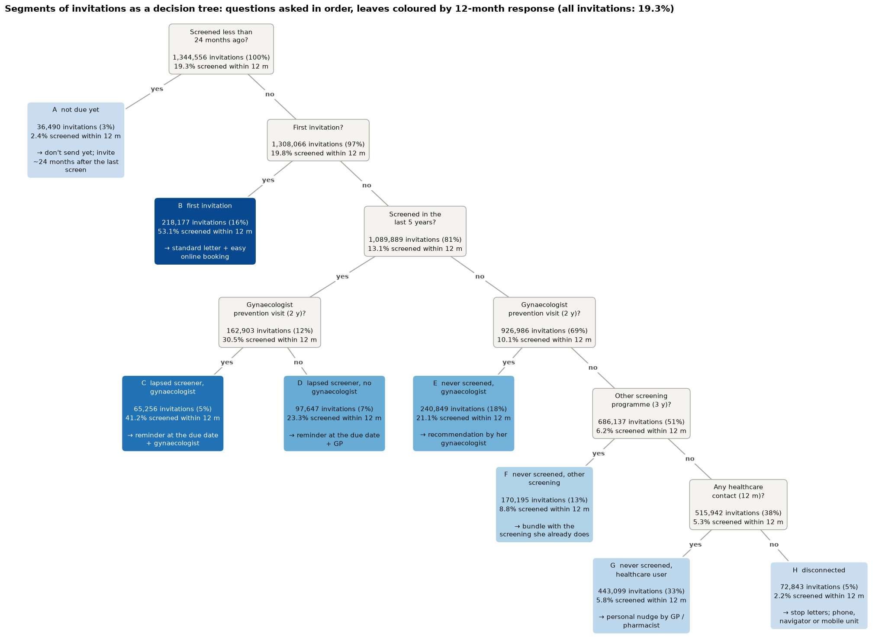
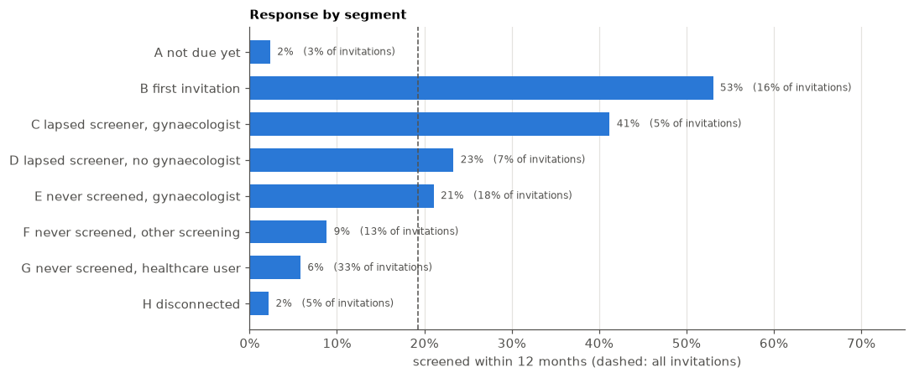
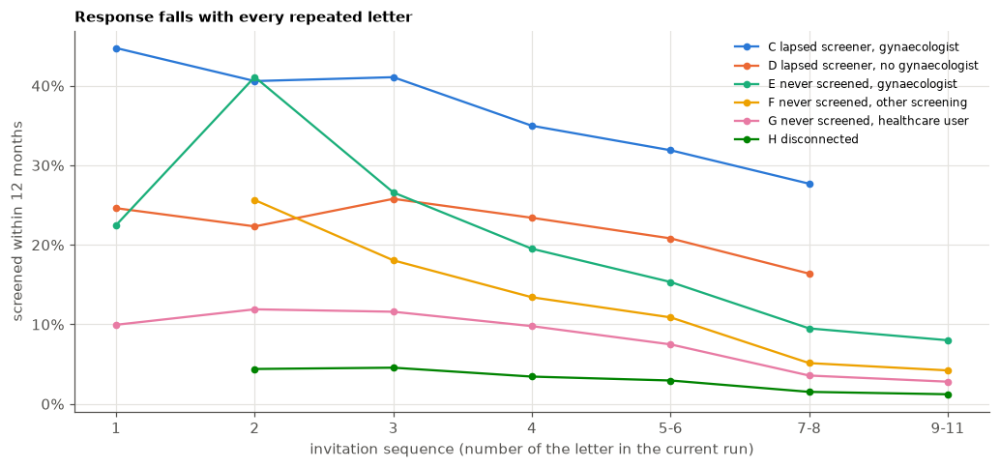
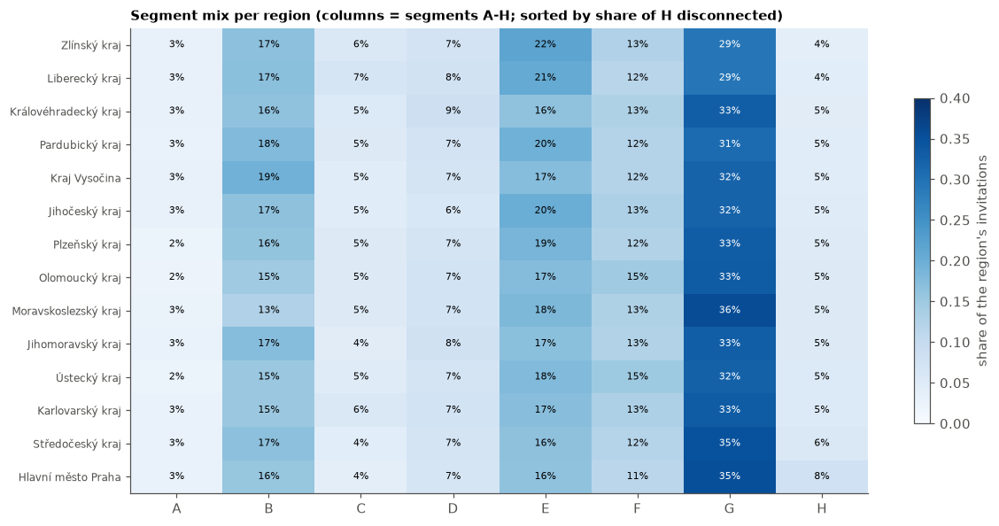

# Segments of invited women, for interventions

**Goal.** Split the invitations into a few groups that are (1) easy to explain, (2) assigned by simple rules on
information known when the invitation is sent, never on the outcome, and (3) different in *why* the woman does
not respond, so each group can get its own intervention.

**Rules** (`segments.py`, applied in order, the first match wins). They follow the three questions that drive response
in all models (`training/classifiers/explain`): *is she due*, *did she screen before*, *is she connected to
preventive care*.


```python
import sys
from pathlib import Path

import matplotlib.pyplot as plt
import numpy as np
import pandas as pd
from IPython.display import display
from sklearn.metrics import roc_auc_score


sys.path.insert(0, ".")
from segments import COLUMNS, SEGMENTS, assign


DATA = Path("../data")
LABELS = ["SCREENING_3M_FLAG", "SCREENING_6M_FLAG", "SCREENING_12M_FLAG"]
extra = ["PERSON_ID", "INVITATION_DATE", "INVITATION_YEAR", "AGE_BAND", "KRAJ", "INVITATION_SEQUENCE",
         "PRIOR_SCREEN_COUNT_5Y", "GYN_REGISTERED_FLAG", "GP_REGISTERED", "GP_PREVENTION_24M_CNT",
         "DENTAL_PREVENTION_24M_CNT", "AGE_BAND_MEAN"]
df = pd.read_csv(DATA / "Rakhaton2026_prepared.csv", usecols=COLUMNS + LABELS + extra, dtype={"PERSON_ID": str})
df["SEGMENT"] = assign(df)
names = list(SEGMENTS)

INK2, GRID = "#52514e", "#e4e3df"
BLUE, RED = "#2a78d6", "#e34948"
plt.rcParams.update({
    "figure.dpi": 110, "axes.spines.top": False, "axes.spines.right": False,
    "axes.edgecolor": INK2, "axes.labelcolor": INK2, "xtick.color": INK2, "ytick.color": INK2,
    "axes.grid": True, "grid.color": GRID, "grid.linewidth": 0.8, "axes.axisbelow": True,
    "axes.titleweight": "bold", "axes.titlesize": 10, "axes.titlelocation": "left", "legend.frameon": False,
})
pd.set_option("display.max_colwidth", None)
pd.DataFrame({"segment": names, "rule": list(SEGMENTS.values())}).style.hide(axis="index")
```


<style type="text/css">
</style>
<table id="T_981cd">
  <thead>
    <tr>
      <th id="T_981cd_level0_col0" class="col_heading level0 col0" >segment</th>
      <th id="T_981cd_level0_col1" class="col_heading level0 col1" >rule</th>
    </tr>
  </thead>
  <tbody>
    <tr>
      <td id="T_981cd_row0_col0" class="data row0 col0" >A not due yet</td>
      <td id="T_981cd_row0_col1" class="data row0 col1" >screened < 24 months before the invitation</td>
    </tr>
    <tr>
      <td id="T_981cd_row1_col0" class="data row1 col0" >B first invitation</td>
      <td id="T_981cd_row1_col1" class="data row1 col1" >first invitation of the woman</td>
    </tr>
    <tr>
      <td id="T_981cd_row2_col0" class="data row2 col0" >C lapsed screener, gynaecologist</td>
      <td id="T_981cd_row2_col1" class="data row2 col1" >screened before (>= 24 months ago), gynaecologist prevention visit in 2 years</td>
    </tr>
    <tr>
      <td id="T_981cd_row3_col0" class="data row3 col0" >D lapsed screener, no gynaecologist</td>
      <td id="T_981cd_row3_col1" class="data row3 col1" >screened before (>= 24 months ago), no gynaecologist prevention visit</td>
    </tr>
    <tr>
      <td id="T_981cd_row4_col0" class="data row4 col0" >E never screened, gynaecologist</td>
      <td id="T_981cd_row4_col1" class="data row4 col1" >repeat invitation, not screened in 5 years, gynaecologist prevention visit</td>
    </tr>
    <tr>
      <td id="T_981cd_row5_col0" class="data row5 col0" >F never screened, other screening</td>
      <td id="T_981cd_row5_col1" class="data row5 col1" >repeat, not screened, no gynaecologist visit, but other screening programme in 3 years</td>
    </tr>
    <tr>
      <td id="T_981cd_row6_col0" class="data row6 col0" >G never screened, healthcare user</td>
      <td id="T_981cd_row6_col1" class="data row6 col1" >repeat, not screened, no prevention, but some healthcare contact in 12 months</td>
    </tr>
    <tr>
      <td id="T_981cd_row7_col0" class="data row7 col0" >H disconnected</td>
      <td id="T_981cd_row7_col1" class="data row7 col1" >repeat, not screened, no prevention and no healthcare contact</td>
    </tr>
  </tbody>
</table>


### The rules as a decision tree

The same rules drawn as the decision tree they are: each grey box is one yes/no question, asked in order; each coloured leaf is a segment, with its size, 12-month response (darker = higher) and suggested intervention. Unlike a fitted tree, every split here was chosen by hand to have a meaning (see `tree_diagram.py`, which also checks that the drawing matches `assign()` exactly).


```python
from tree_diagram import draw_segment_tree


draw_segment_tree(df, Path("segment_tree.png"))
plt.show()
```


    

    


## 1. Size and response of each segment


```python
latest = df.sort_values("INVITATION_DATE").groupby("PERSON_ID").tail(1)  # each woman's most recent invitation
size = pd.DataFrame({
    "invitations": df.SEGMENT.value_counts(sort=False),
    "share of invitations": df.SEGMENT.value_counts(normalize=True, sort=False),
    "women (latest invitation)": latest.SEGMENT.value_counts(sort=False),
})
rates = df.groupby("SEGMENT", observed=False)[LABELS].mean().set_axis(["3M", "6M", "12M"], axis=1)
rates["fast share (3M / 12M)"] = rates["3M"] / rates["12M"]
summary = size.join(rates)
summary.loc["ALL"] = [len(df), 1.0, len(latest), *df[LABELS].mean(), df[LABELS[0]].mean() / df[LABELS[2]].mean()]
summary.style.format({"invitations": "{:,.0f}", "women (latest invitation)": "{:,.0f}",
                      "share of invitations": "{:.1%}", "3M": "{:.1%}", "6M": "{:.1%}", "12M": "{:.1%}",
                      "fast share (3M / 12M)": "{:.0%}"})
```


<style type="text/css">
</style>
<table id="T_dc297">
  <thead>
    <tr>
      <th class="blank level0" >&nbsp;</th>
      <th id="T_dc297_level0_col0" class="col_heading level0 col0" >invitations</th>
      <th id="T_dc297_level0_col1" class="col_heading level0 col1" >share of invitations</th>
      <th id="T_dc297_level0_col2" class="col_heading level0 col2" >women (latest invitation)</th>
      <th id="T_dc297_level0_col3" class="col_heading level0 col3" >3M</th>
      <th id="T_dc297_level0_col4" class="col_heading level0 col4" >6M</th>
      <th id="T_dc297_level0_col5" class="col_heading level0 col5" >12M</th>
      <th id="T_dc297_level0_col6" class="col_heading level0 col6" >fast share (3M / 12M)</th>
    </tr>
    <tr>
      <th class="index_name level0" >SEGMENT</th>
      <th class="blank col0" >&nbsp;</th>
      <th class="blank col1" >&nbsp;</th>
      <th class="blank col2" >&nbsp;</th>
      <th class="blank col3" >&nbsp;</th>
      <th class="blank col4" >&nbsp;</th>
      <th class="blank col5" >&nbsp;</th>
      <th class="blank col6" >&nbsp;</th>
    </tr>
  </thead>
  <tbody>
    <tr>
      <th id="T_dc297_level0_row0" class="row_heading level0 row0" >A not due yet</th>
      <td id="T_dc297_row0_col0" class="data row0 col0" >36,490</td>
      <td id="T_dc297_row0_col1" class="data row0 col1" >2.7%</td>
      <td id="T_dc297_row0_col2" class="data row0 col2" >33,350</td>
      <td id="T_dc297_row0_col3" class="data row0 col3" >1.4%</td>
      <td id="T_dc297_row0_col4" class="data row0 col4" >2.0%</td>
      <td id="T_dc297_row0_col5" class="data row0 col5" >2.4%</td>
      <td id="T_dc297_row0_col6" class="data row0 col6" >59%</td>
    </tr>
    <tr>
      <th id="T_dc297_level0_row1" class="row_heading level0 row1" >B first invitation</th>
      <td id="T_dc297_row1_col0" class="data row1 col0" >218,177</td>
      <td id="T_dc297_row1_col1" class="data row1 col1" >16.2%</td>
      <td id="T_dc297_row1_col2" class="data row1 col2" >126,397</td>
      <td id="T_dc297_row1_col3" class="data row1 col3" >22.2%</td>
      <td id="T_dc297_row1_col4" class="data row1 col4" >37.3%</td>
      <td id="T_dc297_row1_col5" class="data row1 col5" >53.1%</td>
      <td id="T_dc297_row1_col6" class="data row1 col6" >42%</td>
    </tr>
    <tr>
      <th id="T_dc297_level0_row2" class="row_heading level0 row2" >C lapsed screener, gynaecologist</th>
      <td id="T_dc297_row2_col0" class="data row2 col0" >65,256</td>
      <td id="T_dc297_row2_col1" class="data row2 col1" >4.9%</td>
      <td id="T_dc297_row2_col2" class="data row2 col2" >32,558</td>
      <td id="T_dc297_row2_col3" class="data row2 col3" >16.9%</td>
      <td id="T_dc297_row2_col4" class="data row2 col4" >28.0%</td>
      <td id="T_dc297_row2_col5" class="data row2 col5" >41.2%</td>
      <td id="T_dc297_row2_col6" class="data row2 col6" >41%</td>
    </tr>
    <tr>
      <th id="T_dc297_level0_row3" class="row_heading level0 row3" >D lapsed screener, no gynaecologist</th>
      <td id="T_dc297_row3_col0" class="data row3 col0" >97,647</td>
      <td id="T_dc297_row3_col1" class="data row3 col1" >7.3%</td>
      <td id="T_dc297_row3_col2" class="data row3 col2" >35,535</td>
      <td id="T_dc297_row3_col3" class="data row3 col3" >6.6%</td>
      <td id="T_dc297_row3_col4" class="data row3 col4" >13.6%</td>
      <td id="T_dc297_row3_col5" class="data row3 col5" >23.3%</td>
      <td id="T_dc297_row3_col6" class="data row3 col6" >28%</td>
    </tr>
    <tr>
      <th id="T_dc297_level0_row4" class="row_heading level0 row4" >E never screened, gynaecologist</th>
      <td id="T_dc297_row4_col0" class="data row4 col0" >240,849</td>
      <td id="T_dc297_row4_col1" class="data row4 col1" >17.9%</td>
      <td id="T_dc297_row4_col2" class="data row4 col2" >89,757</td>
      <td id="T_dc297_row4_col3" class="data row4 col3" >7.9%</td>
      <td id="T_dc297_row4_col4" class="data row4 col4" >13.5%</td>
      <td id="T_dc297_row4_col5" class="data row4 col5" >21.1%</td>
      <td id="T_dc297_row4_col6" class="data row4 col6" >38%</td>
    </tr>
    <tr>
      <th id="T_dc297_level0_row5" class="row_heading level0 row5" >F never screened, other screening</th>
      <td id="T_dc297_row5_col0" class="data row5 col0" >170,195</td>
      <td id="T_dc297_row5_col1" class="data row5 col1" >12.7%</td>
      <td id="T_dc297_row5_col2" class="data row5 col2" >51,710</td>
      <td id="T_dc297_row5_col3" class="data row5 col3" >2.4%</td>
      <td id="T_dc297_row5_col4" class="data row5 col4" >4.9%</td>
      <td id="T_dc297_row5_col5" class="data row5 col5" >8.8%</td>
      <td id="T_dc297_row5_col6" class="data row5 col6" >28%</td>
    </tr>
    <tr>
      <th id="T_dc297_level0_row6" class="row_heading level0 row6" >G never screened, healthcare user</th>
      <td id="T_dc297_row6_col0" class="data row6 col0" >443,099</td>
      <td id="T_dc297_row6_col1" class="data row6 col1" >33.0%</td>
      <td id="T_dc297_row6_col2" class="data row6 col2" >118,360</td>
      <td id="T_dc297_row6_col3" class="data row6 col3" >1.3%</td>
      <td id="T_dc297_row6_col4" class="data row6 col4" >3.0%</td>
      <td id="T_dc297_row6_col5" class="data row6 col5" >5.8%</td>
      <td id="T_dc297_row6_col6" class="data row6 col6" >23%</td>
    </tr>
    <tr>
      <th id="T_dc297_level0_row7" class="row_heading level0 row7" >H disconnected</th>
      <td id="T_dc297_row7_col0" class="data row7 col0" >72,843</td>
      <td id="T_dc297_row7_col1" class="data row7 col1" >5.4%</td>
      <td id="T_dc297_row7_col2" class="data row7 col2" >20,860</td>
      <td id="T_dc297_row7_col3" class="data row7 col3" >0.4%</td>
      <td id="T_dc297_row7_col4" class="data row7 col4" >1.0%</td>
      <td id="T_dc297_row7_col5" class="data row7 col5" >2.2%</td>
      <td id="T_dc297_row7_col6" class="data row7 col6" >17%</td>
    </tr>
    <tr>
      <th id="T_dc297_level0_row8" class="row_heading level0 row8" >ALL</th>
      <td id="T_dc297_row8_col0" class="data row8 col0" >1,344,556</td>
      <td id="T_dc297_row8_col1" class="data row8 col1" >100.0%</td>
      <td id="T_dc297_row8_col2" class="data row8 col2" >508,527</td>
      <td id="T_dc297_row8_col3" class="data row8 col3" >7.1%</td>
      <td id="T_dc297_row8_col4" class="data row8 col4" >12.5%</td>
      <td id="T_dc297_row8_col5" class="data row8 col5" >19.3%</td>
      <td id="T_dc297_row8_col6" class="data row8 col6" >37%</td>
    </tr>
  </tbody>
</table>


```python
s = summary.drop("ALL")
fig, ax = plt.subplots(figsize=(10, 4.2))
y = np.arange(len(s))[::-1]
ax.barh(y, s["12M"], color=BLUE, height=0.65)
ax.axvline(summary.loc["ALL", "12M"], color=INK2, lw=1, ls="--")
for yi, (rate, share) in zip(y, zip(s["12M"], s["share of invitations"], strict=True), strict=True):
    ax.text(rate + 0.008, yi, f"{rate:.0%}   ({share:.0%} of invitations)", va="center", fontsize=8, color=INK2)
ax.set_yticks(y, s.index)
ax.grid(axis="y", visible=False)
ax.set_xlim(0, 0.75)
ax.xaxis.set_major_formatter(plt.FuncFormatter(lambda v, _: f"{v:.0%}"))
ax.set_xlabel("screened within 12 months (dashed: all invitations)")
ax.set_title("Response by segment")
plt.tight_layout(); plt.show()
```


    

    


## 2. Who is in each segment

Profile at the invitation date: share of women aged 50+, average invitation sequence, registrations and
prevention habits. Percentages are shares of the segment's invitations.


```python
g = df.groupby("SEGMENT", observed=False)
profile = pd.DataFrame({
    "aged 50+": g.AGE_BAND_MEAN.apply(lambda a: (a >= 50).mean()),
    "mean invitation sequence": g.INVITATION_SEQUENCE.mean(),
    "invitation 7+": g.INVITATION_SEQUENCE.apply(lambda s: (s >= 7).mean()),
    "GP registered": g.GP_REGISTERED.mean(),
    "gynaecologist registered": g.GYN_REGISTERED_FLAG.mean(),
    "GP prevention visit": g.GP_PREVENTION_24M_CNT.apply(lambda s: (s > 0).mean()),
    "dental prevention": g.DENTAL_PREVENTION_24M_CNT.apply(lambda s: (s > 0).mean()),
    "median healthcare contacts (12m)": g.HEALTHCARE_CONTACT_12M_CNT.median(),
})
pct = dict.fromkeys(profile.columns, "{:.0%}")
profile.style.format(pct | {"mean invitation sequence": "{:.1f}", "median healthcare contacts (12m)": "{:.0f}"})
```


<style type="text/css">
</style>
<table id="T_439f2">
  <thead>
    <tr>
      <th class="blank level0" >&nbsp;</th>
      <th id="T_439f2_level0_col0" class="col_heading level0 col0" >aged 50+</th>
      <th id="T_439f2_level0_col1" class="col_heading level0 col1" >mean invitation sequence</th>
      <th id="T_439f2_level0_col2" class="col_heading level0 col2" >invitation 7+</th>
      <th id="T_439f2_level0_col3" class="col_heading level0 col3" >GP registered</th>
      <th id="T_439f2_level0_col4" class="col_heading level0 col4" >gynaecologist registered</th>
      <th id="T_439f2_level0_col5" class="col_heading level0 col5" >GP prevention visit</th>
      <th id="T_439f2_level0_col6" class="col_heading level0 col6" >dental prevention</th>
      <th id="T_439f2_level0_col7" class="col_heading level0 col7" >median healthcare contacts (12m)</th>
    </tr>
    <tr>
      <th class="index_name level0" >SEGMENT</th>
      <th class="blank col0" >&nbsp;</th>
      <th class="blank col1" >&nbsp;</th>
      <th class="blank col2" >&nbsp;</th>
      <th class="blank col3" >&nbsp;</th>
      <th class="blank col4" >&nbsp;</th>
      <th class="blank col5" >&nbsp;</th>
      <th class="blank col6" >&nbsp;</th>
      <th class="blank col7" >&nbsp;</th>
    </tr>
  </thead>
  <tbody>
    <tr>
      <th id="T_439f2_level0_row0" class="row_heading level0 row0" >A not due yet</th>
      <td id="T_439f2_row0_col0" class="data row0 col0" >54%</td>
      <td id="T_439f2_row0_col1" class="data row0 col1" >2.6</td>
      <td id="T_439f2_row0_col2" class="data row0 col2" >8%</td>
      <td id="T_439f2_row0_col3" class="data row0 col3" >100%</td>
      <td id="T_439f2_row0_col4" class="data row0 col4" >94%</td>
      <td id="T_439f2_row0_col5" class="data row0 col5" >57%</td>
      <td id="T_439f2_row0_col6" class="data row0 col6" >74%</td>
      <td id="T_439f2_row0_col7" class="data row0 col7" >19</td>
    </tr>
    <tr>
      <th id="T_439f2_level0_row1" class="row_heading level0 row1" >B first invitation</th>
      <td id="T_439f2_row1_col0" class="data row1 col0" >21%</td>
      <td id="T_439f2_row1_col1" class="data row1 col1" >1.0</td>
      <td id="T_439f2_row1_col2" class="data row1 col2" >0%</td>
      <td id="T_439f2_row1_col3" class="data row1 col3" >99%</td>
      <td id="T_439f2_row1_col4" class="data row1 col4" >93%</td>
      <td id="T_439f2_row1_col5" class="data row1 col5" >47%</td>
      <td id="T_439f2_row1_col6" class="data row1 col6" >74%</td>
      <td id="T_439f2_row1_col7" class="data row1 col7" >14</td>
    </tr>
    <tr>
      <th id="T_439f2_level0_row2" class="row_heading level0 row2" >C lapsed screener, gynaecologist</th>
      <td id="T_439f2_row2_col0" class="data row2 col0" >86%</td>
      <td id="T_439f2_row2_col1" class="data row2 col1" >2.1</td>
      <td id="T_439f2_row2_col2" class="data row2 col2" >1%</td>
      <td id="T_439f2_row2_col3" class="data row2 col3" >99%</td>
      <td id="T_439f2_row2_col4" class="data row2 col4" >97%</td>
      <td id="T_439f2_row2_col5" class="data row2 col5" >51%</td>
      <td id="T_439f2_row2_col6" class="data row2 col6" >72%</td>
      <td id="T_439f2_row2_col7" class="data row2 col7" >17</td>
    </tr>
    <tr>
      <th id="T_439f2_level0_row3" class="row_heading level0 row3" >D lapsed screener, no gynaecologist</th>
      <td id="T_439f2_row3_col0" class="data row3 col0" >95%</td>
      <td id="T_439f2_row3_col1" class="data row3 col1" >2.0</td>
      <td id="T_439f2_row3_col2" class="data row3 col2" >1%</td>
      <td id="T_439f2_row3_col3" class="data row3 col3" >99%</td>
      <td id="T_439f2_row3_col4" class="data row3 col4" >84%</td>
      <td id="T_439f2_row3_col5" class="data row3 col5" >44%</td>
      <td id="T_439f2_row3_col6" class="data row3 col6" >55%</td>
      <td id="T_439f2_row3_col7" class="data row3 col7" >13</td>
    </tr>
    <tr>
      <th id="T_439f2_level0_row4" class="row_heading level0 row4" >E never screened, gynaecologist</th>
      <td id="T_439f2_row4_col0" class="data row4 col0" >55%</td>
      <td id="T_439f2_row4_col1" class="data row4 col1" >5.0</td>
      <td id="T_439f2_row4_col2" class="data row4 col2" >30%</td>
      <td id="T_439f2_row4_col3" class="data row4 col3" >99%</td>
      <td id="T_439f2_row4_col4" class="data row4 col4" >96%</td>
      <td id="T_439f2_row4_col5" class="data row4 col5" >48%</td>
      <td id="T_439f2_row4_col6" class="data row4 col6" >69%</td>
      <td id="T_439f2_row4_col7" class="data row4 col7" >15</td>
    </tr>
    <tr>
      <th id="T_439f2_level0_row5" class="row_heading level0 row5" >F never screened, other screening</th>
      <td id="T_439f2_row5_col0" class="data row5 col0" >89%</td>
      <td id="T_439f2_row5_col1" class="data row5 col1" >6.8</td>
      <td id="T_439f2_row5_col2" class="data row5 col2" >60%</td>
      <td id="T_439f2_row5_col3" class="data row5 col3" >99%</td>
      <td id="T_439f2_row5_col4" class="data row5 col4" >71%</td>
      <td id="T_439f2_row5_col5" class="data row5 col5" >64%</td>
      <td id="T_439f2_row5_col6" class="data row5 col6" >49%</td>
      <td id="T_439f2_row5_col7" class="data row5 col7" >11</td>
    </tr>
    <tr>
      <th id="T_439f2_level0_row6" class="row_heading level0 row6" >G never screened, healthcare user</th>
      <td id="T_439f2_row6_col0" class="data row6 col0" >81%</td>
      <td id="T_439f2_row6_col1" class="data row6 col1" >6.7</td>
      <td id="T_439f2_row6_col2" class="data row6 col2" >59%</td>
      <td id="T_439f2_row6_col3" class="data row6 col3" >98%</td>
      <td id="T_439f2_row6_col4" class="data row6 col4" >64%</td>
      <td id="T_439f2_row6_col5" class="data row6 col5" >31%</td>
      <td id="T_439f2_row6_col6" class="data row6 col6" >45%</td>
      <td id="T_439f2_row6_col7" class="data row6 col7" >9</td>
    </tr>
    <tr>
      <th id="T_439f2_level0_row7" class="row_heading level0 row7" >H disconnected</th>
      <td id="T_439f2_row7_col0" class="data row7 col0" >81%</td>
      <td id="T_439f2_row7_col1" class="data row7 col1" >7.0</td>
      <td id="T_439f2_row7_col2" class="data row7 col2" >63%</td>
      <td id="T_439f2_row7_col3" class="data row7 col3" >91%</td>
      <td id="T_439f2_row7_col4" class="data row7 col4" >50%</td>
      <td id="T_439f2_row7_col5" class="data row7 col5" >9%</td>
      <td id="T_439f2_row7_col6" class="data row7 col6" >8%</td>
      <td id="T_439f2_row7_col7" class="data row7 col7" >0</td>
    </tr>
  </tbody>
</table>


## 3. Repeated letters: when does another letter stop working?

12-month response by invitation sequence within each segment. Where the line is flat near zero, sending the same
letter again achieves little, so that is where a different channel should take over.


```python
seq = pd.cut(df.INVITATION_SEQUENCE, [0, 1, 2, 3, 4, 6, 8, 11], labels=["1", "2", "3", "4", "5-6", "7-8", "9-11"])
decay = df.groupby(["SEGMENT", seq], observed=False).SCREENING_12M_FLAG.agg(["mean", "size"]).reset_index()
decay = decay[decay["size"] >= 500]
show = ["C lapsed screener, gynaecologist", "D lapsed screener, no gynaecologist", "E never screened, gynaecologist",
        "F never screened, other screening", "G never screened, healthcare user", "H disconnected"]
palette = ["#2a78d6", "#eb6834", "#1baf7a", "#eda100", "#e87ba4", "#008300"]
fig, ax = plt.subplots(figsize=(9.5, 4.5))
for seg, color in zip(show, palette, strict=True):
    t = decay[seg == decay.SEGMENT]
    ax.plot(t.INVITATION_SEQUENCE.astype(str), t["mean"], marker="o", ms=4, color=color, label=seg)
ax.yaxis.set_major_formatter(plt.FuncFormatter(lambda v, _: f"{v:.0%}"))
ax.set_xlabel("invitation sequence (number of the letter in the current run)")
ax.set_ylabel("screened within 12 months")
ax.legend(fontsize=8, loc="upper right")
ax.set_title("Response falls with every repeated letter")
plt.tight_layout(); plt.show()
```


    

    


## 4. Are the segments stable? 12-month response by year


```python
by_year = df.pivot_table(index="SEGMENT", columns="INVITATION_YEAR", values="SCREENING_12M_FLAG", aggfunc="mean",
                         observed=False)
share_year = pd.crosstab(df.SEGMENT, df.INVITATION_YEAR, normalize="columns")
display(by_year.style.format("{:.1%}").set_caption("12M response"))
display(share_year.style.format("{:.1%}").set_caption("share of the year's invitations"))
```


<style type="text/css">
</style>
<table id="T_4f744">
  <caption>12M response</caption>
  <thead>
    <tr>
      <th class="index_name level0" >INVITATION_YEAR</th>
      <th id="T_4f744_level0_col0" class="col_heading level0 col0" >2020</th>
      <th id="T_4f744_level0_col1" class="col_heading level0 col1" >2021</th>
      <th id="T_4f744_level0_col2" class="col_heading level0 col2" >2022</th>
      <th id="T_4f744_level0_col3" class="col_heading level0 col3" >2023</th>
      <th id="T_4f744_level0_col4" class="col_heading level0 col4" >2024</th>
    </tr>
    <tr>
      <th class="index_name level0" >SEGMENT</th>
      <th class="blank col0" >&nbsp;</th>
      <th class="blank col1" >&nbsp;</th>
      <th class="blank col2" >&nbsp;</th>
      <th class="blank col3" >&nbsp;</th>
      <th class="blank col4" >&nbsp;</th>
    </tr>
  </thead>
  <tbody>
    <tr>
      <th id="T_4f744_level0_row0" class="row_heading level0 row0" >A not due yet</th>
      <td id="T_4f744_row0_col0" class="data row0 col0" >2.2%</td>
      <td id="T_4f744_row0_col1" class="data row0 col1" >2.3%</td>
      <td id="T_4f744_row0_col2" class="data row0 col2" >2.2%</td>
      <td id="T_4f744_row0_col3" class="data row0 col3" >2.6%</td>
      <td id="T_4f744_row0_col4" class="data row0 col4" >2.4%</td>
    </tr>
    <tr>
      <th id="T_4f744_level0_row1" class="row_heading level0 row1" >B first invitation</th>
      <td id="T_4f744_row1_col0" class="data row1 col0" >48.1%</td>
      <td id="T_4f744_row1_col1" class="data row1 col1" >53.5%</td>
      <td id="T_4f744_row1_col2" class="data row1 col2" >54.4%</td>
      <td id="T_4f744_row1_col3" class="data row1 col3" >54.8%</td>
      <td id="T_4f744_row1_col4" class="data row1 col4" >55.1%</td>
    </tr>
    <tr>
      <th id="T_4f744_level0_row2" class="row_heading level0 row2" >C lapsed screener, gynaecologist</th>
      <td id="T_4f744_row2_col0" class="data row2 col0" >36.2%</td>
      <td id="T_4f744_row2_col1" class="data row2 col1" >41.0%</td>
      <td id="T_4f744_row2_col2" class="data row2 col2" >42.8%</td>
      <td id="T_4f744_row2_col3" class="data row2 col3" >42.5%</td>
      <td id="T_4f744_row2_col4" class="data row2 col4" >43.3%</td>
    </tr>
    <tr>
      <th id="T_4f744_level0_row3" class="row_heading level0 row3" >D lapsed screener, no gynaecologist</th>
      <td id="T_4f744_row3_col0" class="data row3 col0" >19.6%</td>
      <td id="T_4f744_row3_col1" class="data row3 col1" >23.6%</td>
      <td id="T_4f744_row3_col2" class="data row3 col2" >24.5%</td>
      <td id="T_4f744_row3_col3" class="data row3 col3" >24.4%</td>
      <td id="T_4f744_row3_col4" class="data row3 col4" >24.8%</td>
    </tr>
    <tr>
      <th id="T_4f744_level0_row4" class="row_heading level0 row4" >E never screened, gynaecologist</th>
      <td id="T_4f744_row4_col0" class="data row4 col0" >20.2%</td>
      <td id="T_4f744_row4_col1" class="data row4 col1" >21.9%</td>
      <td id="T_4f744_row4_col2" class="data row4 col2" >21.5%</td>
      <td id="T_4f744_row4_col3" class="data row4 col3" >21.3%</td>
      <td id="T_4f744_row4_col4" class="data row4 col4" >20.5%</td>
    </tr>
    <tr>
      <th id="T_4f744_level0_row5" class="row_heading level0 row5" >F never screened, other screening</th>
      <td id="T_4f744_row5_col0" class="data row5 col0" >7.5%</td>
      <td id="T_4f744_row5_col1" class="data row5 col1" >8.9%</td>
      <td id="T_4f744_row5_col2" class="data row5 col2" >9.2%</td>
      <td id="T_4f744_row5_col3" class="data row5 col3" >9.3%</td>
      <td id="T_4f744_row5_col4" class="data row5 col4" >9.3%</td>
    </tr>
    <tr>
      <th id="T_4f744_level0_row6" class="row_heading level0 row6" >G never screened, healthcare user</th>
      <td id="T_4f744_row6_col0" class="data row6 col0" >5.1%</td>
      <td id="T_4f744_row6_col1" class="data row6 col1" >5.6%</td>
      <td id="T_4f744_row6_col2" class="data row6 col2" >5.8%</td>
      <td id="T_4f744_row6_col3" class="data row6 col3" >6.5%</td>
      <td id="T_4f744_row6_col4" class="data row6 col4" >6.1%</td>
    </tr>
    <tr>
      <th id="T_4f744_level0_row7" class="row_heading level0 row7" >H disconnected</th>
      <td id="T_4f744_row7_col0" class="data row7 col0" >2.0%</td>
      <td id="T_4f744_row7_col1" class="data row7 col1" >1.8%</td>
      <td id="T_4f744_row7_col2" class="data row7 col2" >1.3%</td>
      <td id="T_4f744_row7_col3" class="data row7 col3" >2.7%</td>
      <td id="T_4f744_row7_col4" class="data row7 col4" >2.6%</td>
    </tr>
  </tbody>
</table>


<style type="text/css">
</style>
<table id="T_862e1">
  <caption>share of the year's invitations</caption>
  <thead>
    <tr>
      <th class="index_name level0" >INVITATION_YEAR</th>
      <th id="T_862e1_level0_col0" class="col_heading level0 col0" >2020</th>
      <th id="T_862e1_level0_col1" class="col_heading level0 col1" >2021</th>
      <th id="T_862e1_level0_col2" class="col_heading level0 col2" >2022</th>
      <th id="T_862e1_level0_col3" class="col_heading level0 col3" >2023</th>
      <th id="T_862e1_level0_col4" class="col_heading level0 col4" >2024</th>
    </tr>
    <tr>
      <th class="index_name level0" >SEGMENT</th>
      <th class="blank col0" >&nbsp;</th>
      <th class="blank col1" >&nbsp;</th>
      <th class="blank col2" >&nbsp;</th>
      <th class="blank col3" >&nbsp;</th>
      <th class="blank col4" >&nbsp;</th>
    </tr>
  </thead>
  <tbody>
    <tr>
      <th id="T_862e1_level0_row0" class="row_heading level0 row0" >A not due yet</th>
      <td id="T_862e1_row0_col0" class="data row0 col0" >2.3%</td>
      <td id="T_862e1_row0_col1" class="data row0 col1" >3.0%</td>
      <td id="T_862e1_row0_col2" class="data row0 col2" >2.7%</td>
      <td id="T_862e1_row0_col3" class="data row0 col3" >2.6%</td>
      <td id="T_862e1_row0_col4" class="data row0 col4" >3.0%</td>
    </tr>
    <tr>
      <th id="T_862e1_level0_row1" class="row_heading level0 row1" >B first invitation</th>
      <td id="T_862e1_row1_col0" class="data row1 col0" >17.7%</td>
      <td id="T_862e1_row1_col1" class="data row1 col1" >16.9%</td>
      <td id="T_862e1_row1_col2" class="data row1 col2" >16.3%</td>
      <td id="T_862e1_row1_col3" class="data row1 col3" >15.5%</td>
      <td id="T_862e1_row1_col4" class="data row1 col4" >14.6%</td>
    </tr>
    <tr>
      <th id="T_862e1_level0_row2" class="row_heading level0 row2" >C lapsed screener, gynaecologist</th>
      <td id="T_862e1_row2_col0" class="data row2 col0" >4.7%</td>
      <td id="T_862e1_row2_col1" class="data row2 col1" >4.8%</td>
      <td id="T_862e1_row2_col2" class="data row2 col2" >4.9%</td>
      <td id="T_862e1_row2_col3" class="data row2 col3" >5.0%</td>
      <td id="T_862e1_row2_col4" class="data row2 col4" >5.0%</td>
    </tr>
    <tr>
      <th id="T_862e1_level0_row3" class="row_heading level0 row3" >D lapsed screener, no gynaecologist</th>
      <td id="T_862e1_row3_col0" class="data row3 col0" >7.4%</td>
      <td id="T_862e1_row3_col1" class="data row3 col1" >7.8%</td>
      <td id="T_862e1_row3_col2" class="data row3 col2" >7.8%</td>
      <td id="T_862e1_row3_col3" class="data row3 col3" >7.1%</td>
      <td id="T_862e1_row3_col4" class="data row3 col4" >6.1%</td>
    </tr>
    <tr>
      <th id="T_862e1_level0_row4" class="row_heading level0 row4" >E never screened, gynaecologist</th>
      <td id="T_862e1_row4_col0" class="data row4 col0" >16.5%</td>
      <td id="T_862e1_row4_col1" class="data row4 col1" >16.9%</td>
      <td id="T_862e1_row4_col2" class="data row4 col2" >17.5%</td>
      <td id="T_862e1_row4_col3" class="data row4 col3" >18.9%</td>
      <td id="T_862e1_row4_col4" class="data row4 col4" >19.9%</td>
    </tr>
    <tr>
      <th id="T_862e1_level0_row5" class="row_heading level0 row5" >F never screened, other screening</th>
      <td id="T_862e1_row5_col0" class="data row5 col0" >13.1%</td>
      <td id="T_862e1_row5_col1" class="data row5 col1" >12.6%</td>
      <td id="T_862e1_row5_col2" class="data row5 col2" >12.1%</td>
      <td id="T_862e1_row5_col3" class="data row5 col3" >12.3%</td>
      <td id="T_862e1_row5_col4" class="data row5 col4" >13.2%</td>
    </tr>
    <tr>
      <th id="T_862e1_level0_row6" class="row_heading level0 row6" >G never screened, healthcare user</th>
      <td id="T_862e1_row6_col0" class="data row6 col0" >31.6%</td>
      <td id="T_862e1_row6_col1" class="data row6 col1" >33.7%</td>
      <td id="T_862e1_row6_col2" class="data row6 col2" >35.3%</td>
      <td id="T_862e1_row6_col3" class="data row6 col3" >32.4%</td>
      <td id="T_862e1_row6_col4" class="data row6 col4" >31.6%</td>
    </tr>
    <tr>
      <th id="T_862e1_level0_row7" class="row_heading level0 row7" >H disconnected</th>
      <td id="T_862e1_row7_col0" class="data row7 col0" >6.7%</td>
      <td id="T_862e1_row7_col1" class="data row7 col1" >4.3%</td>
      <td id="T_862e1_row7_col2" class="data row7 col2" >3.4%</td>
      <td id="T_862e1_row7_col3" class="data row7 col3" >6.3%</td>
      <td id="T_862e1_row7_col4" class="data row7 col4" >6.6%</td>
    </tr>
  </tbody>
</table>


## 5. Where are they? Segment mix by region (kraj)


```python
mix = pd.crosstab(df.KRAJ, df.SEGMENT, normalize="index")
mix = mix.loc[mix["H disconnected"].sort_values().index]
fig, ax = plt.subplots(figsize=(11, 5.5))
im = ax.imshow(mix.to_numpy(), cmap="Blues", vmin=0, vmax=0.4, aspect="auto")
ax.set_xticks(range(mix.shape[1]), [c.split(" ", 1)[0] for c in mix.columns])
ax.set_yticks(range(mix.shape[0]), mix.index, fontsize=8)
ax.grid(False)
for i in range(mix.shape[0]):
    for j in range(mix.shape[1]):
        ax.text(j, i, f"{mix.iat[i, j]:.0%}", ha="center", va="center", fontsize=7,
                color="white" if mix.iat[i, j] > 0.28 else "black")
fig.colorbar(im, ax=ax, shrink=0.7, label="share of the region's invitations")
ax.set_title("Segment mix per region (columns = segments A-H; sorted by share of H disconnected)")
plt.tight_layout(); plt.show()
```


    

    


## 6. How much of the predictive signal do 8 rules capture?

Score every test invitation with its segment's response rate from the train split, and compare its ROC AUC with
the best model's (gradient boosting, 0.841).


```python
splits = {n: pd.read_csv(DATA / "splits" / f"{n}.csv", usecols=COLUMNS + LABELS) for n in ["train", "test"]}
for d in splits.values():
    d["SEGMENT"] = assign(d)
rows = []
for label in LABELS:
    rate = splits["train"].groupby("SEGMENT", observed=False)[label].mean()
    score = splits["test"].SEGMENT.map(rate).astype(float)
    rows.append({"label": label, "segments (8 rules)": roc_auc_score(splits["test"][label], score)})
pd.DataFrame(rows).assign(**{"gradient boosting (all features)": [0.841, 0.839, 0.841]}).set_index("label")\
    .style.format("{:.3f}")
```


<style type="text/css">
</style>
<table id="T_5dc2e">
  <thead>
    <tr>
      <th class="blank level0" >&nbsp;</th>
      <th id="T_5dc2e_level0_col0" class="col_heading level0 col0" >segments (8 rules)</th>
      <th id="T_5dc2e_level0_col1" class="col_heading level0 col1" >gradient boosting (all features)</th>
    </tr>
    <tr>
      <th class="index_name level0" >label</th>
      <th class="blank col0" >&nbsp;</th>
      <th class="blank col1" >&nbsp;</th>
    </tr>
  </thead>
  <tbody>
    <tr>
      <th id="T_5dc2e_level0_row0" class="row_heading level0 row0" >SCREENING_3M_FLAG</th>
      <td id="T_5dc2e_row0_col0" class="data row0 col0" >0.795</td>
      <td id="T_5dc2e_row0_col1" class="data row0 col1" >0.841</td>
    </tr>
    <tr>
      <th id="T_5dc2e_level0_row1" class="row_heading level0 row1" >SCREENING_6M_FLAG</th>
      <td id="T_5dc2e_row1_col0" class="data row1 col0" >0.792</td>
      <td id="T_5dc2e_row1_col1" class="data row1 col1" >0.839</td>
    </tr>
    <tr>
      <th id="T_5dc2e_level0_row2" class="row_heading level0 row2" >SCREENING_12M_FLAG</th>
      <td id="T_5dc2e_row2_col0" class="data row2 col0" >0.793</td>
      <td id="T_5dc2e_row2_col1" class="data row2 col1" >0.841</td>
    </tr>
  </tbody>
</table>


## 7. Suggested interventions

Each segment has a different likely reason for not responding, and so a different channel that could reach it. The
interventions below are **hypotheses derived from the data**: the data shows *who* responds, not *what would
change* their behaviour. Each one should be tested with a randomized comparison inside its segment (part of the
women get the intervention, the rest the standard letter). Only that measures the real gain (uplift); see tasks 3–4.

| segment | invitations | 12M response | likely reason | suggested intervention |
|---|---|---|---|---|
| **A not due yet** | 2.7% | 2% | screened in the last few months; the letter comes too early | **Do not send** (or postpone to ~24 months after the last screen). Fixes a timing error and saves letters. |
| **B first invitation** | 16% | 53% | new to the programme, motivated | Keep the standard letter, and make booking easy (online / pre-booked slot). Highest yield per letter. |
| **C lapsed screener, gynaecologist** | 5% | 41% | regular screener who is overdue | **Timely reminder** at ~24–30 months (SMS / e-mail), and a reminder from her gynaecologist. |
| **D lapsed screener, no gynaecologist** | 7% | 23% | screened before, 95% aged 50+, weaker contact with care | Reminder at the due date plus **GP involvement** (GP-signed letter, mention at the next visit). |
| **E never screened, gynaecologist** | 18% | 21% | sees a gynaecologist preventively (96% registered), but no mammography | **Gynaecologist recommendation / referral** at the preventive visit. Largest reachable group: 241k invitations, about 90k women. Switch to this channel after ~3 ignored letters (response falls from 41% at the 2nd letter to 9% by the 7th). |
| **F never screened, other screening** | 13% | 9% | takes part in other screening programmes (64% GP prevention) | **Bundle** with the screening she already does: a joint invitation or a mention by the GP at the other screening. |
| **G never screened, healthcare user** | 33% | 6% | uses healthcare (median 9 contacts a year) but no prevention | **GP / pharmacist nudge**: personal recommendation at a routine visit; message aimed at women who have never screened. Largest segment (443k invitations, about 118k women). |
| **H disconnected** | 5% | 2% | no healthcare contact in a year; only 9% GP prevention and 8% dental | Letters barely work (2%, 0.4% within 3 months). **Stop repeating the letter**; test a different channel: phone call, patient navigator / community outreach, mobile screening unit. |

**Across segments**
- **Repeated letters lose effect.** In every never-screened segment, response falls with each repeated letter. After
  the 3rd–4th letter, switching channel is more promising than another letter.
- **Where to spend effort.** Segments B and C respond well already. The largest *volume* of non-response sits in E
  and G (51% of invitations together). E has an existing channel (the gynaecologist), which makes it the most
  promising target for a first pilot.
- **Regions** have a similar segment mix. Prague has the most disconnected women (8%), and Moravskoslezský the most
  healthcare users without prevention (36%) and the fewest first invitations (13%), which fits its low overall
  response.
- The 8 rules capture most of the signal: ranking invitations by segment reaches ROC AUC 0.79 (best model 0.84). The
  segments are simple enough to use in practice without a model, and stable across 2021–2024.
