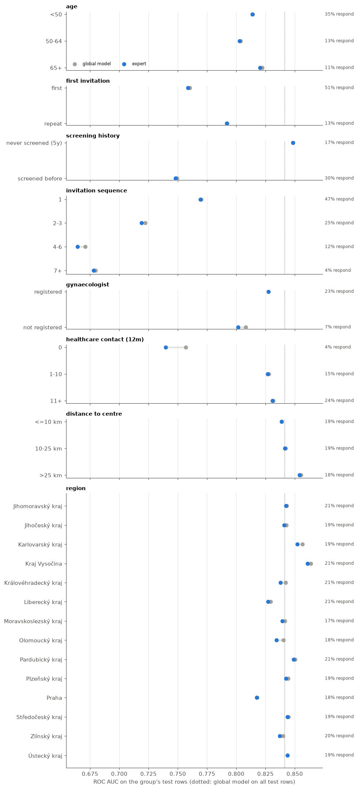
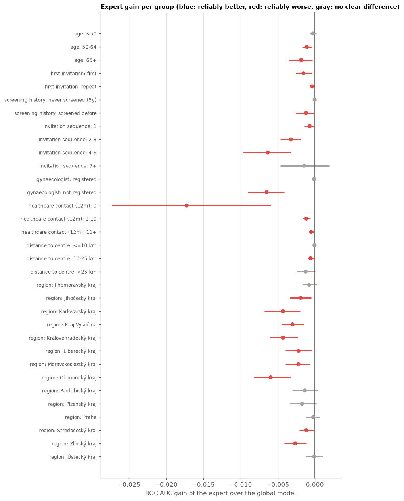
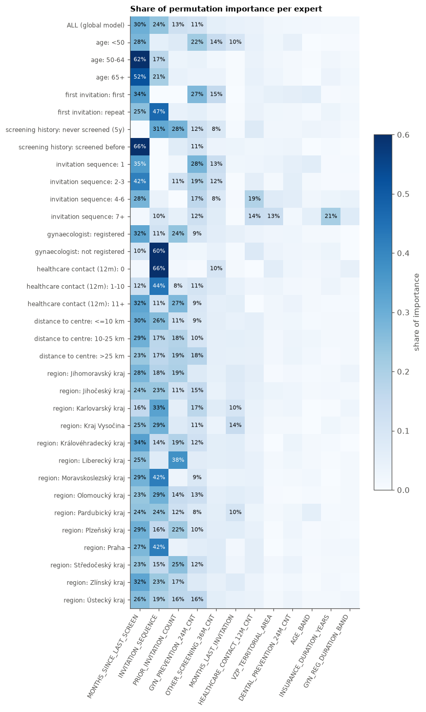
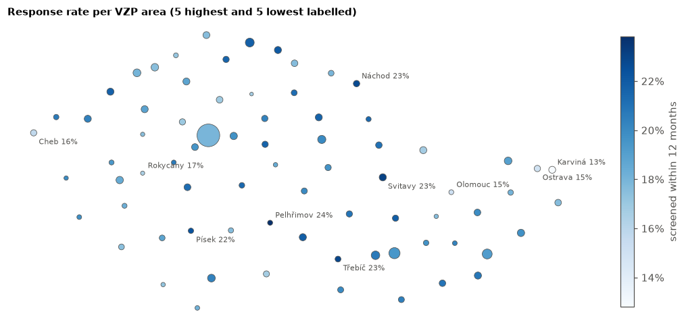

# Per-group experts

**Question:** if we split the women into groups (young vs. old, first vs. repeat invitation, …) and train a separate
model per group, does any group get predicted much better? And what drives the response *inside* each group?

**Method** (`experts.py`, results in `results/`)
- Label: `SCREENING_12M_FLAG` (screened within 12 months). Features: the 19 original columns. Model: untuned
  `HistGradientBoostingClassifier`. Data: the official patient-level split (train → fit, test → all numbers below).
- **Global model:** one model trained on all train rows.
- **Expert:** for every group, a model trained on that group's train rows only. It is evaluated on the same group's
  test rows as the global model.
- **Gain** = expert ROC AUC − global ROC AUC on the group's test rows, with a 95% bootstrap interval. The bootstrap
  resamples women (with all their invitations), because one woman's invitations are correlated.
- **Importance:** permutation importance of each expert (drop in ROC AUC when one feature is shuffled) on up to 20k
  test rows of its group.

**How to read it.** Within-group AUCs are lower than the overall AUC: the grouping variable is itself a strong
predictor, and inside a group it no longer separates anyone. Compare expert vs. global *within* a group, and use the
AUC level across groups only as "how predictable is this group from the remaining features".


```python
from pathlib import Path

import matplotlib.pyplot as plt
import numpy as np
import pandas as pd


RESULTS = Path("results")
scores = pd.read_csv(RESULTS / "group_scores.csv")
imp = pd.read_csv(RESULTS / "group_importance.csv", index_col=["criterion", "group"])

BLUE, GRAY, INK2, GRID = "#2a78d6", "#a3a29d", "#52514e", "#e4e3df"
plt.rcParams.update({
    "figure.dpi": 110, "axes.spines.top": False, "axes.spines.right": False,
    "axes.edgecolor": INK2, "axes.labelcolor": INK2, "xtick.color": INK2, "ytick.color": INK2,
    "axes.grid": True, "grid.color": GRID, "grid.linewidth": 0.8, "axes.axisbelow": True,
    "axes.titleweight": "bold", "axes.titlesize": 10, "axes.titlelocation": "left", "legend.frameon": False,
})
criteria = [c for c in scores.criterion.unique() if c != "all"]
overall = scores.query("criterion == 'all'").iloc[0]
print(f"Global model on all test rows: ROC AUC {overall.auc_global:.3f}, PR AUC {overall.pr_auc_global:.3f}, "
      f"base rate {overall.base_rate:.1%}")
```

    Global model on all test rows: ROC AUC 0.841, PR AUC 0.581, base rate 19.3%
    

## 1. Scores per group


```python
table = scores.query("criterion != 'all'").set_index(["criterion", "group"])[
    ["n_train", "n_test", "base_rate", "auc_global", "auc_expert", "gain", "gain_low", "gain_high",
     "pr_auc_global", "pr_auc_expert"]]
table.style.format({"n_train": "{:,}", "n_test": "{:,}", "base_rate": "{:.1%}", "gain": "{:+.3f}",
                    "gain_low": "{:+.3f}", "gain_high": "{:+.3f}"} |
                   dict.fromkeys(["auc_global", "auc_expert", "pr_auc_global", "pr_auc_expert"], "{:.3f}"))\
    .background_gradient(subset=["gain"], cmap="RdBu", vmin=-0.02, vmax=0.02)
```


<style type="text/css">
#T_4803a_row0_col5, #T_4803a_row29_col5 {
  background-color: #f7f5f4;
  color: #000000;
}
#T_4803a_row1_col5, #T_4803a_row6_col5, #T_4803a_row14_col5, #T_4803a_row18_col5, #T_4803a_row30_col5 {
  background-color: #f9efe9;
  color: #000000;
}
#T_4803a_row2_col5, #T_4803a_row28_col5 {
  background-color: #faeae1;
  color: #000000;
}
#T_4803a_row3_col5, #T_4803a_row10_col5 {
  background-color: #f9ede5;
  color: #000000;
}
#T_4803a_row4_col5 {
  background-color: #f8f4f2;
  color: #000000;
}
#T_4803a_row5_col5, #T_4803a_row11_col5, #T_4803a_row16_col5, #T_4803a_row32_col5 {
  background-color: #f7f6f6;
  color: #000000;
}
#T_4803a_row7_col5, #T_4803a_row19_col5 {
  background-color: #f8f2ef;
  color: #000000;
}
#T_4803a_row8_col5 {
  background-color: #fce0d0;
  color: #000000;
}
#T_4803a_row9_col5 {
  background-color: #f8bb9e;
  color: #000000;
}
#T_4803a_row12_col5 {
  background-color: #f7b99c;
  color: #000000;
}
#T_4803a_row13_col5 {
  background-color: #991027;
  color: #f1f1f1;
}
#T_4803a_row15_col5, #T_4803a_row17_col5 {
  background-color: #f8f3f0;
  color: #000000;
}
#T_4803a_row20_col5 {
  background-color: #fae9df;
  color: #000000;
}
#T_4803a_row21_col5, #T_4803a_row23_col5 {
  background-color: #fcd7c2;
  color: #000000;
}
#T_4803a_row22_col5 {
  background-color: #fce2d2;
  color: #000000;
}
#T_4803a_row24_col5, #T_4803a_row25_col5 {
  background-color: #fae7dc;
  color: #000000;
}
#T_4803a_row26_col5 {
  background-color: #f8bfa4;
  color: #000000;
}
#T_4803a_row27_col5 {
  background-color: #f9eee7;
  color: #000000;
}
#T_4803a_row31_col5 {
  background-color: #fbe4d6;
  color: #000000;
}
</style>
<table id="T_4803a">
  <thead>
    <tr>
      <th class="blank" >&nbsp;</th>
      <th class="blank level0" >&nbsp;</th>
      <th id="T_4803a_level0_col0" class="col_heading level0 col0" >n_train</th>
      <th id="T_4803a_level0_col1" class="col_heading level0 col1" >n_test</th>
      <th id="T_4803a_level0_col2" class="col_heading level0 col2" >base_rate</th>
      <th id="T_4803a_level0_col3" class="col_heading level0 col3" >auc_global</th>
      <th id="T_4803a_level0_col4" class="col_heading level0 col4" >auc_expert</th>
      <th id="T_4803a_level0_col5" class="col_heading level0 col5" >gain</th>
      <th id="T_4803a_level0_col6" class="col_heading level0 col6" >gain_low</th>
      <th id="T_4803a_level0_col7" class="col_heading level0 col7" >gain_high</th>
      <th id="T_4803a_level0_col8" class="col_heading level0 col8" >pr_auc_global</th>
      <th id="T_4803a_level0_col9" class="col_heading level0 col9" >pr_auc_expert</th>
    </tr>
    <tr>
      <th class="index_name level0" >criterion</th>
      <th class="index_name level1" >group</th>
      <th class="blank col0" >&nbsp;</th>
      <th class="blank col1" >&nbsp;</th>
      <th class="blank col2" >&nbsp;</th>
      <th class="blank col3" >&nbsp;</th>
      <th class="blank col4" >&nbsp;</th>
      <th class="blank col5" >&nbsp;</th>
      <th class="blank col6" >&nbsp;</th>
      <th class="blank col7" >&nbsp;</th>
      <th class="blank col8" >&nbsp;</th>
      <th class="blank col9" >&nbsp;</th>
    </tr>
  </thead>
  <tbody>
    <tr>
      <th id="T_4803a_level0_row0" class="row_heading level0 row0" rowspan="3">age</th>
      <th id="T_4803a_level1_row0" class="row_heading level1 row0" ><50</th>
      <td id="T_4803a_row0_col0" class="data row0 col0" >297,132</td>
      <td id="T_4803a_row0_col1" class="data row0 col1" >63,458</td>
      <td id="T_4803a_row0_col2" class="data row0 col2" >34.6%</td>
      <td id="T_4803a_row0_col3" class="data row0 col3" >0.814</td>
      <td id="T_4803a_row0_col4" class="data row0 col4" >0.814</td>
      <td id="T_4803a_row0_col5" class="data row0 col5" >-0.000</td>
      <td id="T_4803a_row0_col6" class="data row0 col6" >-0.001</td>
      <td id="T_4803a_row0_col7" class="data row0 col7" >+0.000</td>
      <td id="T_4803a_row0_col8" class="data row0 col8" >0.677</td>
      <td id="T_4803a_row0_col9" class="data row0 col9" >0.677</td>
    </tr>
    <tr>
      <th id="T_4803a_level1_row1" class="row_heading level1 row1" >50-64</th>
      <td id="T_4803a_row1_col0" class="data row1 col0" >450,098</td>
      <td id="T_4803a_row1_col1" class="data row1 col1" >96,817</td>
      <td id="T_4803a_row1_col2" class="data row1 col2" >12.8%</td>
      <td id="T_4803a_row1_col3" class="data row1 col3" >0.804</td>
      <td id="T_4803a_row1_col4" class="data row1 col4" >0.803</td>
      <td id="T_4803a_row1_col5" class="data row1 col5" >-0.001</td>
      <td id="T_4803a_row1_col6" class="data row1 col6" >-0.002</td>
      <td id="T_4803a_row1_col7" class="data row1 col7" >-0.000</td>
      <td id="T_4803a_row1_col8" class="data row1 col8" >0.408</td>
      <td id="T_4803a_row1_col9" class="data row1 col9" >0.406</td>
    </tr>
    <tr>
      <th id="T_4803a_level1_row2" class="row_heading level1 row2" >65+</th>
      <td id="T_4803a_row2_col0" class="data row2 col0" >194,592</td>
      <td id="T_4803a_row2_col1" class="data row2 col1" >41,576</td>
      <td id="T_4803a_row2_col2" class="data row2 col2" >11.0%</td>
      <td id="T_4803a_row2_col3" class="data row2 col3" >0.822</td>
      <td id="T_4803a_row2_col4" class="data row2 col4" >0.820</td>
      <td id="T_4803a_row2_col5" class="data row2 col5" >-0.002</td>
      <td id="T_4803a_row2_col6" class="data row2 col6" >-0.003</td>
      <td id="T_4803a_row2_col7" class="data row2 col7" >-0.000</td>
      <td id="T_4803a_row2_col8" class="data row2 col8" >0.409</td>
      <td id="T_4803a_row2_col9" class="data row2 col9" >0.408</td>
    </tr>
    <tr>
      <th id="T_4803a_level0_row3" class="row_heading level0 row3" rowspan="2">first invitation</th>
      <th id="T_4803a_level1_row3" class="row_heading level1 row3" >first</th>
      <td id="T_4803a_row3_col0" class="data row3 col0" >160,222</td>
      <td id="T_4803a_row3_col1" class="data row3 col1" >34,232</td>
      <td id="T_4803a_row3_col2" class="data row3 col2" >51.1%</td>
      <td id="T_4803a_row3_col3" class="data row3 col3" >0.760</td>
      <td id="T_4803a_row3_col4" class="data row3 col4" >0.759</td>
      <td id="T_4803a_row3_col5" class="data row3 col5" >-0.002</td>
      <td id="T_4803a_row3_col6" class="data row3 col6" >-0.003</td>
      <td id="T_4803a_row3_col7" class="data row3 col7" >-0.000</td>
      <td id="T_4803a_row3_col8" class="data row3 col8" >0.730</td>
      <td id="T_4803a_row3_col9" class="data row3 col9" >0.729</td>
    </tr>
    <tr>
      <th id="T_4803a_level1_row4" class="row_heading level1 row4" >repeat</th>
      <td id="T_4803a_row4_col0" class="data row4 col0" >781,600</td>
      <td id="T_4803a_row4_col1" class="data row4 col1" >167,619</td>
      <td id="T_4803a_row4_col2" class="data row4 col2" >12.8%</td>
      <td id="T_4803a_row4_col3" class="data row4 col3" >0.792</td>
      <td id="T_4803a_row4_col4" class="data row4 col4" >0.792</td>
      <td id="T_4803a_row4_col5" class="data row4 col5" >-0.000</td>
      <td id="T_4803a_row4_col6" class="data row4 col6" >-0.001</td>
      <td id="T_4803a_row4_col7" class="data row4 col7" >-0.000</td>
      <td id="T_4803a_row4_col8" class="data row4 col8" >0.371</td>
      <td id="T_4803a_row4_col9" class="data row4 col9" >0.371</td>
    </tr>
    <tr>
      <th id="T_4803a_level0_row5" class="row_heading level0 row5" rowspan="2">screening history</th>
      <th id="T_4803a_level1_row5" class="row_heading level1 row5" >never screened (5y)</th>
      <td id="T_4803a_row5_col0" class="data row5 col0" >770,311</td>
      <td id="T_4803a_row5_col1" class="data row5 col1" >165,340</td>
      <td id="T_4803a_row5_col2" class="data row5 col2" >17.0%</td>
      <td id="T_4803a_row5_col3" class="data row5 col3" >0.848</td>
      <td id="T_4803a_row5_col4" class="data row5 col4" >0.848</td>
      <td id="T_4803a_row5_col5" class="data row5 col5" >-0.000</td>
      <td id="T_4803a_row5_col6" class="data row5 col6" >-0.000</td>
      <td id="T_4803a_row5_col7" class="data row5 col7" >+0.000</td>
      <td id="T_4803a_row5_col8" class="data row5 col8" >0.588</td>
      <td id="T_4803a_row5_col9" class="data row5 col9" >0.589</td>
    </tr>
    <tr>
      <th id="T_4803a_level1_row6" class="row_heading level1 row6" >screened before</th>
      <td id="T_4803a_row6_col0" class="data row6 col0" >171,511</td>
      <td id="T_4803a_row6_col1" class="data row6 col1" >36,511</td>
      <td id="T_4803a_row6_col2" class="data row6 col2" >29.7%</td>
      <td id="T_4803a_row6_col3" class="data row6 col3" >0.749</td>
      <td id="T_4803a_row6_col4" class="data row6 col4" >0.748</td>
      <td id="T_4803a_row6_col5" class="data row6 col5" >-0.001</td>
      <td id="T_4803a_row6_col6" class="data row6 col6" >-0.003</td>
      <td id="T_4803a_row6_col7" class="data row6 col7" >-0.000</td>
      <td id="T_4803a_row6_col8" class="data row6 col8" >0.525</td>
      <td id="T_4803a_row6_col9" class="data row6 col9" >0.523</td>
    </tr>
    <tr>
      <th id="T_4803a_level0_row7" class="row_heading level0 row7" rowspan="4">invitation sequence</th>
      <th id="T_4803a_level1_row7" class="row_heading level1 row7" >1</th>
      <td id="T_4803a_row7_col0" class="data row7 col0" >202,406</td>
      <td id="T_4803a_row7_col1" class="data row7 col1" >43,110</td>
      <td id="T_4803a_row7_col2" class="data row7 col2" >46.7%</td>
      <td id="T_4803a_row7_col3" class="data row7 col3" >0.770</td>
      <td id="T_4803a_row7_col4" class="data row7 col4" >0.769</td>
      <td id="T_4803a_row7_col5" class="data row7 col5" >-0.001</td>
      <td id="T_4803a_row7_col6" class="data row7 col6" >-0.001</td>
      <td id="T_4803a_row7_col7" class="data row7 col7" >-0.000</td>
      <td id="T_4803a_row7_col8" class="data row7 col8" >0.711</td>
      <td id="T_4803a_row7_col9" class="data row7 col9" >0.711</td>
    </tr>
    <tr>
      <th id="T_4803a_level1_row8" class="row_heading level1 row8" >2-3</th>
      <td id="T_4803a_row8_col0" class="data row8 col0" >208,038</td>
      <td id="T_4803a_row8_col1" class="data row8 col1" >44,360</td>
      <td id="T_4803a_row8_col2" class="data row8 col2" >24.5%</td>
      <td id="T_4803a_row8_col3" class="data row8 col3" >0.722</td>
      <td id="T_4803a_row8_col4" class="data row8 col4" >0.719</td>
      <td id="T_4803a_row8_col5" class="data row8 col5" >-0.003</td>
      <td id="T_4803a_row8_col6" class="data row8 col6" >-0.005</td>
      <td id="T_4803a_row8_col7" class="data row8 col7" >-0.002</td>
      <td id="T_4803a_row8_col8" class="data row8 col8" >0.434</td>
      <td id="T_4803a_row8_col9" class="data row8 col9" >0.430</td>
    </tr>
    <tr>
      <th id="T_4803a_level1_row9" class="row_heading level1 row9" >4-6</th>
      <td id="T_4803a_row9_col0" class="data row9 col0" >192,563</td>
      <td id="T_4803a_row9_col1" class="data row9 col1" >41,204</td>
      <td id="T_4803a_row9_col2" class="data row9 col2" >11.7%</td>
      <td id="T_4803a_row9_col3" class="data row9 col3" >0.671</td>
      <td id="T_4803a_row9_col4" class="data row9 col4" >0.664</td>
      <td id="T_4803a_row9_col5" class="data row9 col5" >-0.006</td>
      <td id="T_4803a_row9_col6" class="data row9 col6" >-0.010</td>
      <td id="T_4803a_row9_col7" class="data row9 col7" >-0.003</td>
      <td id="T_4803a_row9_col8" class="data row9 col8" >0.213</td>
      <td id="T_4803a_row9_col9" class="data row9 col9" >0.205</td>
    </tr>
    <tr>
      <th id="T_4803a_level1_row10" class="row_heading level1 row10" >7+</th>
      <td id="T_4803a_row10_col0" class="data row10 col0" >338,813</td>
      <td id="T_4803a_row10_col1" class="data row10 col1" >73,177</td>
      <td id="T_4803a_row10_col2" class="data row10 col2" >4.2%</td>
      <td id="T_4803a_row10_col3" class="data row10 col3" >0.680</td>
      <td id="T_4803a_row10_col4" class="data row10 col4" >0.678</td>
      <td id="T_4803a_row10_col5" class="data row10 col5" >-0.001</td>
      <td id="T_4803a_row10_col6" class="data row10 col6" >-0.005</td>
      <td id="T_4803a_row10_col7" class="data row10 col7" >+0.002</td>
      <td id="T_4803a_row10_col8" class="data row10 col8" >0.091</td>
      <td id="T_4803a_row10_col9" class="data row10 col9" >0.088</td>
    </tr>
    <tr>
      <th id="T_4803a_level0_row11" class="row_heading level0 row11" rowspan="2">gynaecologist</th>
      <th id="T_4803a_level1_row11" class="row_heading level1 row11" >registered</th>
      <td id="T_4803a_row11_col0" class="data row11 col0" >739,512</td>
      <td id="T_4803a_row11_col1" class="data row11 col1" >158,617</td>
      <td id="T_4803a_row11_col2" class="data row11 col2" >22.7%</td>
      <td id="T_4803a_row11_col3" class="data row11 col3" >0.828</td>
      <td id="T_4803a_row11_col4" class="data row11 col4" >0.827</td>
      <td id="T_4803a_row11_col5" class="data row11 col5" >-0.000</td>
      <td id="T_4803a_row11_col6" class="data row11 col6" >-0.000</td>
      <td id="T_4803a_row11_col7" class="data row11 col7" >+0.000</td>
      <td id="T_4803a_row11_col8" class="data row11 col8" >0.596</td>
      <td id="T_4803a_row11_col9" class="data row11 col9" >0.596</td>
    </tr>
    <tr>
      <th id="T_4803a_level1_row12" class="row_heading level1 row12" >not registered</th>
      <td id="T_4803a_row12_col0" class="data row12 col0" >202,310</td>
      <td id="T_4803a_row12_col1" class="data row12 col1" >43,234</td>
      <td id="T_4803a_row12_col2" class="data row12 col2" >6.9%</td>
      <td id="T_4803a_row12_col3" class="data row12 col3" >0.808</td>
      <td id="T_4803a_row12_col4" class="data row12 col4" >0.802</td>
      <td id="T_4803a_row12_col5" class="data row12 col5" >-0.007</td>
      <td id="T_4803a_row12_col6" class="data row12 col6" >-0.009</td>
      <td id="T_4803a_row12_col7" class="data row12 col7" >-0.004</td>
      <td id="T_4803a_row12_col8" class="data row12 col8" >0.348</td>
      <td id="T_4803a_row12_col9" class="data row12 col9" >0.342</td>
    </tr>
    <tr>
      <th id="T_4803a_level0_row13" class="row_heading level0 row13" rowspan="3">healthcare contact (12m)</th>
      <th id="T_4803a_level1_row13" class="row_heading level1 row13" >0</th>
      <td id="T_4803a_row13_col0" class="data row13 col0" >64,111</td>
      <td id="T_4803a_row13_col1" class="data row13 col1" >13,952</td>
      <td id="T_4803a_row13_col2" class="data row13 col2" >3.8%</td>
      <td id="T_4803a_row13_col3" class="data row13 col3" >0.757</td>
      <td id="T_4803a_row13_col4" class="data row13 col4" >0.740</td>
      <td id="T_4803a_row13_col5" class="data row13 col5" >-0.017</td>
      <td id="T_4803a_row13_col6" class="data row13 col6" >-0.027</td>
      <td id="T_4803a_row13_col7" class="data row13 col7" >-0.006</td>
      <td id="T_4803a_row13_col8" class="data row13 col8" >0.154</td>
      <td id="T_4803a_row13_col9" class="data row13 col9" >0.129</td>
    </tr>
    <tr>
      <th id="T_4803a_level1_row14" class="row_heading level1 row14" >1-10</th>
      <td id="T_4803a_row14_col0" class="data row14 col0" >369,225</td>
      <td id="T_4803a_row14_col1" class="data row14 col1" >79,470</td>
      <td id="T_4803a_row14_col2" class="data row14 col2" >15.4%</td>
      <td id="T_4803a_row14_col3" class="data row14 col3" >0.828</td>
      <td id="T_4803a_row14_col4" class="data row14 col4" >0.827</td>
      <td id="T_4803a_row14_col5" class="data row14 col5" >-0.001</td>
      <td id="T_4803a_row14_col6" class="data row14 col6" >-0.002</td>
      <td id="T_4803a_row14_col7" class="data row14 col7" >-0.001</td>
      <td id="T_4803a_row14_col8" class="data row14 col8" >0.512</td>
      <td id="T_4803a_row14_col9" class="data row14 col9" >0.508</td>
    </tr>
    <tr>
      <th id="T_4803a_level1_row15" class="row_heading level1 row15" >11+</th>
      <td id="T_4803a_row15_col0" class="data row15 col0" >508,486</td>
      <td id="T_4803a_row15_col1" class="data row15 col1" >108,429</td>
      <td id="T_4803a_row15_col2" class="data row15 col2" >24.1%</td>
      <td id="T_4803a_row15_col3" class="data row15 col3" >0.831</td>
      <td id="T_4803a_row15_col4" class="data row15 col4" >0.831</td>
      <td id="T_4803a_row15_col5" class="data row15 col5" >-0.001</td>
      <td id="T_4803a_row15_col6" class="data row15 col6" >-0.001</td>
      <td id="T_4803a_row15_col7" class="data row15 col7" >-0.000</td>
      <td id="T_4803a_row15_col8" class="data row15 col8" >0.616</td>
      <td id="T_4803a_row15_col9" class="data row15 col9" >0.614</td>
    </tr>
    <tr>
      <th id="T_4803a_level0_row16" class="row_heading level0 row16" rowspan="3">distance to centre</th>
      <th id="T_4803a_level1_row16" class="row_heading level1 row16" ><=10 km</th>
      <td id="T_4803a_row16_col0" class="data row16 col0" >580,713</td>
      <td id="T_4803a_row16_col1" class="data row16 col1" >125,106</td>
      <td id="T_4803a_row16_col2" class="data row16 col2" >19.4%</td>
      <td id="T_4803a_row16_col3" class="data row16 col3" >0.839</td>
      <td id="T_4803a_row16_col4" class="data row16 col4" >0.839</td>
      <td id="T_4803a_row16_col5" class="data row16 col5" >-0.000</td>
      <td id="T_4803a_row16_col6" class="data row16 col6" >-0.000</td>
      <td id="T_4803a_row16_col7" class="data row16 col7" >+0.000</td>
      <td id="T_4803a_row16_col8" class="data row16 col8" >0.580</td>
      <td id="T_4803a_row16_col9" class="data row16 col9" >0.580</td>
    </tr>
    <tr>
      <th id="T_4803a_level1_row17" class="row_heading level1 row17" >10-25 km</th>
      <td id="T_4803a_row17_col0" class="data row17 col0" >284,689</td>
      <td id="T_4803a_row17_col1" class="data row17 col1" >60,462</td>
      <td id="T_4803a_row17_col2" class="data row17 col2" >19.3%</td>
      <td id="T_4803a_row17_col3" class="data row17 col3" >0.842</td>
      <td id="T_4803a_row17_col4" class="data row17 col4" >0.842</td>
      <td id="T_4803a_row17_col5" class="data row17 col5" >-0.001</td>
      <td id="T_4803a_row17_col6" class="data row17 col6" >-0.001</td>
      <td id="T_4803a_row17_col7" class="data row17 col7" >-0.000</td>
      <td id="T_4803a_row17_col8" class="data row17 col8" >0.576</td>
      <td id="T_4803a_row17_col9" class="data row17 col9" >0.576</td>
    </tr>
    <tr>
      <th id="T_4803a_level1_row18" class="row_heading level1 row18" >>25 km</th>
      <td id="T_4803a_row18_col0" class="data row18 col0" >76,420</td>
      <td id="T_4803a_row18_col1" class="data row18 col1" >16,283</td>
      <td id="T_4803a_row18_col2" class="data row18 col2" >18.5%</td>
      <td id="T_4803a_row18_col3" class="data row18 col3" >0.855</td>
      <td id="T_4803a_row18_col4" class="data row18 col4" >0.854</td>
      <td id="T_4803a_row18_col5" class="data row18 col5" >-0.001</td>
      <td id="T_4803a_row18_col6" class="data row18 col6" >-0.002</td>
      <td id="T_4803a_row18_col7" class="data row18 col7" >+0.000</td>
      <td id="T_4803a_row18_col8" class="data row18 col8" >0.601</td>
      <td id="T_4803a_row18_col9" class="data row18 col9" >0.599</td>
    </tr>
    <tr>
      <th id="T_4803a_level0_row19" class="row_heading level0 row19" rowspan="14">region</th>
      <th id="T_4803a_level1_row19" class="row_heading level1 row19" >Jihomoravský kraj</th>
      <td id="T_4803a_row19_col0" class="data row19 col0" >100,873</td>
      <td id="T_4803a_row19_col1" class="data row19 col1" >21,663</td>
      <td id="T_4803a_row19_col2" class="data row19 col2" >20.5%</td>
      <td id="T_4803a_row19_col3" class="data row19 col3" >0.843</td>
      <td id="T_4803a_row19_col4" class="data row19 col4" >0.842</td>
      <td id="T_4803a_row19_col5" class="data row19 col5" >-0.001</td>
      <td id="T_4803a_row19_col6" class="data row19 col6" >-0.002</td>
      <td id="T_4803a_row19_col7" class="data row19 col7" >+0.000</td>
      <td id="T_4803a_row19_col8" class="data row19 col8" >0.601</td>
      <td id="T_4803a_row19_col9" class="data row19 col9" >0.598</td>
    </tr>
    <tr>
      <th id="T_4803a_level1_row20" class="row_heading level1 row20" >Jihočeský kraj</th>
      <td id="T_4803a_row20_col0" class="data row20 col0" >60,241</td>
      <td id="T_4803a_row20_col1" class="data row20 col1" >13,271</td>
      <td id="T_4803a_row20_col2" class="data row20 col2" >19.5%</td>
      <td id="T_4803a_row20_col3" class="data row20 col3" >0.843</td>
      <td id="T_4803a_row20_col4" class="data row20 col4" >0.841</td>
      <td id="T_4803a_row20_col5" class="data row20 col5" >-0.002</td>
      <td id="T_4803a_row20_col6" class="data row20 col6" >-0.003</td>
      <td id="T_4803a_row20_col7" class="data row20 col7" >-0.000</td>
      <td id="T_4803a_row20_col8" class="data row20 col8" >0.585</td>
      <td id="T_4803a_row20_col9" class="data row20 col9" >0.578</td>
    </tr>
    <tr>
      <th id="T_4803a_level1_row21" class="row_heading level1 row21" >Karlovarský kraj</th>
      <td id="T_4803a_row21_col0" class="data row21 col0" >31,458</td>
      <td id="T_4803a_row21_col1" class="data row21 col1" >6,557</td>
      <td id="T_4803a_row21_col2" class="data row21 col2" >19.1%</td>
      <td id="T_4803a_row21_col3" class="data row21 col3" >0.856</td>
      <td id="T_4803a_row21_col4" class="data row21 col4" >0.852</td>
      <td id="T_4803a_row21_col5" class="data row21 col5" >-0.004</td>
      <td id="T_4803a_row21_col6" class="data row21 col6" >-0.007</td>
      <td id="T_4803a_row21_col7" class="data row21 col7" >-0.002</td>
      <td id="T_4803a_row21_col8" class="data row21 col8" >0.614</td>
      <td id="T_4803a_row21_col9" class="data row21 col9" >0.600</td>
    </tr>
    <tr>
      <th id="T_4803a_level1_row22" class="row_heading level1 row22" >Kraj Vysočina</th>
      <td id="T_4803a_row22_col0" class="data row22 col0" >49,498</td>
      <td id="T_4803a_row22_col1" class="data row22 col1" >10,712</td>
      <td id="T_4803a_row22_col2" class="data row22 col2" >21.1%</td>
      <td id="T_4803a_row22_col3" class="data row22 col3" >0.864</td>
      <td id="T_4803a_row22_col4" class="data row22 col4" >0.861</td>
      <td id="T_4803a_row22_col5" class="data row22 col5" >-0.003</td>
      <td id="T_4803a_row22_col6" class="data row22 col6" >-0.004</td>
      <td id="T_4803a_row22_col7" class="data row22 col7" >-0.001</td>
      <td id="T_4803a_row22_col8" class="data row22 col8" >0.655</td>
      <td id="T_4803a_row22_col9" class="data row22 col9" >0.653</td>
    </tr>
    <tr>
      <th id="T_4803a_level1_row23" class="row_heading level1 row23" >Královéhradecký kraj</th>
      <td id="T_4803a_row23_col0" class="data row23 col0" >49,112</td>
      <td id="T_4803a_row23_col1" class="data row23 col1" >10,494</td>
      <td id="T_4803a_row23_col2" class="data row23 col2" >21.0%</td>
      <td id="T_4803a_row23_col3" class="data row23 col3" >0.842</td>
      <td id="T_4803a_row23_col4" class="data row23 col4" >0.838</td>
      <td id="T_4803a_row23_col5" class="data row23 col5" >-0.004</td>
      <td id="T_4803a_row23_col6" class="data row23 col6" >-0.006</td>
      <td id="T_4803a_row23_col7" class="data row23 col7" >-0.002</td>
      <td id="T_4803a_row23_col8" class="data row23 col8" >0.614</td>
      <td id="T_4803a_row23_col9" class="data row23 col9" >0.603</td>
    </tr>
    <tr>
      <th id="T_4803a_level1_row24" class="row_heading level1 row24" >Liberecký kraj</th>
      <td id="T_4803a_row24_col0" class="data row24 col0" >56,295</td>
      <td id="T_4803a_row24_col1" class="data row24 col1" >11,898</td>
      <td id="T_4803a_row24_col2" class="data row24 col2" >21.0%</td>
      <td id="T_4803a_row24_col3" class="data row24 col3" >0.829</td>
      <td id="T_4803a_row24_col4" class="data row24 col4" >0.827</td>
      <td id="T_4803a_row24_col5" class="data row24 col5" >-0.002</td>
      <td id="T_4803a_row24_col6" class="data row24 col6" >-0.004</td>
      <td id="T_4803a_row24_col7" class="data row24 col7" >-0.000</td>
      <td id="T_4803a_row24_col8" class="data row24 col8" >0.583</td>
      <td id="T_4803a_row24_col9" class="data row24 col9" >0.581</td>
    </tr>
    <tr>
      <th id="T_4803a_level1_row25" class="row_heading level1 row25" >Moravskoslezský kraj</th>
      <td id="T_4803a_row25_col0" class="data row25 col0" >58,413</td>
      <td id="T_4803a_row25_col1" class="data row25 col1" >12,741</td>
      <td id="T_4803a_row25_col2" class="data row25 col2" >16.7%</td>
      <td id="T_4803a_row25_col3" class="data row25 col3" >0.841</td>
      <td id="T_4803a_row25_col4" class="data row25 col4" >0.839</td>
      <td id="T_4803a_row25_col5" class="data row25 col5" >-0.002</td>
      <td id="T_4803a_row25_col6" class="data row25 col6" >-0.004</td>
      <td id="T_4803a_row25_col7" class="data row25 col7" >-0.001</td>
      <td id="T_4803a_row25_col8" class="data row25 col8" >0.544</td>
      <td id="T_4803a_row25_col9" class="data row25 col9" >0.540</td>
    </tr>
    <tr>
      <th id="T_4803a_level1_row26" class="row_heading level1 row26" >Olomoucký kraj</th>
      <td id="T_4803a_row26_col0" class="data row26 col0" >36,384</td>
      <td id="T_4803a_row26_col1" class="data row26 col1" >7,780</td>
      <td id="T_4803a_row26_col2" class="data row26 col2" >17.5%</td>
      <td id="T_4803a_row26_col3" class="data row26 col3" >0.840</td>
      <td id="T_4803a_row26_col4" class="data row26 col4" >0.835</td>
      <td id="T_4803a_row26_col5" class="data row26 col5" >-0.006</td>
      <td id="T_4803a_row26_col6" class="data row26 col6" >-0.008</td>
      <td id="T_4803a_row26_col7" class="data row26 col7" >-0.003</td>
      <td id="T_4803a_row26_col8" class="data row26 col8" >0.545</td>
      <td id="T_4803a_row26_col9" class="data row26 col9" >0.535</td>
    </tr>
    <tr>
      <th id="T_4803a_level1_row27" class="row_heading level1 row27" >Pardubický kraj</th>
      <td id="T_4803a_row27_col0" class="data row27 col0" >52,949</td>
      <td id="T_4803a_row27_col1" class="data row27 col1" >11,285</td>
      <td id="T_4803a_row27_col2" class="data row27 col2" >20.9%</td>
      <td id="T_4803a_row27_col3" class="data row27 col3" >0.850</td>
      <td id="T_4803a_row27_col4" class="data row27 col4" >0.849</td>
      <td id="T_4803a_row27_col5" class="data row27 col5" >-0.001</td>
      <td id="T_4803a_row27_col6" class="data row27 col6" >-0.003</td>
      <td id="T_4803a_row27_col7" class="data row27 col7" >+0.000</td>
      <td id="T_4803a_row27_col8" class="data row27 col8" >0.614</td>
      <td id="T_4803a_row27_col9" class="data row27 col9" >0.611</td>
    </tr>
    <tr>
      <th id="T_4803a_level1_row28" class="row_heading level1 row28" >Plzeňský kraj</th>
      <td id="T_4803a_row28_col0" class="data row28 col0" >52,594</td>
      <td id="T_4803a_row28_col1" class="data row28 col1" >10,711</td>
      <td id="T_4803a_row28_col2" class="data row28 col2" >18.6%</td>
      <td id="T_4803a_row28_col3" class="data row28 col3" >0.844</td>
      <td id="T_4803a_row28_col4" class="data row28 col4" >0.843</td>
      <td id="T_4803a_row28_col5" class="data row28 col5" >-0.002</td>
      <td id="T_4803a_row28_col6" class="data row28 col6" >-0.003</td>
      <td id="T_4803a_row28_col7" class="data row28 col7" >+0.000</td>
      <td id="T_4803a_row28_col8" class="data row28 col8" >0.594</td>
      <td id="T_4803a_row28_col9" class="data row28 col9" >0.592</td>
    </tr>
    <tr>
      <th id="T_4803a_level1_row29" class="row_heading level1 row29" >Praha</th>
      <td id="T_4803a_row29_col0" class="data row29 col0" >135,064</td>
      <td id="T_4803a_row29_col1" class="data row29 col1" >29,481</td>
      <td id="T_4803a_row29_col2" class="data row29 col2" >18.1%</td>
      <td id="T_4803a_row29_col3" class="data row29 col3" >0.818</td>
      <td id="T_4803a_row29_col4" class="data row29 col4" >0.818</td>
      <td id="T_4803a_row29_col5" class="data row29 col5" >-0.000</td>
      <td id="T_4803a_row29_col6" class="data row29 col6" >-0.001</td>
      <td id="T_4803a_row29_col7" class="data row29 col7" >+0.001</td>
      <td id="T_4803a_row29_col8" class="data row29 col8" >0.505</td>
      <td id="T_4803a_row29_col9" class="data row29 col9" >0.506</td>
    </tr>
    <tr>
      <th id="T_4803a_level1_row30" class="row_heading level1 row30" >Středočeský kraj</th>
      <td id="T_4803a_row30_col0" class="data row30 col0" >109,989</td>
      <td id="T_4803a_row30_col1" class="data row30 col1" >23,444</td>
      <td id="T_4803a_row30_col2" class="data row30 col2" >18.9%</td>
      <td id="T_4803a_row30_col3" class="data row30 col3" >0.845</td>
      <td id="T_4803a_row30_col4" class="data row30 col4" >0.844</td>
      <td id="T_4803a_row30_col5" class="data row30 col5" >-0.001</td>
      <td id="T_4803a_row30_col6" class="data row30 col6" >-0.002</td>
      <td id="T_4803a_row30_col7" class="data row30 col7" >-0.000</td>
      <td id="T_4803a_row30_col8" class="data row30 col8" >0.574</td>
      <td id="T_4803a_row30_col9" class="data row30 col9" >0.571</td>
    </tr>
    <tr>
      <th id="T_4803a_level1_row31" class="row_heading level1 row31" >Zlínský kraj</th>
      <td id="T_4803a_row31_col0" class="data row31 col0" >59,390</td>
      <td id="T_4803a_row31_col1" class="data row31 col1" >12,691</td>
      <td id="T_4803a_row31_col2" class="data row31 col2" >20.0%</td>
      <td id="T_4803a_row31_col3" class="data row31 col3" >0.840</td>
      <td id="T_4803a_row31_col4" class="data row31 col4" >0.837</td>
      <td id="T_4803a_row31_col5" class="data row31 col5" >-0.003</td>
      <td id="T_4803a_row31_col6" class="data row31 col6" >-0.004</td>
      <td id="T_4803a_row31_col7" class="data row31 col7" >-0.001</td>
      <td id="T_4803a_row31_col8" class="data row31 col8" >0.573</td>
      <td id="T_4803a_row31_col9" class="data row31 col9" >0.567</td>
    </tr>
    <tr>
      <th id="T_4803a_level1_row32" class="row_heading level1 row32" >Ústecký kraj</th>
      <td id="T_4803a_row32_col0" class="data row32 col0" >89,562</td>
      <td id="T_4803a_row32_col1" class="data row32 col1" >19,123</td>
      <td id="T_4803a_row32_col2" class="data row32 col2" >18.6%</td>
      <td id="T_4803a_row32_col3" class="data row32 col3" >0.844</td>
      <td id="T_4803a_row32_col4" class="data row32 col4" >0.844</td>
      <td id="T_4803a_row32_col5" class="data row32 col5" >-0.000</td>
      <td id="T_4803a_row32_col6" class="data row32 col6" >-0.001</td>
      <td id="T_4803a_row32_col7" class="data row32 col7" >+0.001</td>
      <td id="T_4803a_row32_col8" class="data row32 col8" >0.578</td>
      <td id="T_4803a_row32_col9" class="data row32 col9" >0.576</td>
    </tr>
  </tbody>
</table>


## 2. How predictable is each group, and does an expert help?

Dots: ROC AUC of the global model (gray) and the group's expert (blue) on the group's test rows.
The label on the right is the group's response rate.


```python
fig, axes = plt.subplots(len(criteria), 1, figsize=(9, 1.0 + 0.55 * len(scores)), sharex=True,
                         gridspec_kw={"height_ratios": [scores.criterion.eq(c).sum() for c in criteria]})
for ax, crit in zip(axes, criteria, strict=True):
    s = scores[scores.criterion == crit].iloc[::-1]
    y = np.arange(len(s))
    ax.hlines(y, s.auc_global, s.auc_expert, color=GRID, lw=3)
    ax.scatter(s.auc_global, y, color=GRAY, s=40, label="global model", zorder=3)
    ax.scatter(s.auc_expert, y, color=BLUE, s=40, label="expert", zorder=3)
    ax.set_yticks(y, s.group)
    ax.set_title(crit)
    ax.axvline(overall.auc_global, color=INK2, lw=0.8, ls=":")
    ax.grid(axis="y", visible=False)
    for yi, rate in zip(y, s.base_rate, strict=True):
        ax.annotate(f"{rate:.0%} respond", (1.0, yi), xycoords=("axes fraction", "data"), xytext=(4, 0),
                    textcoords="offset points", va="center", fontsize=8, color=INK2)
axes[0].legend(loc="lower left", ncol=2, fontsize=8)
axes[-1].set_xlabel("ROC AUC on the group's test rows (dotted: global model on all test rows)")
plt.tight_layout(); plt.show()
```


    

    


## 3. Expert gain with 95% bootstrap interval

Intervals that cross zero mean the expert is not reliably better (or worse) than the global model for that group.


```python
s = scores.query("criterion != 'all'").iloc[::-1].reset_index(drop=True)
fig, ax = plt.subplots(figsize=(8, 0.32 * len(s) + 1))
y = np.arange(len(s))
colors = np.where(s.gain_low > 0, BLUE, np.where(s.gain_high < 0, "#e34948", GRAY))
ax.hlines(y, s.gain_low, s.gain_high, color=colors, lw=2)
ax.scatter(s.gain, y, color=colors, s=30, zorder=3)
ax.axvline(0, color=INK2, lw=1)
ax.set_yticks(y, s.criterion + ": " + s.group, fontsize=8)
ax.grid(axis="y", visible=False)
ax.set_xlabel("ROC AUC gain of the expert over the global model")
ax.set_title("Expert gain per group (blue: reliably better, red: reliably worse, gray: no clear difference)")
plt.tight_layout(); plt.show()
```


    

    


## 4. What drives response inside each group?

Permutation importance of each expert, as a **share of that expert's total importance** (each row sums to 100%).
The first row is the global model on all test rows, for reference. Features are ordered by global importance;
features that are constant inside a group (e.g. `FIRST_INVITATION` among first invitations) have 0.


```python
share = imp.clip(lower=0)
share = share.div(share.sum(axis=1), axis=0)
cols = share.loc[("all", "all")].sort_values(ascending=False).index
cols = [c for c in cols if share[c].max() >= 0.03]  # hide features that never matter
share = share[cols]

fig, ax = plt.subplots(figsize=(1.0 + 0.55 * len(cols), 0.33 * len(share) + 1.5))
im = ax.imshow(share.to_numpy(), cmap="Blues", vmin=0, vmax=0.6, aspect="auto")
ax.set_xticks(range(len(cols)), cols, rotation=60, ha="right", fontsize=8)
ax.set_yticks(range(len(share)), [f"{c}: {g}" if c != "all" else "ALL (global model)" for c, g in share.index],
              fontsize=8)
ax.grid(False)
for i in range(share.shape[0]):
    for j in range(share.shape[1]):
        v = share.iat[i, j]
        if v >= 0.08:
            ax.text(j, i, f"{v:.0%}", ha="center", va="center", fontsize=7, color="white" if v > 0.35 else "black")
fig.colorbar(im, ax=ax, shrink=0.6, label="share of importance")
ax.set_title("Share of permutation importance per expert")
plt.tight_layout(); plt.show()
```


    

    


```python
pd.set_option("display.max_colwidth", None)
top = (share.stack().rename("share").reset_index().rename(columns={"level_2": "feature"})
       .sort_values("share", ascending=False).groupby(["criterion", "group"], sort=False).head(3))
top.groupby(["criterion", "group"], sort=False).apply(
    lambda t: ", ".join(f"{f} ({s:.0%})" for f, s in zip(t.feature, t.share, strict=True)), include_groups=False
).reindex(share.index).to_frame("top 3 features")
```


<div>
<style scoped>
    .dataframe tbody tr th:only-of-type {
        vertical-align: middle;
    }

    .dataframe tbody tr th {
        vertical-align: top;
    }

    .dataframe thead th {
        text-align: right;
    }
</style>
<table border="1" class="dataframe">
  <thead>
    <tr style="text-align: right;">
      <th></th>
      <th></th>
      <th>top 3 features</th>
    </tr>
    <tr>
      <th>criterion</th>
      <th>group</th>
      <th></th>
    </tr>
  </thead>
  <tbody>
    <tr>
      <th>all</th>
      <th>all</th>
      <td>MONTHS_SINCE_LAST_SCREEN (30%), INVITATION_SEQUENCE (24%), PRIOR_INVITATION_COUNT (13%)</td>
    </tr>
    <tr>
      <th rowspan="3" valign="top">age</th>
      <th>&lt;50</th>
      <td>MONTHS_SINCE_LAST_SCREEN (28%), GYN_PREVENTION_24M_CNT (22%), OTHER_SCREENING_36M_CNT (14%)</td>
    </tr>
    <tr>
      <th>50-64</th>
      <td>MONTHS_SINCE_LAST_SCREEN (62%), INVITATION_SEQUENCE (17%), GYN_PREVENTION_24M_CNT (4%)</td>
    </tr>
    <tr>
      <th>65+</th>
      <td>MONTHS_SINCE_LAST_SCREEN (52%), INVITATION_SEQUENCE (21%), HEALTHCARE_CONTACT_12M_CNT (4%)</td>
    </tr>
    <tr>
      <th rowspan="2" valign="top">first invitation</th>
      <th>first</th>
      <td>MONTHS_SINCE_LAST_SCREEN (34%), GYN_PREVENTION_24M_CNT (27%), OTHER_SCREENING_36M_CNT (15%)</td>
    </tr>
    <tr>
      <th>repeat</th>
      <td>INVITATION_SEQUENCE (47%), MONTHS_SINCE_LAST_SCREEN (25%), GYN_PREVENTION_24M_CNT (6%)</td>
    </tr>
    <tr>
      <th rowspan="2" valign="top">screening history</th>
      <th>never screened (5y)</th>
      <td>INVITATION_SEQUENCE (31%), PRIOR_INVITATION_COUNT (28%), GYN_PREVENTION_24M_CNT (12%)</td>
    </tr>
    <tr>
      <th>screened before</th>
      <td>MONTHS_SINCE_LAST_SCREEN (66%), GYN_PREVENTION_24M_CNT (11%), PRIOR_INVITATION_COUNT (7%)</td>
    </tr>
    <tr>
      <th rowspan="4" valign="top">invitation sequence</th>
      <th>1</th>
      <td>MONTHS_SINCE_LAST_SCREEN (35%), GYN_PREVENTION_24M_CNT (28%), OTHER_SCREENING_36M_CNT (13%)</td>
    </tr>
    <tr>
      <th>2-3</th>
      <td>MONTHS_SINCE_LAST_SCREEN (42%), GYN_PREVENTION_24M_CNT (19%), OTHER_SCREENING_36M_CNT (12%)</td>
    </tr>
    <tr>
      <th>4-6</th>
      <td>MONTHS_SINCE_LAST_SCREEN (28%), HEALTHCARE_CONTACT_12M_CNT (19%), GYN_PREVENTION_24M_CNT (17%)</td>
    </tr>
    <tr>
      <th>7+</th>
      <td>INSURANCE_DURATION_YEARS (21%), HEALTHCARE_CONTACT_12M_CNT (14%), VZP_TERRITORIAL_AREA (13%)</td>
    </tr>
    <tr>
      <th rowspan="2" valign="top">gynaecologist</th>
      <th>registered</th>
      <td>MONTHS_SINCE_LAST_SCREEN (32%), PRIOR_INVITATION_COUNT (24%), INVITATION_SEQUENCE (11%)</td>
    </tr>
    <tr>
      <th>not registered</th>
      <td>INVITATION_SEQUENCE (60%), MONTHS_SINCE_LAST_SCREEN (10%), HEALTHCARE_CONTACT_12M_CNT (8%)</td>
    </tr>
    <tr>
      <th rowspan="3" valign="top">healthcare contact (12m)</th>
      <th>0</th>
      <td>INVITATION_SEQUENCE (66%), OTHER_SCREENING_36M_CNT (10%), VZP_TERRITORIAL_AREA (6%)</td>
    </tr>
    <tr>
      <th>1-10</th>
      <td>INVITATION_SEQUENCE (44%), MONTHS_SINCE_LAST_SCREEN (12%), GYN_PREVENTION_24M_CNT (11%)</td>
    </tr>
    <tr>
      <th>11+</th>
      <td>MONTHS_SINCE_LAST_SCREEN (32%), PRIOR_INVITATION_COUNT (27%), INVITATION_SEQUENCE (11%)</td>
    </tr>
    <tr>
      <th rowspan="3" valign="top">distance to centre</th>
      <th>&lt;=10 km</th>
      <td>MONTHS_SINCE_LAST_SCREEN (30%), INVITATION_SEQUENCE (26%), PRIOR_INVITATION_COUNT (11%)</td>
    </tr>
    <tr>
      <th>10-25 km</th>
      <td>MONTHS_SINCE_LAST_SCREEN (29%), PRIOR_INVITATION_COUNT (18%), INVITATION_SEQUENCE (17%)</td>
    </tr>
    <tr>
      <th>&gt;25 km</th>
      <td>MONTHS_SINCE_LAST_SCREEN (23%), PRIOR_INVITATION_COUNT (19%), GYN_PREVENTION_24M_CNT (18%)</td>
    </tr>
    <tr>
      <th rowspan="14" valign="top">region</th>
      <th>Jihomoravský kraj</th>
      <td>MONTHS_SINCE_LAST_SCREEN (28%), PRIOR_INVITATION_COUNT (19%), INVITATION_SEQUENCE (18%)</td>
    </tr>
    <tr>
      <th>Jihočeský kraj</th>
      <td>MONTHS_SINCE_LAST_SCREEN (24%), INVITATION_SEQUENCE (23%), GYN_PREVENTION_24M_CNT (15%)</td>
    </tr>
    <tr>
      <th>Karlovarský kraj</th>
      <td>INVITATION_SEQUENCE (33%), GYN_PREVENTION_24M_CNT (17%), MONTHS_SINCE_LAST_SCREEN (16%)</td>
    </tr>
    <tr>
      <th>Kraj Vysočina</th>
      <td>INVITATION_SEQUENCE (29%), MONTHS_SINCE_LAST_SCREEN (25%), MONTHS_LAST_INVITATION (14%)</td>
    </tr>
    <tr>
      <th>Královéhradecký kraj</th>
      <td>MONTHS_SINCE_LAST_SCREEN (34%), PRIOR_INVITATION_COUNT (19%), INVITATION_SEQUENCE (14%)</td>
    </tr>
    <tr>
      <th>Liberecký kraj</th>
      <td>PRIOR_INVITATION_COUNT (38%), MONTHS_SINCE_LAST_SCREEN (25%), INVITATION_SEQUENCE (7%)</td>
    </tr>
    <tr>
      <th>Moravskoslezský kraj</th>
      <td>INVITATION_SEQUENCE (42%), MONTHS_SINCE_LAST_SCREEN (29%), GYN_PREVENTION_24M_CNT (9%)</td>
    </tr>
    <tr>
      <th>Olomoucký kraj</th>
      <td>INVITATION_SEQUENCE (29%), MONTHS_SINCE_LAST_SCREEN (23%), PRIOR_INVITATION_COUNT (14%)</td>
    </tr>
    <tr>
      <th>Pardubický kraj</th>
      <td>MONTHS_SINCE_LAST_SCREEN (24%), INVITATION_SEQUENCE (24%), PRIOR_INVITATION_COUNT (12%)</td>
    </tr>
    <tr>
      <th>Plzeňský kraj</th>
      <td>MONTHS_SINCE_LAST_SCREEN (29%), PRIOR_INVITATION_COUNT (22%), INVITATION_SEQUENCE (16%)</td>
    </tr>
    <tr>
      <th>Praha</th>
      <td>INVITATION_SEQUENCE (42%), MONTHS_SINCE_LAST_SCREEN (27%), OTHER_SCREENING_36M_CNT (7%)</td>
    </tr>
    <tr>
      <th>Středočeský kraj</th>
      <td>PRIOR_INVITATION_COUNT (25%), MONTHS_SINCE_LAST_SCREEN (23%), INVITATION_SEQUENCE (15%)</td>
    </tr>
    <tr>
      <th>Zlínský kraj</th>
      <td>MONTHS_SINCE_LAST_SCREEN (32%), INVITATION_SEQUENCE (23%), PRIOR_INVITATION_COUNT (17%)</td>
    </tr>
    <tr>
      <th>Ústecký kraj</th>
      <td>MONTHS_SINCE_LAST_SCREEN (26%), INVITATION_SEQUENCE (19%), PRIOR_INVITATION_COUNT (16%)</td>
    </tr>
  </tbody>
</table>
</div>


## 5. Location: response rate per VZP area

The region experts above group the 75 VZP areas into 14 regions (kraje). This map shows the finer picture: each dot is one area at its geocoded centre, coloured by the share of invitations followed by screening within 12 months (all splits), sized by the number of invitations.


```python
areas = pd.read_csv("../../data/area_coordinates.csv")
rows = pd.concat(pd.read_csv(f"../../data/splits/{n}.csv", usecols=["VZP_TERRITORIAL_AREA", "SCREENING_12M_FLAG"])
                 for n in ["train", "val", "test"])
rate = rows.groupby("VZP_TERRITORIAL_AREA").SCREENING_12M_FLAG.agg(["mean", "size"])
areas = areas.join(rate, on="area")

fig, ax = plt.subplots(figsize=(10, 5.5))
sc = ax.scatter(areas.lon, areas.lat, c=areas["mean"], s=areas["size"] / 400, cmap="Blues",
                edgecolor=INK2, linewidth=0.5, vmin=areas["mean"].min(), vmax=areas["mean"].max())
labelled = pd.concat([areas.nlargest(5, "mean"), areas.nsmallest(5, "mean")]).sort_values("lon")
for i, (_, r) in enumerate(labelled.iterrows()):  # alternate above / below so neighbours don't collide
    ax.annotate(f"{r.area.title()} {r['mean']:.0%}", (r.lon, r.lat), xytext=(5, 5 if i % 2 else -11),
                textcoords="offset points", fontsize=7, color=INK2)
ax.set_aspect(1 / np.cos(np.radians(49.8)))  # keep Czech geography undistorted
ax.grid(False); ax.set_xticks([]); ax.set_yticks([])
for side in ["left", "bottom"]:
    ax.spines[side].set_visible(False)
fig.colorbar(sc, ax=ax, shrink=0.7, format=lambda v, _: f"{v:.0%}", label="screened within 12 months")
ax.set_title("Response rate per VZP area (5 highest and 5 lowest labelled)")
plt.tight_layout(); plt.show()
print(f"Area response rates range from {areas['mean'].min():.1%} to {areas['mean'].max():.1%} "
      f"(overall {rows.SCREENING_12M_FLAG.mean():.1%}).")
```


    

    


    Area response rates range from 12.8% to 23.8% (overall 19.3%).
    

## 6. Conclusions

**1. Experts do not beat one global model.** In all 33 groups (including the 14 regions), the expert is equal to or worse than the global model
(gain between −0.017 and +0.000; no 95% interval lies above zero). Gradient-boosted trees already model interactions, so
the global model learns group-specific patterns *and* benefits from all the data. Experts lose most where their group is
small or rare: no healthcare contact (−0.017, 64k train rows, 4% respond), no gynaecologist (−0.007), invitations 4–6
(−0.006). **Keep one global model**; group splits are a tool for understanding, not for accuracy.

**2. Some groups are much harder to predict.** Within-group ROC AUC (global model):
- hardest: repeat non-responders (invitation 4–6: 0.67, 7+: 0.68), women screened before (0.75), first invitations (0.76),
  no healthcare contact (0.76);
- easiest: never screened in 5 years (0.85), far from a centre (>25 km: 0.85).

The 7+ group is both large (36% of train rows) and nearly unpredictable at a 4% response rate. Better targeting there
needs new information (e.g. channel, GP context), not a better model.

**3. What drives response differs by group** (permutation importance, section 4):
- **Young women / first invitations / sequence 1:** preventive behaviour matters most after timing:
  gynaecologist prevention visits (22–28% of importance) and other screening programmes (13–15%). Women already engaged
  with prevention respond to their first invitation.
- **50+ and women screened before:** timing dominates. `MONTHS_SINCE_LAST_SCREEN` carries 52–66% of importance. These
  women screen regularly; the question is *when* they are due, not *whether* they will come.
- **Never screened in 5 years, no gynaecologist, no healthcare contact:** the invitation history dominates
  (`INVITATION_SEQUENCE` / `PRIOR_INVITATION_COUNT`: 59–66%). The best predictor of ignoring this letter is having ignored
  the previous ones.
- **Chronic non-responders (7+):** no strong signal. The top features are insurance duration, healthcare contact and
  region, each only 13–21%.

**4. Distance to a screening centre barely matters.** Response is 19.4% / 19.3% / 18.5% for ≤10 / 10–25 / >25 km, and
the drivers are the same in all three groups. Caveat: distance is straight-line and per VZP area, not per woman.

**5. Location: regions differ in response rate, not in what drives it.**
- Region experts never help either (gain −0.006 to −0.000). The top drivers in every region are the same:
  invitation history and time since the last screen. The regions differ only in how importance is split between the
  two correlated invitation counters, which is not a real regional difference.
- Response rates do differ (test split): the Moravian-Silesian region is lowest (Moravskoslezský 16.7%, Olomoucký 17.5%), Vysočina
  highest (21.1%). Per area (all splits) the spread is wider: Karviná 12.8%, Ostrava 15.0%, Olomouc 15.1% vs. Pelhřimov 23.8%,
  Svitavy 23.1%, Třebíč 22.9% (map in section 5).
- Prague is the hardest region to predict (ROC AUC 0.818 vs. 0.83–0.86 elsewhere) and responds below average (18.1%).
- So location acts as a **baseline shift** (some areas respond less overall), which the global model already gets from
  `VZP_TERRITORIAL_AREA`. It is useful for planning (e.g. extra effort in the Ostrava/Karviná area), not for a
  separate model.

**Caveats.** Results are for the 12M label, untuned models and the 19 original features. Correlated features
(`INVITATION_SEQUENCE` vs `PRIOR_INVITATION_COUNT`) split their importance between them, so read importance per group
of related features rather than per single feature.
